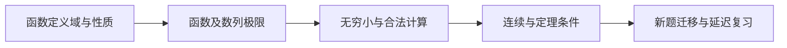

# 2028 数一高数第一章可复现教学配方

> [!info] 学习资源
> 核心：`考研数学一 函数 定义域 复合函数 极限 εδ 连续 入门`
> 拓展：`数列 单调有界 夹逼 等价无穷小 复合极限 条件 反例`
> 进阶：`极限定义 量词 递推收敛 根式抵消 间断分类 存在唯一 证明`
> 未逐段核验的视频不提供链接。这些检索建议不等于视频已观看或大纲已核对。

本配方包含函数、极限、无穷小与计算、连续四个单元，12条完整教学链与32题（28道客观题、4道证明题）。学习目标是能说清前提、独立完成计算、用反例解释条件为何不能省略。2028官方考试大纲目前未取得，使用实际阅读的公开微积分教材，不声称覆盖最新大纲。

`chapter.json` 是逐题题干、条件、答案、三级提示、解析和独立核对；`teaching.py` 保存各点前置、原理、步骤、误区、边界、对比、练习与迁移，并提供比HTML更详细的独立证明；`sources.json` 保存实际来源定位、摘录和原快照校验值。`page.template.html` 由生成器填入教学数据；最终页面不留模板占位。

生成器实际启动本工程MCP stdio、登记来源和知识依赖、提交完整Markdown/HTML正文包，然后才注册每题与保存交付物。Markdown是完整知识源，页面是它的课堂展示与交互。生成不会冒造学习者已经答题、通过或掌握的记录。

```powershell
python scripts/build_math1_chapter.py --output '<new-delivery-directory>'
python scripts/verify_math1_chapter.py --delivery '<new-delivery-directory>'
```

学习时打开生成目录的 `第一章-函数极限连续.html`。先看前置与完整例题，操作图示，再独立答题。需要提示时逐级请求；展开完整答案后，后续作答携带提示4，不能算成无提示证据。证明题保留原文，等待宿主审核结论、条件与推理。

配方 `sources.json` 保存2026-10-10实际读取的9条来源证据；重复运行配方使用该次阅读记录，不能宣称又重新阅读了最新版本。有原始读取快照时，用生成命令的 `--source-snapshots '<source-directory>'` 验证并打包7对有定位的原始HTML与提取文本；提供原始获取索引时，也保留其余3份已读前置章节，共10对。行号指提取txt，来源记录的SHA256指原始HTML；输出 `sources/index.json` 同时列出两类文件的哈希。验证器会检查文件哈希和9段定位摘录是否一致。



页面支持记录导出、恢复与回执导入。宿主同步CLI独立核对客观答案，利用调用ID账本和Runtime事件日志避免重试重复作答，证明题只保存原文。

```powershell
python scripts/sync_math1_chapter.py '<record.json>' --delivery '<delivery-directory>' --receipt '<receipt.json>'
```

随后在页面“保存记录与继续评阅”导入回执。回执是一次实际Runtime调用的快照；没有永久网络连接时，不能显示“实时接入”。遇到评分或推进拒绝，应读错误与guard原因，而不是改本地掌握度。

> [!example]- 数学检查与测试边界
> 验证器检查精确恒等式、合法输入、分支条件、64次错误客观提交、28次正确提交、4次证明题原文采集，以及全部12主题推导控制、参数图、宽屏、手机、记录导入与真实MCP回传。测试在临时数据库副本运行，正式学习者成绩保持空白。程序检查不是一般数学定理的自动证明。

关联：[[docs/teaching-delivery]] · [[docs/content-quality]] · [[docs/subject-knowledge-map]] · [[README_CN]] · [[examples/02-math-linear-equation/knowledge]]

Related: [[Knowledge_Index]]

<!-- LEAP_BACKLINKS -->

## Backlinks / 反向关联

[[Knowledge_Index]] · [[README]] · [[README_CN]] · [[docs/content-quality]] · [[docs/quality-audit-2026-10-10]]
