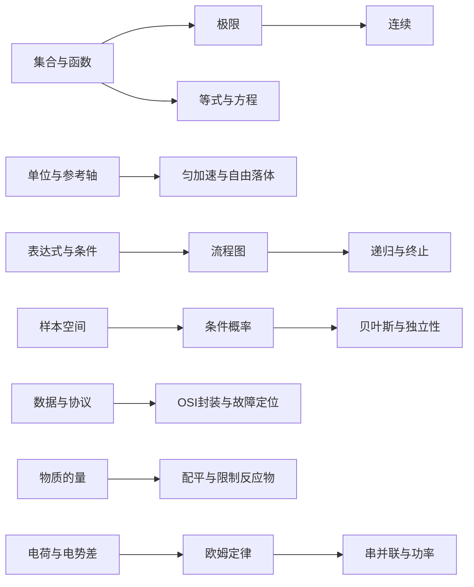

> [!info] Learning resources / 学习资源
> Core: `LEAP 学科知识图谱与可执行路线 foundations definitions workflow`
> Extension: `LEAP 学科知识图谱与可执行路线 failure cases examples comparison`
> Advanced: `LEAP 学科知识图谱与可执行路线 invariants verification transfer`
> These are search queries; no video has been certified for this note.

Related: [[Knowledge_Index]] · [[docs/teaching-delivery]]

# 学科知识图谱与可执行路线

本目录是可扩展模块起点，不宣称穷尽整门学科。所有模块均调用同一永久教学规范，并独立核对来源、假设和推导。目录扩充与学科教学审校是不同工作。

## 对应笔记与进一步模块

| 学科 | 先学什么 | 具体示例 | 后续模块与前置关系 |
|---|---|---|---|
| 编程 | 输入类型、条件、调用 | [[examples/01-python-recursion/knowledge]] | 递归之后学习复杂度与测试；终止性不能只靠运行一次判断 |
| 数学 | 集合、等式性质 | [[examples/02-math-linear-equation/knowledge]] | 函数→极限→连续；方程是运算前置，但不是极限的唯一前置 |
| 计算机 | 数据、地址、协议 | [[examples/03-cs-osi-model/knowledge]] | 分层→封装→诊断；OSI 参考模型与 TCP/IP 实现需分开 |
| 物理 | 单位、坐标轴、初值 | [[examples/04-physics-free-fall/knowledge]] | 运动学→力学；自由落体模型需验证空气阻力可忽略 |
| 逻辑 | 命题、布尔、条件 | [[examples/05-logic-flowchart/knowledge]] | 分支→循环→不变量；选择一条边不等于执行到输出 |
| 统计 | 样本空间、集合交集 | [[examples/06-statistics-probability/knowledge]] | 条件概率→独立性/贝叶斯；倒置条件需要重新确定分母 |
| 化学 | 摩尔、原子数、比例 | [[examples/07-chemistry-stoichiometry/knowledge]] | 配平→计量→平衡；反应速率和产率需另建模型 |
| 电子 | 电荷、电压、电流、单位 | [[examples/08-electronics-ohms-law/knowledge]] | 欧姆→基尔霍夫→测量；实际电源内阻改变理想计算 |
| 生物 | 细胞、等位基因 | [[docs/subject-notes/biology]] | 遗传概率→群体与系统；显隐性不等于常见/少见 |
| 经济 | 稀缺、机会成本 | [[docs/subject-notes/economics]] | 边际→供需→政策；比较需明确 ceteris paribus |
| 语言 | 音形义与语境 | [[docs/subject-notes/language]] | 词组→句法→篇章；孤立词义不能替代上下文理解 |

## 连接方式与学习证据

前置边指出下一技能需要的确切操作。例如条件概率要求先数清分母集合，配平要求原子守恒，极限定义要求不等式和量词。相关关系只表示可比较，不能一律当成强制学习顺序。Runtime DAG 每个节点记录目标、练习和迁移要求，内容在 canonical MD 展开。

> [!tip]- 建立新模块的可复用流程
> 用一个具体输入说明模块要解决的问题；列必要前置操作并给就绪小题；阅读对应领域来源；写全推导与反例；选能呈现原因的图示；提供基础、条件变式和新语境迁移；注册笔记/页面，再注册逐题解析。最后用新输入检验并保留来源与计算记录。

本图不复制 learner mastery。完成来源阅读、看完页面、揭示答案与独立展示能力是不同事件，均应在 [[docs/teaching-delivery]] 的边界下处理。

Related: [[Knowledge_Index]] · [[docs/teaching-delivery]] · [[docs/mcp-tools]] · [[docs/subject-notes/chemistry]] · [[docs/subject-notes/electronics]]

> [!note]- Reading and verification sequence: LEAP 学科知识图谱与可执行路线
> Start with the definitions and scope in this note. Follow each prerequisite link before applying the workflow.
> Work through a concrete input and retain intermediate results; compare the output with the applicable contract or definition.
> For a failure, preserve the original input, the exact rejection reason and the corrected next action. A successful transport call is evidence of execution, not of domain correctness or learning.
> After the worked case, change one condition and state which conclusion still follows. Store the result as a timestamped observation rather than promoting evidence locally.

<!-- LEAP_BACKLINKS -->

## Backlinks / 反向关联

[[Knowledge_Index]] · [[README]] · [[curricula/math1-2028-ch01/README]] · [[docs/subject-notes/biology]] · [[docs/subject-notes/chemistry]] · [[docs/subject-notes/economics]] · [[docs/subject-notes/electronics]] · [[docs/subject-notes/language]] · [[docs/teaching-delivery]] · [[examples/07-chemistry-stoichiometry/knowledge]] · [[examples/08-electronics-ohms-law/knowledge]]
