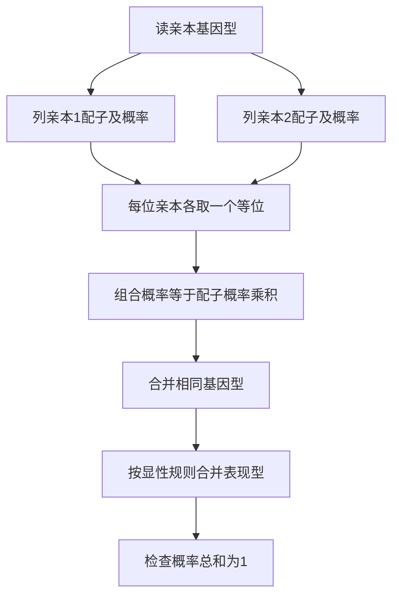

# 生物学入门：单基因杂交与子代概率

## 学习资源检索词（三层）

| 层级 | 检索词 | 本层任务 |
|---|---|---|
| 核心 | 等位基因 基因型 表现型 显性 隐性 配子；Punnett square monohybrid cross | 分开“携带的基因组合”与“表现出的性状” |
| 扩展 | Aa 杂交 测交 1比2比1 3比1 概率 独立事件 | 从亲本配子逐格计算，不背比例 |
| 进阶 | 条件概率 显性子代 杂合概率 孟德尔假设 不完全显性 | 给定观察结果后更新可能基因型，并说明模型边界 |

导航：[[Knowledge_Index|知识库入口]]、[[docs/subject-knowledge-map|学科知识覆盖图]]、[[docs/teaching-delivery|教学交付说明]]。

> [!abstract] 模块范围
> 这是一个具体入门技能的 starter，教“在常染色体单基因、完全显性模型中由亲本推算子代概率”。它不代表生物学全覆盖，也不把所有性状都解释为简单显隐性。完成后应能列配子、画组合表、区分基因型与表现型，并对观察结果做简单条件概率更新。

## 1. 先修：一对等位基因怎样进入子代

在本模型中，个体为二倍体，一个常染色体基因位点上携带两个等位基因。记为A与a：AA、Aa、aa是三种基因型。大写表示在**本模型中**对性状表现显性，小写表示隐性；大写不表示“更强、更优秀、更常见”。

| 术语 | 含义 | 本模型中的例子 |
|---|---|---|
| 等位基因 | 同一位点的不同版本 | A或a |
| 纯合 | 两个版本相同 | AA、aa |
| 杂合 | 两个版本不同 | Aa |
| 基因型 | 个体携带的等位组合 | Aa |
| 表现型 | 观察到的性状类别 | AA与Aa同属显性类别，aa属隐性 |
| 配子 | 在该位点只带一个版本 | Aa亲本可产生A或a |

Aa的减数分裂在本模型中把A与a分到不同配子，比例各1/2。AA只产生A，aa只产生a。子代从每位亲本各获得一个等位基因。**不能从一位亲本同时取A和a组成子代。**

概率计算采用：亲本配子来源相互独立、配子等比例形成、结合机会相同、各子代基因型生存机会相同、性状完全显性且外显稳定。这些假设若不满足，简单比例可能改变。

## 2. 核心方法：先列配子，再合成基因型

整个组合表的每格是否等概率，取决于配子概率。不能因为图有四格就自动认定每格1/4；Aa×Aa的四格恰好等概率，是因为两个亲本都各有1/2的A与a。

## 3. Worked例题：Aa×Aa

1. 亲本1为Aa，配子A概率1/2、a概率1/2。
2. 亲本2也为Aa，同样两种配子各1/2。
3. 每格从两位亲本各取一个版本。
4. 结合概率相乘：1/2×1/2=1/4。

| 亲本1 \ 亲本2 | A（1/2） | a（1/2） |
|---|---|---|
| A（1/2） | AA，1/4 | Aa，1/4 |
| a（1/2） | aA即Aa，1/4 | aa，1/4 |

Aa与aA在此常染色体单基因模型里是同一种杂合基因型，两格合并得到：P(AA)=1/4、P(Aa)=1/2、P(aa)=1/4，即基因型概率比1:2:1。

完全显性下AA与Aa表现为显性，所以P(显性)=1/4+1/2=3/4，P(隐性)=1/4，即表现型概率比3:1。检查：1/4+1/2+1/4=1；3/4+1/4=1。

> [!warning] 比例是长期概率，不是每四个子代必须固定出现一次
> 若四个独立子代都表现显性，概率是(3/4)^4=81/256，约31.6%，并不矛盾。不能按“前面已经三个显性，下一个必隐性”预测；在给定亲本与独立假设下，下一个仍有1/4的隐性概率。

## 4. Basic练习：AA×aa

先不看答案，写每位亲本可能配子，再给子代基因型和表现型概率。

> [!success]- 逐步解答
> AA亲本只给A，概率1；aa亲本只给a，概率1。因此唯一组合是Aa，概率1×1=1。所有子代均为杂合Aa，完全显性模型下均表现显性。这里不能套Aa×Aa的3:1，因为亲本配子不同。

进一步检查：AA×Aa的子代为AA和Aa各1/2，但表现型都显性；“表现型全显性”并不等于“基因型都AA”。

## 5. Variation练习：测交Aa×aa

已知亲本1为Aa、亲本2为aa，求隐性子代概率。

> [!success]- 逐步解答
> 亲本1给A或a各1/2，亲本2只给a。组合A+a得到Aa，概率1/2；组合a+a得到aa，概率1/2。隐性概率1/2，显性概率1/2。这是改变亲本组合后的新推导，不是3:1的“例外”。

如果亲本1只知道表现显性，可能为AA或Aa。与aa交配：AA会全部Aa；Aa会1:1。观察到一个aa子代能排除AA（在本模型及无突变/误判假设下），但有限个全显性子代不能绝对证明AA；Aa也可能偶然全显性。

## 6. Challenge：显性子代中有多少杂合？

Aa×Aa的一个子代已观察为显性。它是Aa的概率是多少？如果它后来与aa个体交配，随机一个子代为aa的概率是多少？

> [!success]- 完整条件概率解答
> 第一步：先验P(AA)=1/4、P(Aa)=1/2、P(aa)=1/4。观察显性排除aa，保留AA与Aa，总概率3/4。第二步：P(Aa\|显性)=(1/2)/(3/4)=2/3，P(AA\|显性)=1/3。第三步：若它是AA，与aa结合不会产生aa；若它是Aa，与aa结合产生aa概率1/2。合成P(下一代aa)=1/3×0+2/3×1/2=1/3。观察信息改变了可接受基因型的权重，不能仍把杂合概率当1/2。

## 7. 误区、反例与边界

| 误区 | 反例 | 修正 |
|---|---|---|
| 显性性状一定更常见 | 显性等位也可以稀有 | 显性描述杂合体的表现，不描述人群频率 |
| Aa只能产生Aa配子 | 配子在该位点只带A或a | 先区分二倍体个体与单倍体配子 |
| 四格一定是四种基因型 | Aa与aA同类 | 合并相同组合再求概率 |
| 3:1适用于所有杂交 | AA×aa全部Aa | 根据亲本重新列配子 |
| 显性个体必为AA | Aa也显性 | 表现型不唯一确定基因型 |
| 现实性状都单基因显隐性 | 身高等常受多个基因与环境影响 | 先检查模型是否适用 |

不完全显性时Aa可能有独立表现型，Aa×Aa表现型可呈1:2:1；共显性、性连锁、多基因、连锁、外显率、致死基因型等也需要不同模型。**本课计算的是既定模型下的条件预测，而不是诊断真实遗传病。**

## 8. 迁移与自我解释

换成B/b符号仍按同一方法；换成不完全显性时配子与基因型概率可相同，但表现型合并规则改变。先问“这次变化发生在配子形成、结合、存活还是表现规则哪一步？”就能定位需要调整的计算。

合上笔记，重画Aa×Aa，解释Aa为什么有两格、为什么显性概率是3/4、为什么四个子代不保证3:1。隔一天做Aa×aa与条件概率2/3；一周后用自己的例子说明一个不满足本模型假设的性状。

Related: [[Knowledge_Index]] · [[docs/teaching-delivery]]

<!-- LEAP_BACKLINKS -->

## Backlinks / 反向关联

[[Knowledge_Index]] · [[docs/subject-knowledge-map]]
