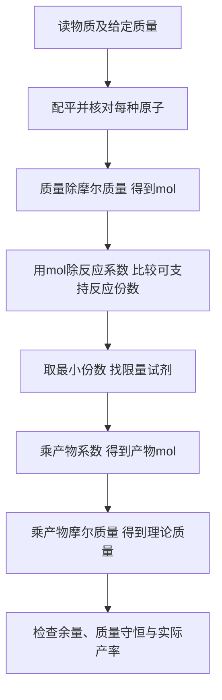

# 化学入门：先数原子，再按物质的量计算

## 学习资源检索词（三层）

| 层级 | 检索词 | 本层任务 |
|---|---|---|
| 核心 | 化学方程式 配平 系数 下标 原子守恒；摩尔 摩尔质量 n等于m除M | 区分改变反应数量与改变物质身份 |
| 扩展 | 化学计量 摩尔比 质量不能直接按系数比；stoichiometry mole ratio | 将质量转为摩尔，再按反应系数换算 |
| 进阶 | 限量试剂 反应进度 理论产量 实际产率 百分产率 | 两种原料都给定时找先耗尽者，区分理论与实际 |

导航：[[Knowledge_Index|知识库入口]]、[[docs/subject-knowledge-map|学科知识覆盖图]]、[[docs/teaching-delivery|教学交付说明]]。

配套网页课程的完整知识笔记：[[examples/07-chemistry-stoichiometry/knowledge|化学计量互动课知识笔记]]。

> [!abstract] 模块范围
> 这是化学计量的 starter，围绕H₂与O₂生成H₂O这一理想反应建立完整计算链。它不代表化学全覆盖，不讲反应速率、平衡、热力学或实验操作。这里是纸笔计算题；不需要实际混合气体或点燃进行验证。

## 1. 先修：化学式、系数与物质的量

`H₂`表示每个氢分子含2个氢原子；`2H₂`表示2个氢分子（宏观上也可代表2 mol氢分子）。前面的系数改变数量，不改变分子内部组成。`H₂O₂`与`H₂O`是不同物质，不能为了配平改下标。

物质的量n以mol表示，它让微观粒子计数与宏观质量联系起来。摩尔质量M的单位为g/mol；质量m的单位为g，则：

$$n=\frac{m}{M}.$$

为了练计算，本模块取近似摩尔质量M(H₂)=2 g/mol、M(O₂)=32 g/mol、M(H₂O)=18 g/mol。更精确数据会产生略不同小数，不影响方法。

## 2. 从原子守恒配平方程式

原式：`H₂ + O₂ → H₂O`。

1. 右侧H₂O每个含1个氧，左侧O₂每个含2个氧。
2. 为匹配氧，在右侧写2H₂O；此时右侧氧2、氢4。
3. 为匹配氢，在左侧写2H₂；此时左侧氢4、氧2。
4. 最简整数系数为2:1:2：

$$2\mathrm{H}_2+\mathrm{O}_2\rightarrow2\mathrm{H}_2\mathrm{O}.$$

| 元素 | 左侧原子数 | 右侧原子数 |
|---|---:|---:|
| H | 2×2=4 | 2×2=4 |
| O | 1×2=2 | 2×1=2 |

这个系数比表示**物质的量比**：2 mol H₂消耗1 mol O₂、形成2 mol H₂O。它不是质量比2:1:2；对应近似质量为4 g、32 g、36 g，总质量守恒。

## 3. Worked例题：4g H₂与过量O₂

1. 已知H₂质量4g，氧气明确过量，所以不由氧气限制。
2. 转换氢气物质的量：4g÷(2g/mol)=2mol。
3. 系数比H₂:H₂O=2:2，故2mol H₂理论生成2mol H₂O。
4. 产物质量：2mol×18g/mol=36g。
5. 检查氧气消耗：H₂:O₂=2:1，消耗1mol O₂=32g。
6. 输入反应质量4+32=36g，与产物一致；“4g原料生成36g”不违背质量守恒，因为另有32g氧参与。

## 4. Basic练习：1mol O₂与过量H₂

理论生成多少mol、多少g水？

> [!success]- 逐步解答
> 1mol O₂对应系数1；水系数2，因此生成2mol H₂O，再乘18g/mol得36g。消耗氢气2mol=4g。没有先给质量时，不需要额外“把mol转换成mol”的步骤，但单位仍要写。

## 5. Variation：两种原料都给出质量

给H₂=3g、O₂=16g，理想完全反应，哪种先耗尽？

> [!success]- 完整解答
> H₂：3÷2=1.5mol；O₂：16÷32=0.5mol。比较“可支持的反应份数”：H₂为1.5/2=0.75，O₂为0.5/1=0.5，取较小0.5，因此O₂限量。水为2×0.5=1mol=18g；氢气消耗2×0.5=1mol=2g，剩3−2=1g。总初始质量19g，反应后水18g+剩氢1g=19g。不能只看H₂克数小就认定它限量。

“mol更少者就是限量”也不通用，因为系数不同。正确比较是n除系数；这相当于各原料能支持多少份完整反应。

## 6. Challenge：理论产量与80%产率

有4g H₂、16g O₂，实际收集水14.4g。求限量试剂、理论产量、百分产率与剩余H₂的理论量。

> [!success]- 完整解答
> H₂=4/2=2mol，O₂=16/32=0.5mol。支持份数H₂=2/2=1、O₂=0.5/1=0.5，O₂限量。理论水量2×0.5=1mol=18g。百分产率=(实际14.4/理论18)×100%=80%。按完全且只有该反应的理想模型，消耗H₂=1mol=2g，剩2g。实际收集量低于理论可能来自反应未完全、产物损失、副反应或测量等；仅知道收集量不能唯一倒推真实剩余氢气。理论余量不能自动当作实验实测余量。

## 7. 误区、边界与反例

| 错误规则 | 反例/后果 | 修正 |
|---|---|---|
| 配平可改下标 | H₂O改H₂O₂换了物质 | 只改系数，核对原子数 |
| 系数比就是质量比 | 2mol H₂仅4g，1mol O₂却32g | 先转mol，再用系数 |
| 克数小的原料限量 | 3g H₂与16g O₂中O₂限量 | 比较n/系数 |
| 理论产量等于实际收集量 | 损失/副反应使收集量低 | 产率单独计算 |
| 所有剩余物能从收集量唯一求出 | 同一产率可由不同原因造成 | 明确反应完全性、损失机制和其他数据 |

零原料的边界：任一必要反应物为0，则该反应理论产物为0。若两者按2:1 mol恰好配比，二者同时按模型耗尽；不必强行选一个“唯一”限量者。理论产量只在指定反应、原料纯度、完全反应等假设下成立；混合物应先乘有效纯度，溶液量还需浓度数据。

## 8. 迁移与自测

换成`N₂+3H₂→2NH₃`时，方法不变：配平→mol→n/系数→最小份数→产物→质量。系数和摩尔质量必须重新读，不能保留2:1:2。题目给体积时先确认条件：同温同压理想气体的体积比可与mol比联系，但不同条件不能直接套。

合上笔记，用3g H₂与16g O₂独立重算；解释为何4g H₂能形成36g水；再说明“理论余量”与“实际收集产率”为什么不同。每行都写单位，能有效发现把g直接按系数换算的错误。

Related: [[Knowledge_Index]] · [[docs/teaching-delivery]]

<!-- LEAP_BACKLINKS -->

## Backlinks / 反向关联

[[Knowledge_Index]] · [[docs/subject-knowledge-map]] · [[examples/07-chemistry-stoichiometry/knowledge]]
