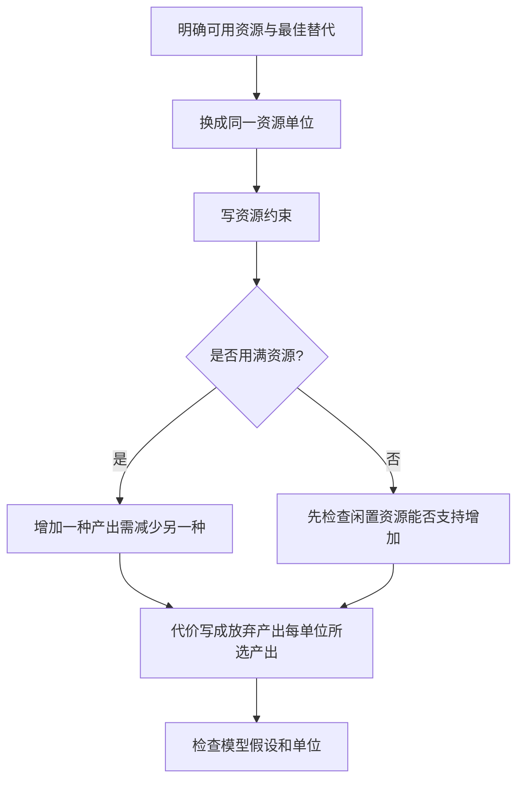

# 经济学入门：用有限时间计算机会成本

## 学习资源检索词（三层）

| 层级 | 检索词 | 本层任务 |
|---|---|---|
| 核心 | 稀缺 选择 机会成本 最佳放弃替代 时间约束 | 分清“选择的成本”和“所有没选项的总和” |
| 扩展 | 线性生产可能性边界 斜率 资源闲置 边际机会成本 | 从产能与资源约束推导代价，并注明成立条件 |
| 进阶 | 绝对优势 比较优势 机会成本 交换比率 沉没成本 | 比较两个生产者的相对代价，说明互利范围 |

导航：[[Knowledge_Index|知识库入口]]、[[docs/subject-knowledge-map|学科知识覆盖图]]、[[docs/teaching-delivery|教学交付说明]]。

> [!abstract] 模块范围
> 这是机会成本的 starter，只围绕“固定时间下在两种产出之间选择”讲一个完整技能。它不代表经济学全覆盖；模型暂不包含价格形成、需求弹性、市场结构、分配、公平或宏观政策。能算代价并不自动决定哪项选择更值得。

## 1. 先修：比率、单位与替代选择

你有12小时。制作1份餐食需要1小时；制作1杯饮料需要1/2小时。假设产能固定、时间可灵活分配、资源不能增加、只有这两种用途且所有时间都用于生产。

记餐食数量m、饮料数量d。占用时间为：

$$m+\frac{d}{2}\le12.$$

等号表示用完12小时，小于号表示存在闲置时间；m、d均非负。若产品必须是整数，实际可行点还要取整数；画出的连续直线是可分割模型的近似。

**机会成本**是一项选择所放弃的最佳可行替代的价值。机会成本不一定用钱衡量；可以用饮料杯数、时间或其他价值单位。它不是把所有未选选项的价值相加。

单位很关键：`2杯饮料/份餐食` 与 `1/2份餐食/杯饮料` 是互为倒数的不同问题；不能只写“机会成本是2”而不写单位。

## 2. 推导可行边界与斜率

用满时间时，d=24−2m。每增加1份餐食，需要1小时；这1小时本可做2杯饮料，故一份餐食的机会成本为2杯饮料。

| 餐食m | 饮料d | 时间消耗 | 状态 |
|---:|---:|---:|---|
| 0 | 24 | 12小时 | 边界点 |
| 4 | 16 | 12小时 | 边界点 |
| 6 | 12 | 12小时 | 边界点 |
| 12 | 0 | 12小时 | 边界点 |
| 4 | 8 | 8小时 | 可行但闲置4小时 |
| 8 | 12 | 14小时 | 不可行 |

边界斜率−2表示增加m时d减少；机会成本通常报告正数2杯/份。斜率与代价的绝对值在本线性模型中对应，不应把负号误说成“成本为负”。

## 3. Worked例题：从4份餐食增到7份

最初在边界上生产m=4、d=16。希望增加餐食到7，饮料要减少多少？

1. 新增餐食：7−4=3份。
2. 每份占1小时，总需3小时。
3. 边界点已没有闲置时间，这3小时必须从饮料生产转出。
4. 饮料每小时2杯，放弃3×2=6杯。
5. 新饮料数量16−6=10杯。
6. 验证时间：7+10/2=12小时，仍在边界上。

机会成本为6杯饮料，总代价不是“最终10杯”，也不是“12小时加6杯”；后者重复或混用单位。

## 4. Basic练习：一杯饮料的机会成本

问增加1杯饮料需要放弃多少份餐食，假设仍在边界上。

> [!success]- 逐步解答
> 1杯饮料需要1/2小时；同样的1/2小时本可生产1/2份餐食，所以代价为1/2份/杯。若实际产品不能分割，单次增1杯可能需要调整整份生产组合；该比率仍表示连续或大批量边际模型中的平均替代关系。

再问增加8杯饮料：需要4小时，放弃4份餐食。比率先明确，批量再相乘。

## 5. Variation：闲置时间与生产率变化

### 5.1 从内部点增加产出

当前m=4、d=8，只用了8小时，闲置4小时。增加2份餐食是否必须放弃4杯饮料？

> [!success]- 解答与边界
> 增2份餐食需2小时，可使用闲置4小时中的2小时，饮料可保持8杯。因此在“闲置时间没有其他有价值用途”的具体情境中，增加产出不必减少当前饮料。若这些时间本用于休息、学习或其他活动，仍会放弃它们的最佳价值；不能笼统说“机会成本必为0”。边界上的2杯/份替代关系不可以不加条件地套到所有内部点。

### 5.2 技术改善

制作餐食提高为每小时2份，饮料仍每小时2杯。餐食一份用1/2小时，代价变为1杯饮料；边界为m/2+d/2=12，即m+d=24。改变生产率后，斜率与机会成本都需重算。

## 6. Challenge：比较优势与互利交换

甲每小时生产3份餐食或6杯饮料；乙每小时生产2份餐食或2杯饮料。甲在两种产品上产量都高，是否两种都该由甲生产？

| 生产者 | 餐食/小时 | 饮料/小时 | 1份餐食的代价 | 1杯饮料的代价 |
|---|---:|---:|---|---|
| 甲 | 3 | 6 | 2杯饮料 | 1/2份餐食 |
| 乙 | 2 | 2 | 1杯饮料 | 1份餐食 |

> [!success]- 完整解答
> 甲拥有两种产品的绝对优势（同一时间产出更多），但比较优势看相对机会成本。餐食：乙代价1杯，低于甲2杯，所以乙有餐食比较优势；饮料：甲代价1/2份，低于乙1份，所以甲有饮料比较优势。若乙用1份餐食换1.5杯饮料，乙比自己生产饮料得到的1杯更多，甲付1.5杯低于自做餐食需放弃的2杯；因此在无运输费、交易成本、质量差异等模型假设下，两者可互利。交换比率严格在1到2杯/份之间时，双方都改善相对自身生产的替代代价。

这不能单凭比率保证现实一定发生交易：需求、初始资源、数量、运输和合同成本等也会影响选择。比较优势解释潜在收益，不替代全部决策信息。

## 7. 误区、反例与边界

| 常见误读 | 为什么不成立 | 修正 |
|---|---|---|
| 机会成本是全部放弃选项总价值 | 同一资源不能同时执行所有替代 | 取最佳可行替代 |
| 只要花了钱，机会成本就是价格 | 时间与非货币价值也可能相关 | 明确所比较的替代及计价单位 |
| 产量更高就有比较优势 | 甲两种都更快，但餐食相对代价更高 | 比较比率而非只看绝对产量 |
| 所有生产边界都直线 | 资源适配和产能可能随分配变化 | 非线性情形用局部/增量代价 |
| 内部点增加产出必牺牲另一产出 | 可能有可利用闲置资源 | 先检查资源是否已用满 |
| 已经投入越多越该继续 | 无法回收的投入可能是沉没成本 | 比较今后新增成本和收益 |

沉没成本指已经发生且无法回收的成本。比如一张不可退的票已买好，现在是否去参加活动，应比较接下来占用时间、交通费与活动收益；若票可转卖，转卖收入就是仍可选择的替代，并非全部沉没。

## 8. 自测与迁移

换成“学习小时 / 工作小时”时，首先明确最低要求与最佳替代价值；换成预算时，资源约束可能是 `价格×数量` 的总和。每次都写清楚资源、约束、产能、单位与是否在边界，而不是机械沿用2杯/份。

合上笔记，独立推导12小时模型的两种单位机会成本；对内部点解释为何不一定减少饮料；再从甲乙数据解释绝对优势与比较优势的差别。如果只记得一个数字，却不能说明放弃了什么，机会成本还没有真正读懂。

Related: [[Knowledge_Index]] · [[docs/teaching-delivery]]

<!-- LEAP_BACKLINKS -->

## Backlinks / 反向关联

[[Knowledge_Index]] · [[docs/subject-knowledge-map]]
