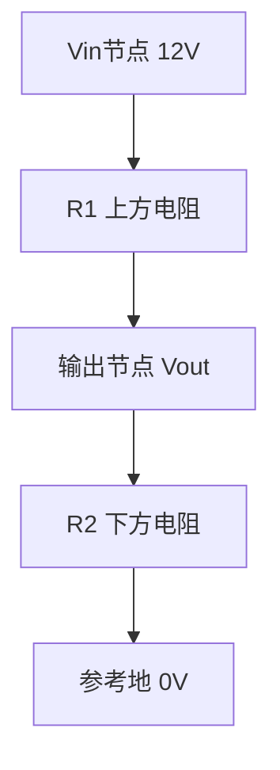
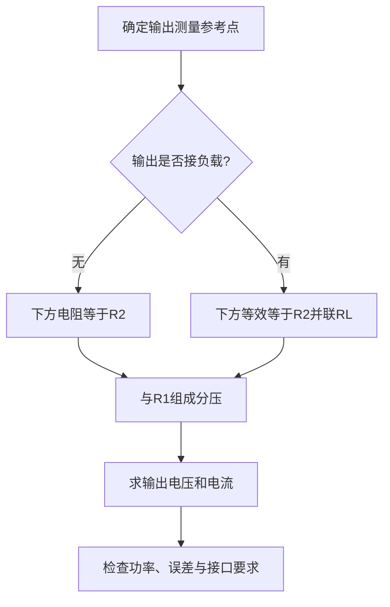

# 电子学入门：从欧姆定律推导分压，再检查负载

## 学习资源检索词（三层）

| 层级 | 检索词 | 目标 |
|---|---|---|
| 核心 | 欧姆定律 串联电阻 电流 节点电压 参考地；voltage divider derivation | 从同一串联电流推导输出电压，不背接反的公式 |
| 扩展 | 分压电路 负载效应 并联等效电阻 输入阻抗 | 连接负载后重新计算，而非沿用空载结果 |
| 进阶 | 戴维南等效 输出阻抗 ADC输入 电阻功率 容差 | 定量判断分压误差、耗电与实际接口限制 |

导航：[[Knowledge_Index|知识库入口]]、[[docs/subject-knowledge-map|学科知识覆盖图]]、[[docs/teaching-delivery|教学交付说明]]。

先修与配套互动课：[[examples/08-electronics-ohms-law/knowledge|欧姆定律互动课知识笔记]]。先学会单电阻的V=IR，再用本模块扩展到分压与负载。

> [!abstract] 模块范围
> 这是低压直流电阻分压的 starter，只教理想稳态分压、负载效应和简单功率检查。它不代表电子学全覆盖，不包括交流阻抗、晶体管、数字时序或电源设计。所有数值是纸笔模型；不是完整硬件接口认证。

## 1. 先修：电压有参考点，电流沿回路流

设理想电压源Vin，上端连接R₁，再连输出节点Vout，下面R₂连接参考地。输出电压是“输出节点相对于地”的电势差，不是电流。

图的线表示电连接，不是算法流程；读时应关注哪个节点相连、测量相对哪个参考点。R₂跨接在Vout与地之间，所以Vout恰好是R₂两端电压。若改量R₁两端，分子就要换成R₁。

欧姆定律：`V=IR`。V单位伏特V，I单位安培A，R单位欧姆Ω。1kΩ=1000Ω；mA与A相差1000倍。串联电阻无中途分流时电流相同，总电阻R₁+R₂。

## 2. 从电流推导分压式

空载，输出节点不从外部取电流：

1. 总电阻R₁+R₂。
2. 回路电流 `I=Vin/(R₁+R₂)`。
3. 输出跨R₂，因此 `Vout=I×R₂`。
4. 代入得到：

$$V_{out}=V_{in}\frac{R_2}{R_1+R_2}.$$

R₁、R₂均正时，0<Vout<Vin。两者相等时Vout=Vin/2。它们同时乘10，理想空载比值不变，但电流变为1/10，输出阻抗变大；不能说“整体电阻值完全没有影响”。

## 3. Worked例题：12V、R₁=2kΩ、R₂=1kΩ

1. 总电阻3kΩ=3000Ω。
2. 电流12V/3000Ω=0.004A=4mA。
3. R₂电压4mA×1kΩ=4V，所以Vout=4V。
4. R₁电压4mA×2kΩ=8V。
5. 8V+4V=12V，符合电压源总电压。
6. 功率：R₁为I²R₁=(0.004)²×2000=0.032W=32mW；R₂为16mW，总48mW，也等于Vin×I=12×0.004。

空载不是没有回路电流：串联电阻仍从电源取4mA。“空载”只指输出节点没有额外外部负载。

## 4. Basic练习：等阻值与接反测量

Vin=5V，R₁=R₂=10kΩ，求Vout与串联电流。若量R₁两端电压，是多少？

> [!success]- 逐步解答
> 总20kΩ，I=5/20000=0.00025A=0.25mA；Vout=I×10kΩ=2.5V。R₁两端也2.5V，因为此题阻值相等。如果使用不等阻值，量R₁的分子应换成R₁，不能把Vout公式固定复制到任何测量点。

## 5. Variation：连接负载后重新求等效

在Worked电路输出与地之间接R_L=1kΩ。它与R₂并联：

$$R_{down}=R_2\parallel R_L=\frac{R_2R_L}{R_2+R_L}=500\Omega.$$

1. R₁与下方并联组合串联，总2kΩ+0.5kΩ=2.5kΩ。
2. 电源电流12/2500=4.8mA。
3. 输出电压4.8mA×500Ω=2.4V。
4. 两个1kΩ支路各取2.4mA，总4.8mA，符合节点电流守恒。
5. 空载4V变为2.4V，下降40%。这就是负载效应；仍套空载4V会错误高估。

## 6. Challenge：负载多大才能让误差低于1%？

原12V、2kΩ/1kΩ分压的戴维南等效为Vth=4V、Rth=R₁∥R₂=666.7Ω。接负载后：

$$V_{load}=V_{th}\frac{R_L}{R_{th}+R_L}.$$

要求相对空载下降不超过1%，即Vload≥0.99Vth。求RL最小值。

> [!success]- 完整解答
> 消去Vth>0：RL/(Rth+RL)≥0.99。整理RL≥0.99Rth+0.99RL，所以0.01RL≥0.99Rth，即RL≥99Rth≈66kΩ。使用100kΩ负载时比值100000/(100000+666.7)≈0.99338，输出约3.9735V，下降约0.662%。这是纯电阻稳态模型的条件；ADC采样电容、动态电流、容差与输入保护还需另外检查。

## 7. 误区、边界与物理限制

| 误区 | 反例/后果 | 修正 |
|---|---|---|
| 分子写上方电阻R₁ | 2k/1k例题会误得8V | Vout跨下方R₂，先画测量参考点 |
| 空载没有电流 | 电阻链仍形成闭合回路 | 空载只说明没有额外输出负载 |
| 比例相同就完全一样 | 阻值全乘10使电流下降、输出阻抗升高 | 分别讨论比值、功率与负载 |
| 小负载可直接取空载电压 | RL=1kΩ使4V降到2.4V | 先做并联等效 |
| 分压器就是稳压电源 | 负载一变输出就变 | 分压适合信号参考，不等同于强供电 |
| 电阻越小越好 | 电流与功率增加 | 兼顾负载误差和耗电/额定功率 |

边界：RL趋于无穷大回到空载；RL趋于0导致Vout趋于0，电源主要通过R₁供电，电流接近Vin/R₁。R₂开路时不能沿用“正R₂的有限公式”；空载节点接近Vin，但真实测量仪表会提供负载。R₁=0等效直接接电源，不是有隔离能力的分压；电源、导线和元件仍有实际限制。把所有电阻设0再讨论比例会出现无意义的0/0模型。

实际电阻有容差。最坏输出高值通常取R₂偏高、R₁偏低；低值相反。若电源自身波动，输出也同比波动。分压不会凭空稳定Vin，也不能仅靠理想计算保证接收端绝对最大额定值。

## 8. 迁移与自测

换成3.3V输入时先重算空载比值；连接传感器或ADC时先查输入阻抗与采样要求；测量仪表本身也是负载。用两个公式交叉核对：串联电流×下方等效电阻、直接分压式。功率用I²R与VI互查单位。

合上笔记，独立推导2kΩ/1kΩ的4V；解释为什么接1kΩ负载会降至2.4V；再说明把阻值全乘10为什么空载电压不变却不再“完全等价”。能同时说明参考点、负载和功率，才达到本模块目标。

Related: [[Knowledge_Index]] · [[docs/teaching-delivery]]

<!-- LEAP_BACKLINKS -->

## Backlinks / 反向关联

[[Knowledge_Index]] · [[docs/subject-knowledge-map]] · [[examples/08-electronics-ohms-law/knowledge]]
