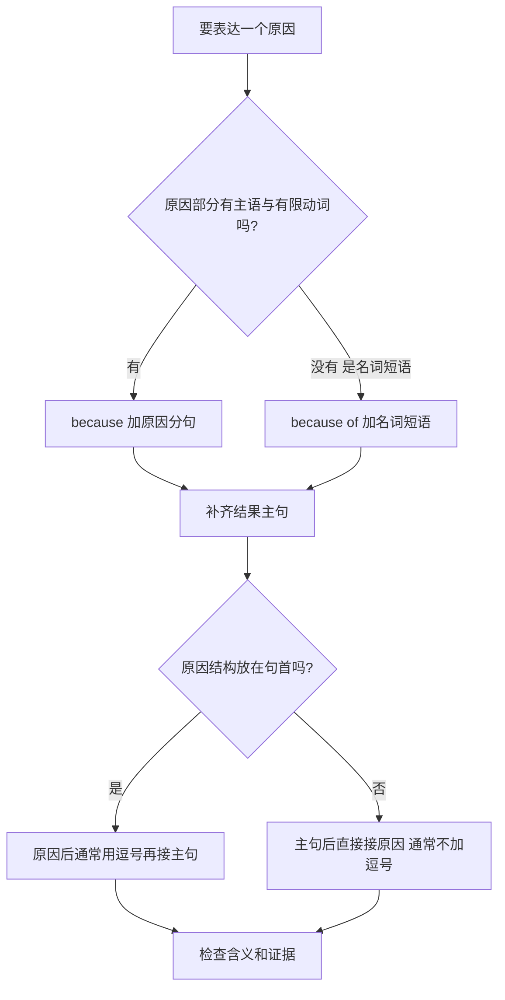

# 语言学习入门：先找句子骨架，再表达原因

## 学习资源检索词（三层）

| 层级 | 检索词 | 目标 |
|---|---|---|
| 核心 | 英语 主语 谓语 完整句 有限动词；because because of clause noun phrase | 判断原因后面是完整分句还是名词短语 |
| 扩展 | 英语 原因状语从句 前置逗号 句子片段 run-on sentence | 合并两句，避免缺主句和句间错误连接 |
| 进阶 | because due to owing to 语域 名词化 因果论证 | 根据读者与写作目的选择表达，并区分语法正确与证据充分 |

导航：[[Knowledge_Index|知识库入口]]、[[docs/subject-knowledge-map|学科知识覆盖图]]、[[docs/teaching-delivery|教学交付说明]]。

> [!abstract] 模块范围
> 这是英语书面因果表达的 starter，聚焦“识别一个主句，并用because或because of补充原因”。它不代表所有语言、所有英语语法或写作能力全覆盖。课程默认常见标准书面英语，口语中的省略回答会单独说明，避免把所有短语都判成错误。

## 1. 先修：句子不是词越多越完整

一个标准陈述主句通常包含主语和能构成谓语的有限动词，并能独立表达一个命题。祈使句、省略结构等不都呈现显式主语；本课先用常见陈述句建立识别方法。

| 文本 | 结构 | 可作独立主句吗？ |
|---|---|---|
| The train stopped. | 主语The train + 谓语stopped | 可以 |
| It was raining. | 主语It + 有限动词was + raining | 可以 |
| the heavy rain | 名词短语 | 本课书面句中不可以单独作完整陈述 |
| Because it was raining. | because引导的从属原因分句 | 正式完整句中还需要主句 |
| Stop! | 祈使句，主语you通常不显式写 | 可以，属于另一个常见结构 |

**有限动词**携带时态或与主语有关的语法信息，例如stopped、was、is。单独的`raining`通常不能在普通陈述句中充当完整有限谓语；`It raining`缺少was/is。`It was raining`中，was提供有限动词位置。

## 2. because与because of的选择依据

- `because + 分句`：后面通常有主语和有限动词，例如because **it was raining**。
- `because of + 名词短语`：后面通常是名词/代词/名词化表达，例如because of **the heavy rain**。

二者都表达原因，但接的结构不同。不能按中文“因为”逐词替换而忽略英语语法。

图中“有限动词”是针对本课基本结构的判断工具；英语还有动名词与复杂从句，不是所有表面含动词形式的内容都属于完整分句。

## 3. Worked例题：合并两个命题

原句：`It was raining heavily. The match was postponed.` 用because合并。

1. 找原因：It was raining heavily（下大雨）。
2. 找结果：The match was postponed（比赛延期）。
3. 原因有主语It和有限动词was，因此用because。
4. 写结果主句，再接原因：`The match was postponed because it was raining heavily.`
5. 核对主句：The match是主语，was postponed是被动谓语；句子不缺主要命题。
6. 核对原因：because只引导原因，不倒置词序。
7. 也可把原因前置：`Because it was raining heavily, the match was postponed.` 前置原因后通常用逗号。

若改用名词短语：`The match was postponed because of the heavy rain.` `the heavy rain`没有自己的有限动词，正适合because of。

| 表达 | 原因结构 | 主句是否完整 |
|---|---|---|
| because it was raining heavily | 分句：It+was | 是 |
| because of the heavy rain | 名词短语 | 是 |
| because the heavy rain | 本课基本写法结构不匹配 | 应改成because of |
| because of it was raining | 介词后接有限分句不匹配 | 应去of或改名词短语 |

## 4. Basic练习：选择连接方式

填because或because of：

1. We stayed inside ___ the storm.
2. We stayed inside ___ the wind was strong.
3. The road was closed ___ ice.

> [!success]- 完整解答
> 1. because of：the storm是名词短语。2. because：the wind是主语、was是有限动词，strong是表语，构成分句。3. because of：ice是名词。检查不要只凭是否有冠词；ice没有冠词仍是名词结构。

## 5. Variation：换位置与修正片段

把`We arrived late because the bus broke down.`改为原因在前的完整句，并修正`Because the bus broke down.`这一独立片段。

> [!success]- 完整解答
> 前置：Because the bus broke down, we arrived late. 原因从句后的逗号分开前置附加信息与主句。单独片段在正式段落中缺结果主句，可补We arrived late，或在上下文需要强调时改为The bus broke down. 不是“because词后不能有句号”，而是它通常引导依赖主句的结构。

口语问`Why were you late?`时，回答`Because the bus broke down.`是自然的省略回答；上下文补出了主句含义。本课书面完整句要求不能机械套到所有对话中。

再修正`Because it was late, so we left.`：在本课常见标准结构中避免because和so同时把同一个原因/结果连接两遍；可写`Because it was late, we left.`，或者`It was late, so we left.`。不同语言的因果连接习惯不完全相同，翻译时需重新组织目标语言结构。

## 6. Challenge：名词化与意义保持

把`The experiment failed because the temperature changed suddenly.`改用because of；再说明这样改是否总能保留所有细节。

> [!success]- 逐步解答
> 原因分句为the temperature changed suddenly；把变化事件名词化为a sudden change in temperature。结果：The experiment failed because of a sudden change in temperature. 保留了“突然”和“温度变化”信息。若只写because of the temperature，就删除了“变化”这一关键原因，意思改变。名词化压缩结构但可能删除动作、时间、主体或程度，改写后要逐项核对，不以更短为更好。

如果在报告中没有充分证据证明温度变化导致失败，语法正确的because也不保证推理正确。可以根据证据写“may have failed because…”等更合适的可能性表达；语言强度要与证据强度匹配。

## 7. 常见误区、反例与边界

| 误区 | 反例 | 修正依据 |
|---|---|---|
| because与because of只是长短不同 | because it rained / because of the rain | 看后接分句还是名词短语 |
| 原因结构必在句首 | 主句后接because也常见 | 根据信息重点选择顺序 |
| 因为从句后永远加逗号 | The road closed because it snowed. 通常不加 | 前置与后置标点惯例不同 |
| 所有独立because回答都不正确 | Why? — Because I was tired. | 区分对话省略与正式完整句 |
| 一句话有动词就完整 | It raining. | 识别有限动词位置 |
| 语法对就证明原因真实 | “销量增长because广告”仍需证据 | 表达结构与因果论证分开 |

`because of being late`中的being是非有限动词形式，整个结构可具有名词化作用；初学时先掌握清楚的名词短语，不要用“只要看见动词就用because”的粗规则。

英语due to、owing to、as、since等因果表达还涉及语域、歧义、焦点与编辑惯例。本课不把它们强行宣布完全等价；先做到because / because of结构准确，再扩展到写作风格。

## 8. 迁移练习与反馈方法

用自己的经历写三组：原因分句、同义名词短语、两种完整表达。例如“公交延误 / 迟到”“道路结冰 / 关闭”“设备故障 / 实验中止”。反馈时分别标注：主句缺失、原因结构选择错、标点、意义遗漏、证据过强，不把它们混成一个“语法不好”。

合上笔记，给`the noise`与`the room was noisy`各选连接方式；解释为什么有时Because…可以独立回答、有时是书面片段；最后把一个句子名词化并检查是否删除信息。能依据结构而非中文直译选择，才达到本模块目标。

Related: [[Knowledge_Index]] · [[docs/teaching-delivery]]

<!-- LEAP_BACKLINKS -->

## Backlinks / 反向关联

[[Knowledge_Index]] · [[docs/subject-knowledge-map]]
