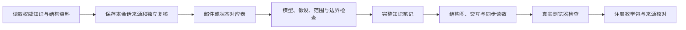

> [!info] Learning resources / 学习资源
> Core: `LEAP 永久教学交付规范 foundations definitions workflow`
> Extension: `LEAP 永久教学交付规范 failure cases examples comparison`
> Advanced: `LEAP 永久教学交付规范 invariants verification transfer`
> These are search queries; no video has been certified for this note.

Related: [[Knowledge_Index]] · [[docs/teaching-delivery]]

# 永久教学交付规范

此规范同时约束所有学科、教学模式、宿主生成器和后续产物。Runtime 返回 `teaching_delivery_policy`；`get_teaching_delivery_policy` 提供完整 3.0 规范。会话模式可改变节奏与题量，不能删除前置知识、推理、边界或验证。

## 先读领域资料，再做教学

宿主必须实际读取资料，保存来源、定位、原文节录、版本或访问日期，并先独立完成代表性例题与反例检查。`save_benchmark_report` 只检查证据记录，不会替宿主学习数学，也不能认证虚构摘录。没有对应年份大纲，就只说明实际参考范围。

这个顺序适用于后续每一次 MCP 教学生成，不能因为已有一个好看的示例就跳过新专题的研究。MCP 初始化指令、成功与失败回包、诊断要求及两类创作规格均从同一份政策提供生成指导；`full` 和 `quickstart` 收到相同要求。

## 从完整笔记到可交互页面

每一个具体教学点须包含前置知识、原理与条件、至少两步带理由的推导、完整例题、误解修正、边界情况、对比、基础/变式/挑战练习与解析、迁移任务、有效图示或不配图的具体原因。先写完整 Obsidian 笔记，再选择其中的简短内容投影成 HTML。

MD 必须覆盖全部实际 HTML 文本节点，包括折叠解析和图示标注；另外提供真实的扩展推导或额外案例。源码长度、CSS 长度、重复文案、填充字数都不是教学深度。动态生成的提示/反馈和用户输入不在静态解析器里，须通过浏览器和人工审校另行核对。

图示要标明对象、输入、方向、单位、适用条件。分步控件保留中间状态，用户能暂停、前进、后退和重置。缩小运动模式给出静态步骤。PC 容器最大宽 1800px，侧栏 420px；1440/1920px 屏幕内容使用率至少 88%，375px 不出现整页横向溢出。

预审课程从同一份章节内容生成教学课件与打印讲义。两者的 `section[data-teaching-point]` 按 manifest 的
教学点顺序对应，共用定义、关键例题和初始图形。教学课件另外提供可调图解、作答与宿主桥接。A4 讲义保留展开后的
推导、静态图和自检，书目集中在册末。宿主用 `full` 档位联调课件，从登记后的 `get_teaching_context` 注入上下文。
课件使用 `reviewed_package_id` 请求同一教学包的打印稿。仓库用 `scripts/verify_reviewed_course.py`
加载实际 MCP 返回的课件、调参作答并下载该包的 A4 讲义。

## 图解教学：Anatomy 创作方式

图解用来解释结构、机制、过程、数据与反例。一个教学点可组合剖面/拆解图、因果图、带单位的数据图和静态分镜；数量取决于要解释的问题。先写真实对象与概念的对应关系，再设计部件、相互遮挡、图例与控件。物理实验可画成可拆解实验台；编程用真实状态与执行轨迹，电路用连接与电流路径，数学用几何变换与数量关系，化学用粒子和守恒。不为了追求立体效果编造机构或科学事实。

作者参考 [Anatomy skill](https://github.com/wheresryan22/anatomy)，固定参考版本 `1482e8469b0a9e0d8cc18ea2740a01423d29ae80`（MIT）。它是可选的创作工具。交付仍是离线内联 SVG/Canvas/HTML，框架运行时不依赖该技能或其 JavaScript kit。自由落体示例的几何为项目原创，构建脚本可重现图形。

每个会动的部件、图中曲线与读数必须由同一个领域模型驱动。说明哪些量按比例绘制、哪些只是示意、哪些数据来自计算。默认静止，主动播放，可暂停、后退、前进或拖动时间并重置；控件有键盘操作和焦点状态。离屏、隐藏标签页时暂停；减少动态效果时保留静态帧与数值探索。连续读数不逐帧向屏幕阅读器播报。

### 研究、结构与模型先于构造

1. 实际打开学科资料；真实设备、器官或装置还需读取手册、结构图、图谱或原始说明。检索摘要、猜测的 URL、模型记忆不能替代阅读。冲突未解决时保留不确定性，使用已经核实的静态说明。
2. 保存精确定位、支持该结构的摘录与阅读日期，调用 `save_benchmark_report`，保留返回的 `sources_saved`。包里的来源不能只引用另一专题的任意记录。
3. 列出有教学意义的部件或形式状态：名称、作用、连接/因果关系、来源、表示方式和尺寸/拓扑依据。真实参照、简化示意、教学类比分别标记为 `reference`、`schematic`、`analogy`；明确哪些支架、比例、运动只是示意。编程与数学可以使用执行状态或数量关系，不强加机械外形。
4. 先定义共享模型，写清单位、假设、输入范围、停止条件和省略项。独立推导典型与边界结果；适用时覆盖开始、中间、结束。检查记录保留输入、预期、独立方法和实际差异，不能把动画自身的输出再次当成期望值。
5. 完整笔记包含上述证据与推理，再制作图形、曲线和读数；三者使用同一个模型状态。完成真实浏览器验证后注册。

### 部件说明的统一交互

结构、机制和空间图提供实际部件命中区域及相邻的稳定说明面板。面板显示名称、作用、关系和适用条件；所有说明也保留在静态部件表与规范笔记中。桌面并排，手机上下排列，说明不遮挡图形、不挤动控件。

| 输入 | 显示结果 | 保持的状态 |
|---|---|---|
| 鼠标进入或键盘聚焦部件 | 临时预览名称与说明 | 原选中部件、模型状态 |
| 点击、Enter、Space 或触摸 | 选中同一部件 | 模型状态 |
| 鼠标离开或焦点移开 | 恢复仍有效的焦点/指针预览，否则显示选中部件，再否则显示总览 | 原选中部件 |
| Escape 或明确的清除按钮 | 清除预览与选择，回到总览 | 模型状态 |
| 重置 | 清除检查状态，恢复模型初始状态与总览 | 参数按教学设计明确恢复 |

预览与选中分开保存，键盘聚焦与指针预览各自退出，不互相清空。SVG 子元素之间移动不能闪烁。Space 选择不能滚动页面；触摸不依赖悬停。原生按钮，或带 `role="button"`、`tabindex="0"`、可访问名称的几何提供键盘等价操作。装饰层不能挡住部件，检查真实屏幕坐标的命中，不只向元素派发人工事件。悬停、选中、播放和拖动不是学习证据，不自动更新掌握度或推进课程。

页面按“学习问题与范围 → 结构总览 → 部件解释 → 可控机制 → 同步数量与说明 → 对比/限制 → 练习”组织。总览、引导步骤和自由探索有明确入口；每个补充视图回答一个不同问题。颜色保持固定含义，焦点与选中也有形状或描边提示。读屏器只播报主动检查或分步变化，不逐帧播报动画。

### 新版契约与旧包兼容

新建或修改的图解教学包采用 `visual_contract.profile: anatomy.v2`。完整字段说明和可替换的 manifest 骨架由 `get_teaching_delivery_policy().policy.visualization.contract` 返回，源文件为 [teaching_delivery_policy.json](../src/leap/specs/teaching_delivery_policy.json)。两类生成规格从它投影，避免维护另一份不一致的清单。骨架中的占位值必须替换为实际阅读、计算、正文和 DOM 记录。

v2 强制要求 `research`，并要求每条研究来源都映射到整图、部件或模型；形式状态图可用 `figure.source_refs` 标明支撑该状态追踪的资料。其中 `sources[].id` 是图内引用的本地名；`evidence_source_id` 是 `save_benchmark_report` 返回的会话来源 ID，必须也列入包的 `source_ids`，必须属于本会话**最近一次 completed benchmark report** 的 `source_ids`，且来源地址、定位、摘录与保存记录一致；`checked_at` 不得晚于今天。结构/机制/空间图要求 `parts` 和 `inspection`，每个部件有解释、关系与来源依据。动画的 `model_binding` 要求假设、范围、限制、来源引用及典型与边界检查。只有 `reference` 部件必须引用具体来源；示意或类比仍须解释其依据与限制。

**新包强制 v2**：对「该 session+node 尚无已接受教学包」的新注册，缺失契约或 `anatomy.v1` 会被 `save_teaching_package` 以 `visual_contract_required` 拒绝；已接受过 v2 的节点也不能在下一次修订中静默降级。只有两种例外：(1) 纯文字课——每个 `teaching_points[].visualization` 都写具体 `no_visual_reason` 且无 `type`，此时允许无契约并返回 `visual_contract_state: not_applicable`；(2) 宿主显式设置 `manifest.allow_legacy: true` 以保留有意兼容的旧包，该选择写入 artifact metadata 并在回包 `warnings` 中报告。`ok=true` 的 legacy 接受一定带 `warnings`，宿主不能把它当成 v2 合规。

**记录要有实义**：缺失记录被拒绝，空壳同样被拒绝。caption、help、部件解释/关系/依据、模型假设/范围/限制、检查的 inputs/expected/method/result、states 与 research.limitations 需要有意义文本（至少 8 个拉丁字符或 6 个中文字符）；labels 与部件名至少 2 个字符。`model_binding.quantities` 的 name 与 unit 必须出现在规范 Markdown 中。存在任何 `visualization.type` 时，包内至少有一个可控图（`animated: true` 并带 controls/states，或参数控件）；声明 controls/states 却 `animated: false` 会被拒绝。

**selector 与静态帧**：所有 selector 是单个 `#id`，接受任何真实 HTML id（数字与中文开头均可），必须存在且唯一、不得位于 `hidden`/`aria-hidden`/内联 `display:none` 的子树或 `disabled` 状态；代码/类名/组合选择器给出明确的语法错误而不是伪装成“找不到 id”。图级 selector 必须是 SVG、Canvas、figure、img 或 table，普通正文 div/section 不能冒充图。静态帧必须是 SVG、图片或表格；动画另需输出量与单位、播放/暂停、重置，以及可逆步骤、拖动或参数控件之一。标题、图例和部件解释在 HTML 与规范笔记中均存在，来源和模型推理保存在笔记中。`visual_contract` 顶层与各对象都不接受未知字段；`visual_contract: null` 与缺失等价；顶层键拼错（如 `visualContract`）会明确报错。

**可见文本口径**：正文覆盖只统计学习者实际能看到的文本。`script/style/head/title/desc/defs/template/noscript/option/datalist` 与 `hidden`/`aria-hidden`/内联 `display:none` 子树不计入；SVG 的 title/desc 无障碍文本因此不再被要求复制进 Markdown。由 CSS `content:` 或样式类生成的文本、以及真实浏览器中的可见性属于宿主浏览器验证，不在静态解析内。

**校验回包状态**：`visual_authoring` 拆分 `visual_contract_state`（`absent | not_applicable | legacy_v1 | current | invalid`）、`visual_contract_valid`、`package_valid`、`text_only`、`visual_contract_required` 与 `browser_behavior_verified_by_runtime`。只有 `current` 才算 v2 合规；`package_valid=false` 表示包整体未通过（可能只是非视觉字段错误）。契约缺失/旧版不再伪装成 `legacy_compatibility`。兼容接受不能用来宣称满足新版。Runtime 无法判断一个没有版本的正文是否刚刚生成，也不能证明 agent 真读过资料。它只验证记录、目标、正文覆盖与来源一致性，不执行模型代码、不验证科学真伪或浏览器行为。

**政策热加载**：服务进程按 `teaching_delivery_policy.json` 的 mtime 重新加载政策；替换政策文件后无需重启，`get_teaching_delivery_policy` 始终返回当前版本。v2 manifest 还需声明与实际政策一致的 `policy_id` 与 `policy_version`。

**与 Anatomy 参考实现的差异**：所引 [Anatomy skill](https://github.com/wheresryan22/anatomy) 以其 CSS selector 描述部件；LEAP 契约只接受唯一 `#id`。照该 skill 原生产物接入时需把部件 class/data-* 重构为唯一 id，交互与浏览器行为仍由宿主实测。

浏览器检查实际部件悬停/聚焦、点击/键盘/触摸、预览退出与选择恢复、清除、开始/中间/结束、前进/后退/重置、暂停后不再变化、无 JavaScript 静态可读、减少动态效果，以及 1440/1920/375px 布局。放大到 4 倍检查遮挡、连接、刻度与标签。针对已知参数独立计算，同时核对图形位置、曲线和读数，不能只断言元素存在。已有学科页面仅作参考，例如 [[examples/04-physics-free-fall/knowledge]]（现为 anatomy.v2 示例）；新专题仍需完成自己的研究与验证。

## 教学包注册与不可绕过的门禁

`save_teaching_package` 接收 `session_id, node_id, subject, markdown, html, manifest` 的实际内容。manifest 的 `teaching_points` 保存每个必需字段；`resources` 保存核验视频或三层关键词；`html_segments` 标明正文，`markdown_extensions` 标明扩展推导，`source_ids` 关联本会话真实阅读记录。可视化 selector 必须匹配实际 HTML id/class。

`source_ids` 要传 `save_benchmark_report` 返回的 `sources_saved` id；仓库内 8 个 `examples/**/*.delivery.json` 用显式占位 `<source id returned by save_benchmark_report>` 并附 `allow_legacy: true`（04 为 anatomy.v2），它们不是可直接提交的会话数据。仓库门禁 `scripts/verify_teaching_repository.py` 除静态校验外，会用临时内存会话执行**注册仿真**：合成 benchmark 来源 → 替换占位 → 走真实 `save_teaching_package`。8 个示例必须同时通过静态校验与注册仿真，否则门禁失败。README/README_CN 与 `docs/i18n/README.*` 作为 GitHub/PyPI 公共文档，仍检查 frontmatter、顶部资源与折叠 callout，但豁免 Obsidian wikilink/反向链接规则。

Runtime 不读取任意宿主路径，也不能在只有路径、标题和“已检查”声明时授予质量通过。成功后再调用 `save_assessment_item`，同节点习题关联已接受的教学包。`save_artifact` 的教学 HTML/MD 必须关联包，并在提供正文时匹配其内容哈希。代码/图表等非教学产物保持独立用途。

## 资源与双向关系

视频须逐项记录实际 URL、标题、发布者、访问日期、定位、核验原文、可访问且相关的结果；来源不确定就使用精确核心词、拓展词、进阶词。关键词同时出现在笔记和页面头部。外部来源链接允许点击，但页面运行不依赖 CDN、外部脚本或联网请求。

内部链接采用 vault 根路径 `[[wikilinks]]`，避免重名 README 的歧义。每一条关系在目标笔记或真实索引中提供反向链接；链接路径必须存在。[[Knowledge_Index]] 是全仓入口，[[docs/subject-knowledge-map]] 组织学科路线，[[docs/mcp-tools]] 从服务端真实注册函数生成。

## 作答与证据闭环

页面逐题保存原始作答和对应 `submit_attempt` call_id。不能借最近一次别题作答提交评分。规则只评明确客观答案；论证、代码说明、概念解释等待宿主语义评阅，不使用关键词命中、长度或包含“因为”等标记作为正确证据。未判断维度为 null，不能填 0 或 1 装作评估过。

`item_completed` 仅表示本地活动结束，产生 `check_advance_unit`；成功检查仍不是完成回执。Runtime 的 `advance_unit` 真正成功后，页面通过对应回执显示已推进。`provisional` 只表示缺少本次评估回执，始终不能授权本地升级 mastery/evidence_stage。`hydrate` 表示最近一次状态快照，不证明实时连接。

> [!example]- 宿主执行的依赖顺序
> 第一个调用是 `submit_attempt`。宿主保存返回的 attempt_id，然后替换同题 commit 的 `{{call_1.attempt_id}}`，调用 `commit_assessment`。成功回执须同时匹配调用 id、作答原文和 attempt_id。之后检查 guard，符合条件才请求 advance；最后刷新上下文。失败保留原请求和错误，不能当作成功清空证据。

## 发布前可复现检查

1. 运行 pytest、工具文档生成一致性、schema 与注册工具一致性。
2. 全仓 Obsidian 路径/元数据/双向关系校验、每个教学包 100% 正文覆盖校验，并运行 `scripts/verify_teaching_repository.py` 的注册仿真（8 个示例须全部通过真实 `save_teaching_package`）。
3. 浏览器执行每个声明控件路径、正确与错误答案、揭示后验证、参数边界、键盘和窄屏/宽屏布局。
4. 实际 stdio MCP 进程 + 临时 SQLite + Chromium 联调，核对评分只写测试库。
5. 独立审校数学、科学及学科原理；结构门禁通过不能代替语义正确。

Related: [[docs/INTEGRATION]] · [[docs/INTEGRATION_CN]] · [[docs/content-quality]] · [[examples/_shared/leap-bridge]] · [[examples/_shared/leap-web-spec]] · [[docs/teaching-upgrade-plan]]

> [!note]- Reading and verification sequence: LEAP 永久教学交付规范
> Start with the definitions and scope in this note. Follow each prerequisite link before applying the workflow.
> Work through a concrete input and retain intermediate results; compare the output with the applicable contract or definition.
> For a failure, preserve the original input, the exact rejection reason and the corrected next action. A successful transport call is evidence of execution, not of domain correctness or learning.
> After the worked case, change one condition and state which conclusion still follows. Store the result as a timestamped observation rather than promoting evidence locally.

<!-- LEAP_BACKLINKS -->

## Backlinks / 反向关联

[[CHANGELOG]] · [[CODE_OF_CONDUCT]] · [[CONTRIBUTING]] · [[Knowledge_Index]] · [[README]] · [[README_CN]] · [[SECURITY]] · [[docs/ARCHITECTURE]] · [[docs/ARCHITECTURE_CN]] · [[docs/EXAMPLES]] · [[docs/INTEGRATION]] · [[docs/INTEGRATION_CN]] · [[docs/LOCALIZATION]] · [[docs/LOCALIZATION_CN]] · [[docs/content-quality]] · [[docs/i18n/README.ar]] · [[docs/i18n/README.es]] · [[docs/i18n/README.fr]] · [[docs/i18n/README.ja]] · [[docs/i18n/README.ko]] · [[docs/i18n/README.ru]] · [[docs/mcp-tools]] · [[docs/quality-audit-2026-10-10]] · [[docs/subject-knowledge-map]] · [[docs/subject-notes/biology]] · [[docs/subject-notes/chemistry]] · [[docs/subject-notes/economics]] · [[docs/subject-notes/electronics]] · [[docs/subject-notes/language]] · [[docs/teaching-upgrade-plan]] · [[examples/01-python-recursion/README]] · [[examples/01-python-recursion/README_CN]] · [[examples/01-python-recursion/knowledge]] · [[examples/02-math-linear-equation/README]] · [[examples/02-math-linear-equation/README_CN]] · [[examples/02-math-linear-equation/knowledge]] · [[examples/03-cs-osi-model/README]] · [[examples/03-cs-osi-model/README_CN]] · [[examples/03-cs-osi-model/knowledge]] · [[examples/04-physics-free-fall/README]] · [[examples/04-physics-free-fall/README_CN]] · [[examples/04-physics-free-fall/knowledge]] · [[examples/05-logic-flowchart/README]] · [[examples/05-logic-flowchart/README_CN]] · [[examples/05-logic-flowchart/knowledge]] · [[examples/06-statistics-probability/README]] · [[examples/06-statistics-probability/README_CN]] · [[examples/06-statistics-probability/knowledge]] · [[examples/07-chemistry-stoichiometry/README]] · [[examples/07-chemistry-stoichiometry/README_CN]] · [[examples/07-chemistry-stoichiometry/knowledge]] · [[examples/07-chemistry-stoichiometry/sources]] · [[examples/08-electronics-ohms-law/README]] · [[examples/08-electronics-ohms-law/README_CN]] · [[examples/08-electronics-ohms-law/knowledge]] · [[examples/README]] · [[examples/README_CN]] · [[examples/_shared/leap-bridge]] · [[examples/_shared/leap-web-spec]]
