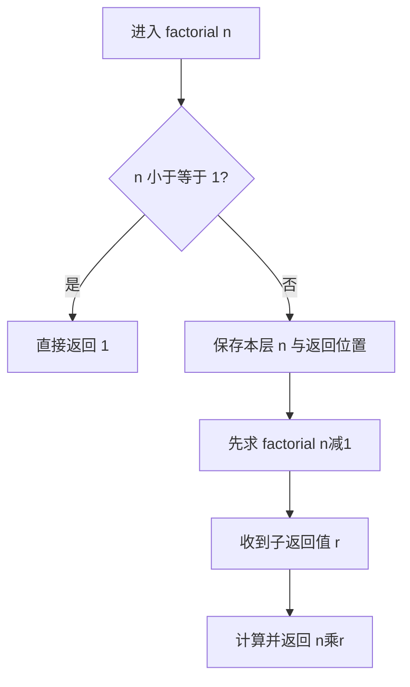
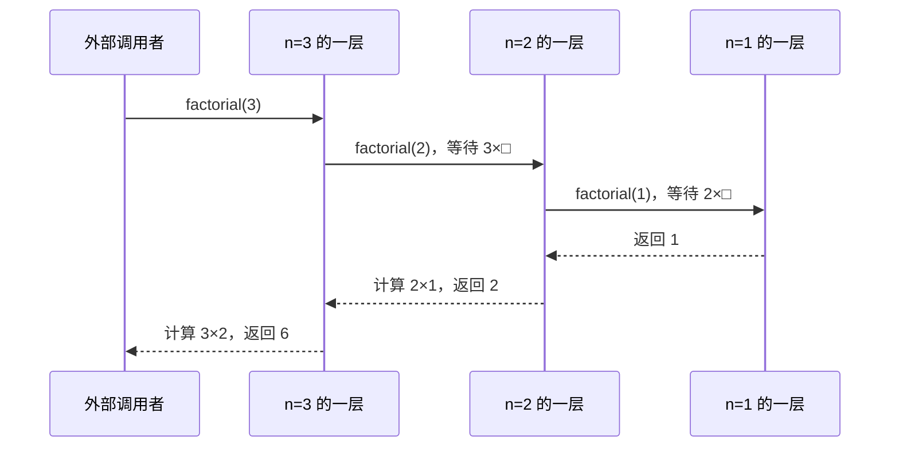

> [!info] 学习资源：精确检索词（三层）
> 核心：`Python 函数参数 局部变量 return 返回值`
> 核心：`Python 阶乘递归 基线条件 调用栈 逐步追踪`
> 扩展：`Python 递归累加 0 基线 阶乘与循环对比`
> 扩展：`Python recursion stack frame return vs print`
> 进阶：`递归终止性 递减度量 自然数 数学归纳法`
> 进阶：`Python 尾递归不优化 递归深度 空间复杂度`
> 这些是检索词，并非声称已核验的视频或已读取的资料；本课不列未经核验的视频链接。

# Python 递归：完整课程与逐步解答

## 学习资源与路线：先找什么资料

这些是按知识层级组织的检索词，可复制到课程平台、文档搜索或搜索引擎。先把核心词对应的内容掌握，再寻找扩展和进阶，不需要一开始就学习斐波那契或复杂树算法。

| 层级 | 中文检索词 | 英文检索词 | 学习后应能做什么 |
|---|---|---|---|
| 核心先修 | Python 函数参数 局部变量 return 返回值；Python if 比较 运算顺序 | Python function parameters local variables return vs print | 解释一次普通调用，把函数返回值代回原表达式 |
| 核心递归 | Python 阶乘递归 基线条件 调用栈 逐步追踪 | Python factorial recursion stack frame step by step | 写出每层 n，区分调用方向与返回方向 |
| 扩展迁移 | Python 递归累加 空和 0 基线；阶乘递归与循环 | recursive sum base case identity element iteration | 从连乘迁移到累加，解释为何基线改变 |
| 扩展排错 | Python RecursionError n−1 n+1 缺少 return | recursion termination unreachable base case missing return | 区分语法、未终止、组合错误与错误输入 |
| 进阶论证 | 递归终止性 递减度量 自然数；数学归纳法 递归正确性 | well founded recursion decreasing measure induction proof | 分别证明会停止和答案正确 |
| 进阶性能 | Python 递归深度 sys.getrecursionlimit；尾递归不优化 大整数复杂度 | CPython recursion limit no tail call optimization big integer complexity | 说明 O(n) 的计数模型及真实运行的限制 |

本课的交互入口与使用说明：[[examples/01-python-recursion/README_CN|递归示例说明]]。统一课程导航：[[examples/README_CN|示例目录]]、[[README_CN|项目说明]]。循环的完整变量追踪见 [[examples/05-logic-flowchart/knowledge|流程图与循环知识笔记]]。

> [!abstract] 这份笔记怎样学
> 第一次学习按先修 → 定义推导 → 调用栈例题 → 终止与边界 → 练习的顺序读。遇到代码时先用纸笔预测，再打开交互页面核对。折叠解答包含完整步骤，不要只抄最终数值。这里包含网页全部教学知识，并补充更细的逐行状态、正式输入检查、反例、证明、更多迁移例题和自测题。

## 教学点精讲与交付对应

本节把每个知识点的输入约束、推导、核对与迁移写成完整教学记录；编号供宿主引用，不表示学习者已经掌握。

### 从非负整数阶乘推导基线与递归组合

教学点编号：`recursion.factorial.definition`。

**先修与记号：** 先把普通调用 add_one(2) * 3 解释为参数 x=2、return 3、原式变成 3*3=9。参数是本次调用的局部名称；print 只显示文字，不能给乘法返回一个数。阶乘输入限于非负整数 n，n≤1 是比较，n=1 是赋值。

**原理与条件：** 正整数的阶乘是从 n 连乘到 1；抽出第一个因子 n，剩下的正好是 (n−1)!，因此 n≥2 时有 n!=n×(n−1)!。0!=1 是空乘积，1!=1 可直接回答，基线与组合式共同决定程序是否符合定义。

**带理由的操作顺序：**

1. 先从 4×3×2×1 中抽出第一个因子 4，识别剩余 3×2×1 就是 3!，这说明当前层为什么乘自己的 n。
2. 再把 0 与 1 的直接答案写为 if n <= 1: return 1，只在 n≥2 时调用 n−1，确保子输入仍在非负整数域并朝基线减少。
3. 最后写 return n * factorial(n-1)，先取得子返回值再乘当前 n；return 把组合结果交回外层，不能只显示结果或只调用子函数。

**完整例题与核对：** 输入 n=4，调用依次进入 4、3、2、1；1≤1 为真返回1，随后 2×1=2、3×2=6、4×6=24。直接连乘 4×3×2×1=24 独立核对。输入0首次命中基线，直接返回1。

**误解与修正：** “只要有基线就一定正确”遗漏了下降方向与组合操作。n+1 从4变5而远离基线；n−2 对4虽能沿4→2→0结束，却只算4×2×1=8。修正为每次减1，并乘上本层 n。

**输入与实现边界：** n=0和n=1都应返回1；仅 n==1 不能处理0。负数、小数、字符串与布尔值应在正式函数的入口拒绝；短代码返回一个值不证明该输入有本课定义的阶乘。网页受控解析器不能代替完整Python解释器。

**近邻方法对比：** n≤1 与整数域中的 n<2 覆盖同样的非负基线；n==1 漏掉0。循环把 result 顺序更新为1、2、6、24，递归在等待帧中保留4、3、2再回退；两者输出相同，但保存中间状态的方式不同。

**基础、变式、挑战与解答：** 基础：factorial(0)=1，因为首次判断真。变式：factorial(4)=24，写出1→2→6→24的返回值。挑战：若用 n−2，factorial(3) 返回3而非6，因为跳过2；“不能停止”也错，因为子输入1会命中基线。

**迁移任务与解释：** 把连乘迁移成求和时重新选择单位元：空和是0，故 sum_to(0)=0；n≥1 时 return n + sum_to(n-1)。只是把乘号改加号而保留 n≤1 返回1，会把合法输入0错误地算为1。

**网页图示：** 基线与递归的逐行参数推演；定位 `#recTraceSvg`。请用对应的单步或参数控件查看状态，图示用于追踪，不替代上面的逻辑证明。

### 用独立调用帧解释等待与返回的相反顺序

教学点编号：`recursion.stack.return`。

**先修与记号：** 读 return n * factorial(n-1) 时，必须先求子调用的值才能完成乘法。局部 n 属于当前帧；给子调用传 n−1 是计算新实参，不会执行上一层的 n=n−1。每个帧还保存返回后继续的位置。

**原理与条件：** 外层在子值未知时暂停，子调用把新帧压入栈顶；基线首先给出值，子帧结束后弹出，上一层用保留的参数继续计算。最后进入的调用最先结束，因此调用方向与返回方向相反。

**带理由的操作顺序：**

1. 进入 factorial(3) 时保存局部 n=3 和待完成的3×□，3≤1为假，所以在算乘法之前先创建参数2的新帧。
2. 进入 n=2 后保存2×□并创建 n=1 的帧；1≤1为真，直接返回1，此时只有基线层能结束，上两层仍在等待。
3. 弹出 n=1 帧，将1代入上一层得到2×1=2并返回；再弹出 n=2 帧，将2代入外层得到3×2=6，最终调用栈为空。

**完整例题与核对：** factorial(3) 的等待式依次为3×□、2×□；n=1返回1，恢复n=2得到2，恢复n=3得到6。独立展开为3×(2×1)=6。factorial(0)只有一个帧，直接返回1后也应弹出，不应保留一个已结束的基线帧。

**误解与修正：** “子调用把所有 n 都改小了”把同名局部变量误认为共享变量；外层等待时仍保存3，子层才是2。“乘法从外向内先算”也不对，缺少子返回值时3×□无法完成。画每层独立的框并保留空格可修正误读。

**输入与实现边界：** n=0或1只有一次调用，不需要下探；若删除基线或反复传同一 n，调用深度持续增加，真实Python可能抛 RecursionError。网页的120层保护是演示限制，与CPython实际递归深度不可等同。

**近邻方法对比：** 调用进入顺序3→2→1，返回顺序1→2→6；这三个返回数分别来自基线、n=2帧、n=3帧。return 交回一个值，print 显示一个值但默认返回None，外层乘 None 会触发类型错误。

**基础、变式、挑战与解答：** 基础：写出n=2的调用参数2、1和返回值1、2。变式：n=4有4个同时等待或执行的帧，最终返回24且栈为空。挑战：删除递归分支的return，n=2虽计算了子值，函数末尾却返回None；n=3随后尝试3*None而报错。

**迁移任务与解释：** 在 power(a,n) 中 a 保持不变、n递减；等待帧保存 a×□，power(a,0)=1先返回，再逐层乘 a。power(3,2)进入指数2、1、0，返回1、3、9，不能把指数 n 当成每层乘数。

**网页图示：** 独立帧与后进先出的可前后退调用栈；定位 `#recTraceSvg`。请用对应的单步或参数控件查看状态，图示用于追踪，不替代上面的逻辑证明。

### 把递归设计迁移到空和并分别证明终止与正确

教学点编号：`recursion.sum.termination`。

**先修与记号：** 求和 S(n) 表示1到n的总和，允许 n=0，空和定义为0。加法单位元0与乘法单位元1不同；识别任务的组合运算后再选择基线，不要沿用阶乘的答案。

**原理与条件：** S(n)=n+S(n−1) 对 n≥1 成立，S(0)=0；每次递归的非负整数 n 减少1，所以最终到0。正确性还需证明基线正确且当前层加n保留了全部项，能停止与算对是两个独立问题。

**带理由的操作顺序：**

1. 先把1+2+3+4拆成4+(1+2+3)，识别子问题仍是同类型的1到n−1求和，所以组合操作应为当前n加子值。
2. 再定义空和S(0)=0，写 if n==0: return 0；只对正整数调用n−1，递减的自然数不可能无限下降，因此基线可到达。
3. 回退时依次把子值代回，得到1+0=1、2+1=3、3+3=6、4+6=10；每层多加入自己的n，保证所有项恰好出现一次。

**完整例题与核对：** 输入4，sum_to 的调用参数为4、3、2、1、0，基线返回0，回退返回1、3、6、10。独立用循环把1、2、3、4累加得10，再用4×5÷2=10核对；输入0直接返回0。

**误解与修正：** “把*改成+就完成迁移”忽略空输入；保留n≤1返回1时，S(0)错误。另一个错误是递增n：即使基线正确，S(3)也沿3、4、5远离0。须同时检查基线、缩小方式和组合方法。

**输入与实现边界：** 本例只允许非负整数；负数若每次减1会远离0，小数未必恰好达到0。递归深度与安全整数限制仍适用；更大n宜用循环或公式，但公式证明与大整数运算成本属于额外分析。

**近邻方法对比：** 阶乘在基线给1并用乘法组合；求和在基线给0并用加法组合。两者都沿n−1下降，但阶乘的标准 n≤1 省掉n=0调用，求和示例沿 n==0 使空和边界显式可见。

**基础、变式、挑战与解答：** 基础：S(0)=0，空和不应写1。变式：S(4)=10，返回值为0、1、3、6、10。挑战：说明终止性用n每次减1，而正确性用S(n−1)正确后再加n；仅列4个实验结果不能代替一般n的两段证明。

**迁移任务与解释：** 迁移到列表总和时，把度量从整数n改为剩余元素个数；空列表返回0，每次取一个元素并缩短剩余列表。推荐用索引i推进、在i==len(xs)时停止，避免每层切片复制与额外时间成本。

**网页图示：** 阶乘与累加可切换的基线和返回值对照；定位 `#recTraceSvg`。请用对应的单步或参数控件查看状态，图示用于追踪，不替代上面的逻辑证明。

## 网页课堂原文与交互读法

下面按网页的实际章节保留课堂原文、表格、代码与图示标注，便于离线阅读和在页面定位。按钮文字用于识别控件；空白答案区需要你自己作答。

> [!warning] 初始状态只是占位
> 本节保留的证据阶段、掌握度、复习日期与0条事件都是页面初始文字，不能作为任何学习者的真实状态。只有Runtime返回的当前上下文与成功回执可说明会话状态。隐藏的后置题也记录在这里，以便完整离线学习；看到答案本身不证明掌握。

跳到教学内容

LEAP
      Python · 递归 · 阶乘 factorial(n)

EVIDENCE STAGE · 证据阶段

practiced · 练习过

MASTERY · 掌握度

0.62

NEXT REVIEW

2 天后 · 09/21

本页尚未连接 Runtime；掌握度与证据阶段保持初始占位值，作答评分仅为待核验反馈。

### 学习资源与路线：从函数返回值到递归证明

第一次接触递归时，先学会“调用一个函数，拿回一个值”。下面是可直接复制到课程平台或搜索引擎的检索词；按基础 → 扩展 → 进阶学习。完整课程与更多例题见 递归知识笔记。

**核心：读懂一次调用**

Python 函数参数 局部变量 return 返回值
Python 阶乘递归 基线条件 调用栈 逐步追踪

**扩展：换问题而不换原理**

Python 递归累加 0 基线 阶乘与循环对比
Python recursion stack frame return vs print

**进阶：解释为何正确、为何停止**

递归终止性 递减度量 自然数 数学归纳法
Python 尾递归不优化 递归深度 空间复杂度

建议：先读下方先修例子 → 用逐行推演器跟踪 n=3 → 独立预测 n=0 与 n=4 → 做原有填空与运行实验 → 将连乘迁移成累加。

01 · TEACHING · 教学内容

### 阶乘递归：基线条件与递归条件

学完这一节，你能补全非负整数的阶乘递归，逐层说明参数与返回值，并将相同的递归设计迁移到 1 到 n 的累加。

预计 35–50 分钟　·　可分段学习　·　先修：整数、比较、函数参数与 return

递归函数把一个问题拆成同类型、但规模更小的子问题，直到小到可以直接回答为止。这个「小到可以直接回答」的情形，就是基线条件（base case）。缺少基线条件的递归会一直往下展开，永远不会开始回退。

递归 = 先把问题拆到基线，再一层层回来算。
基线条件决定什么时候停，递归条件决定怎么变小。

### 两个条件缺一不可

- ①　基线条件 —— n <= 1 时直接返回 1，递归在这里停止。
- ②　递归条件 —— 把 factorial(n) 化为 n × factorial(n-1)，规模每次减 1。

CHECKPOINT · 理解检查

如果删掉 factorial 的基线条件，Python 会发生什么？

- **按钮：** A. 直接报语法错误，函数根本无法定义

- **按钮：** B. 触发 RecursionError：调用层数超过上限

KEY FORM · 关键式子

factorial(n) = n × factorial(n-1)

0! = 1，1! = 1　（非负整数域可用 n <= 1）

墨色 = 递归条件，绿色 = 基线条件。

MISCONCEPTION · 常见误解

有基线还不够：每次调用还必须沿正确方向接近它。n * factorial(n + 1) 虽然有 n <= 1 的基线，输入 4 也永远到不了。返回时还要正确组合子结果。

REQUIRED EVIDENCE · 达标要求

- 掌握度 mastery ≥ 0.80
- 提示依赖 hint_dependency ≤ 0.50
- 至少 1 次在无提示条件下独立完成
- 迁移验证：改写为累加版本 sum(n)

FOUNDATIONS · 先修与推导

### 先会“调用并返回”，再学“调用自己”

本节的输入约定是非负整数 n：0、1、2、3……。负数和小数不属于这里定义的阶乘。先确认你能读懂三个动作：def 定义函数；调用时把实参交给参数；return 立即结束这一层，并把一个值交回调用的位置。

```text
def add_one(x):
    return x + 1

y = add_one(2) * 3
# 调用时 x=2 → 返回 3 → 原式变成 y=3*3 → y=9
```

这里 x 与 y 不是同一个变量。print(3) 会显示文字，但它不能代替 return 3 给乘法一个数；函数走到末尾没有 return 时，会返回 None。

> [!example]- 先修自检：=、==、<= 各做什么？
> x = 2 把值存入变量；x == 2 比较并得到 True / False；x <= 2 判断“不大于 2”。if 根据布尔值选择执行语句。n - 1 只是给子调用计算一个新值，不会把上一层的 n 改掉。

### 从阶乘定义推导程序，避免背模板

4! = 4 × 3 × 2 × 1。把第一个因子 4 拿出来，剩下的 3 × 2 × 1 正好是 3!，所以 4! = 4 × 3!。对一般的 n≥2，同样得到 n! = n × (n−1)!。这一步说明了为何乘 n，而不只是说明“还要调用自己”。

1! = 1，而 0! = 1 是空乘积的约定：乘法在没有因子时从 1 开始。因此在非负整数域里，可以用 n <= 1 同时处理 0 与 1。函数由一个能直接回答的基线，和一个更小且仍属于定义域的子问题组成：

```text
def factorial(n):
    if n <= 1:
        return 1
    return n * factorial(n - 1)
```

**写递归之前必须能回答的三个问题**

| 问题 | 阶乘的回答 | 检查方法 |
| --- | --- | --- |
| 何时可以直接返回？ | n 为 0 或 1，答案是 1 | 试 factorial(0) 与 factorial(1) |
| 子问题怎样变小？ | n≥2 时调用 n−1 | 3 → 2 → 1，终能到达基线 |
| 怎样组合子答案？ | 当前 n × 子调用的返回值 | 3 × factorial(2)，不能遗漏 n 或 return |

### 完整例题：factorial(3)，每一步都保留当前层

| 步 | 正在做什么 | 尚未完成的计算 | 已有结果 |
| --- | --- | --- | --- |
| 1 | 进入 factorial(3)，局部 n=3 | 外层等待最终返回值 | 无 |
| 2 | 3≤1 为假；先算 factorial(2) | 3 × □ | 无 |
| 3 | 进入新一层，局部 n=2；2≤1 为假 | 3 × □；2 × □ | 无 |
| 4 | 进入 n=1 的一层；1≤1 为真 | 上两层仍等待；这一层直接 return 1 | 子答案 1 |
| 5 | 回到 n=2 的一层，替换 □ | 2 × 1 = 2，return 2 | factorial(2)=2 |
| 6 | 回到 n=3 的一层，替换 □ | 3 × 2 = 6，return 6 | factorial(3)=6 |

关键是 n=3 的一层在等待期间仍保存 3。它不会因为子调用用了 n=2 而变成 2；每次调用都有自己的局部变量和“返回后从哪里继续”的位置。

TRACE · 参数、代码行、返回值同步变化

### 亲自走过“进入 → 判断 → 等待 → 返回”

先选阶乘与 n=3。每次“下一步”只推进一个动作；高亮表示当前执行行，栈顶表示正在工作的调用，文字说明显示该层的 n、等待的算式和已返回的值。也可以改为累加，比较乘法基线 1 与加法基线 0。

输入 n（0–6）

问题

**可选模式：** 阶乘 factorial；累加 sum_to。

- **按钮：** 上一步

- **按钮：** 下一步

- **按钮：** 重置推演

1. `def factorial(n):`
2. `if n <= 1:`
3. `return 1`
4. `return n * factorial(n - 1)`

准备从第一层开始。

步骤 0

栈：空 · 尚未执行

> [!example]- 为什么返回顺序与调用顺序相反？
> 调用按 3 → 2 → 1 进入，但 3 在等 2，2 又在等 1；只有 1 能直接给答案。因此返回先给 1，再计算 2，最后计算 6。调用栈是“后进先出”（LIFO）：最后进入的调用最先结束。

> [!example]- 有基线就一定能停吗？看两个反例
> factorial(n + 1) 从 3、4、5……远离 n≤1；factorial(n) 一直重复同样的输入。两者都有基线，输入 3 却都到不了它。正确的论证是在定义域内给出一个不能无限下降的非负整数度量：对本例，递归时 n 严格减 1，且 n≥2 时才递归。

### 边界、反例与递归的适用范围

| 情形 | 实际行为 | 应该怎样理解 |
| --- | --- | --- |
| n=0 或 n=1 | 第一次判断就成立，直接返回 1 | 不需要再往下调用 |
| 只有 n==1 作基线，输入 0 | 0、−1、−2……永远碰不到 1 | 基线必须覆盖允许的终止情形 |
| n−2 替代 n−1，输入 4 | 4 × 2 × 1 = 8，而不是 24 | 即使能终止，跳过因子仍会算错 |
| 把 * 改成 +，仍用基线 1 与 n≤1 | n=4 得 4+3+2+1=10 | 只在非负整数域形成求和的另一种写法；n=0 却错误地得 1 |
| 负数或小数 | 短代码可能返回一个数 | “有返回值”不等于符合数学定义；调用前应验证输入 |

> [!example]- 如何给正式 Python 函数添加输入检查？
> ```text
> def factorial_checked(n):
>     if type(n) is not int:
>         raise TypeError("n 必须是整数")
>     if n < 0:
>         raise ValueError("n 必须是非负数")
>     if n <= 1:
>         return 1
>     return n * factorial_checked(n - 1)
> ```
>
> 用 type(n) is int 是为了同时排除 bool。下面的受控运行器只练递归主体，不支持这段带异常检查的完整 Python 语法；要执行它，请用真实 Python 环境。

### 与循环对比：同一答案，不同的保存方式

```text
def factorial_loop(n):
    result = 1
    for k in range(2, n + 1):
        result = result * k
    return result
```

n=4 时，循环把 result 依次变成 1、2、6、24；递归则保存 n=4、3、2 的等待帧，再返回时计算。在“每次整数运算视为一个单位”的模型里，两者都做 O(n) 次工作，递归要 O(n) 个栈帧，循环只用常数个变量。大整数越来越长，所以真实运行时间与存储还受到数字位数影响。CPython 不自动消除尾递归，不能用“尾调用”保证常数栈空间。

> [!example]- 进一步理解：为何阶乘递归的答案必然正确？
> 先检查 0、1 的答案与定义一致。再假设 factorial(n−1) 对更小输入能返回 (n−1)!；当前层乘 n，就得到 n×(n−1)!=n!。从基线逐层往上应用这个理由，就是数学归纳法。正确性与终止性是两个问题：既要最终停下，也要每层组合正确。

### 分层练习：预测 → 排错 → 迁移

先独立作答再展开解析。这里的检查练习记录答题证据；原有 Q1、提示阶梯与评分规则仍用于本节点的正式活动。

### 1 · 预测边界与普通输入

factorial(0) = 　factorial(4) =

- **按钮：** 检查预测

先判断基线，再写出 4 × 3 × 2 × 1。

> [!example]- 答案与每一步
> factorial(0)=1：0≤1 成立，直接 return 1。factorial(4)=24：调用进入 4、3、2、1；返回先给 1，然后 2×1=2、3×2=6、4×6=24。等待期间不先算乘法。

### 2 · 查错：为什么一步减 2 不对？

return n * factorial(n - 2)，基线仍是 n≤1。对 n=4，哪种解释正确？

永不结束，因为跳过了 1

会结束并得到 8，但遗漏了因子 3

仍然得到 24，因为步长不影响乘积

- **按钮：** 检查排错

把参数逐个写出，不要把“能停止”当作“答案正确”。

> [!example]- 解析与最小反例
> 参数是 4 → 2 → 0；0≤1 命中基线返回 1，接着 2×1=2、4×2=8。基线已经允许 0，所以并非无法终止。输入 3 更早暴露错误：3→1，只得到 3 而非 6。修正要恢复 n−1，让每一个因子都出现。

### 3 · 迁移到 1+2+…+n：修改基线和组合

```text
def sum_to(n):
    if n == 0:
        return ____    # 没有数要加时的起点
    return n + sum_to(n - 1)
```

基线返回值：　sum_to(4) =

- **按钮：** 检查迁移

加法起点与乘法起点是否相同？

> [!example]- 完整迁移解答
> 基线是 0，sum_to(4)=10。逐层返回：sum_to(0)=0，sum_to(1)=1+0=1，sum_to(2)=2+1=3，sum_to(3)=3+3=6，sum_to(4)=4+6=10。“变小”仍是 n−1，但“直接答案”与“组合方式”都由新问题的数学含义决定。

> [!example]- 再迁移：设计 power(a, n)，a 的 n 次方（n 为非负整数）
> 基线 power(a,0)=1；递归式 power(a,n)=a×power(a,n−1)。n=3、a=2 时返回 1→2→4→8。这里变小的是指数 n，每次乘的是固定底数 a；不能照搬阶乘的 n×。通过另一个参数识别“什么固定、什么变小”。

回到下方运行器，把函数改为 sum_to，测试 n=0、1、4；再故意把 n−1 改成 n+1，观察为什么永远到不了基线。做完后，用自己的话同时说明：输入约定、出口、进展、返回值。

02 · PRACTICE · 交互练习

### 调用栈：压栈、命中基线、回退求值

先把 factorial(4) 的执行过程看清楚，再动手把代码补完整。

4 个交互环节　·　即时反馈　·　全部结果写入下方 Agent 输出区

STAGE · CALL STACK SIMULATION

factorial(4) 的展开与回退

TOP · 栈顶

BOTTOM · 栈底

CURRENT STEP · 当前步骤

点击「单步」或「播放」，观察调用栈如何一层层生长、又一层层收回。

步骤 0 / 9　·　状态：待开始

当前层　
              等待返回　
              命中基线　
              已返回

- **按钮：** 播放

- **按钮：** 单步

- **按钮：** 重置

← → 单步　·　空格 播放 / 暂停

Q1

### 补全 factorial 的两个关键位置

两个空都不许留空。填完点「提交作答」，系统会区分你是「概念错了」还是「写法错了」。

def factorial(n):

if :

return 1

return

- **按钮：** 提交作答

- **按钮：** 清空重填

本页的标准目标是 n≤1（或整数域等价的n<2）与 n×factorial(n−1)。仅以n==0为基线也能计算非负阶乘，但会多一层调用，课堂规则按替代写法给部分反馈。其他等价程序应在真实Python中验证，规则未识别不代表数学上错误。

PROGRESSIVE DISCLOSURE · 提示阶梯

每一级都必须由你主动点击——它会被记为你的提示依赖

- **按钮：** ① 引导问题只给方向

- **按钮：** ② 策略提示给思路

- **按钮：** ③ 部分示范给前半段

- **按钮：** ④ 完整答案需二次确认

阶梯高度 = 支持强度。已用层级越高，hint_dependency 越高；本节点当前 0.00。

Q2

### 把「递归步骤」拖到它对应的「执行阶段」

可以拖拽，也可以先点卡片、再点空位（键盘用户请用后一种方式）。四个都放好后点「提交匹配」。

TARGET · 执行阶段

SOURCE · 递归步骤（可拖拽）

- **按钮：** 提交匹配

- **按钮：** 全部取回

Q3

### 受控代码运行器：亲手验证一次

改代码、改参数，看每一次调用与返回。先用 n=4 得到 24；再把 n - 1 改成 n + 1，观察深度上限。最后把 * 改成 +，比较结果；要完整迁移到 sum_to，还要把基线改成 n==0 并返回 0。

CODE

**编辑器初始代码：**

```text
def factorial(n):
    if n <= 1:
        return 1
    return n * factorial(n - 1)
```

CONSOLE

按「运行」开始。每一步调用与返回都会打印在这里。

N =

- **按钮：** 运行

- **按钮：** 清空控制台

本运行器是受控语义模拟，不是通用 Python 解释器。它只支持「单个函数 / 单参数 / 单基线条件 / 单递归步」这一形式（factorial、sum_to 这类）。它按所支持的形式追踪递归语义，演示上限为 120 层，并只返回安全整数；不模拟 CPython 的完整语法、无限精度整数或真实递归上限。删除基线会被解析器拒绝；要观察深度超限，请改成 n+1。

等待作答

### 你做对的部分

提交任意一题后，这里会先指出你判断正确的部分。

### 卡在哪里

如果答错，这里会定位到具体的错误点，并说明缺失的是哪个概念。

### 下一步

这里会给一个你现在就能执行的动作。

ASSESSMENT · 多维评分

transfer 与 hint_dependency 不参与 overall_score 聚合，仅作为 Policy 输入。

POST-VERIFICATION · 后置验证（完整答案后必做）

你已经看过完整答案。请回答下面的问题，宿主将核验你是否理解原理；提交文字本身不代表验证通过。

如果基线条件写成 n == 1 而不是 n <= 1，调用 factorial(0) 会发生什么？为什么？

- **按钮：** 提交自我解释

EVIDENCE TRAIL · 本次会话事件

已产生 0 条事件（只追加，不覆盖）

尚无事件
          作答　提示　运行　完成

03 · AGENT OUTPUT · 数据输出

### 交给宿主 Agent 的交互结果

这一区不是调试信息，而是学习者本次会话的完整档案。宿主 Agent 通过它驱动下一轮教学决策。

BRIDGE · 演示模式
          未接入宿主 Agent；学习动作会累积为待执行的 MCP 调用。

- **按钮：** 取出调用队列 ▾

- **按钮：** AGENT OUTPUT · 已记录 0 条事件
          展开 JSON ▾

LEAP‑V2 分学科前端示例 · 示例 1（编程 / Python 递归）　·　node_id py.recursion.factorial　·　unit_tag python-recursion

    单文件零依赖 · 零 CDN · 零外部图片 · 全部图形为内联 SVG / DOM 绘制　·　结构规范见 examples/_shared/leap-web-spec.md，视觉规范见 LEAP_视觉设计理念_给Gemini.md

## 完整推导、反例与自测扩展

以下按知识逻辑详细推导，再给出更多变式、证明、正式输入验证与可折叠解答。

## 1. 学习目标与输入约定

完成本课后，你应能：

1. 说明 `def`、参数、局部变量和 `return` 的角色。
2. 从阶乘数学定义推导出基线和递归式。
3. 对 `factorial(0)`、`factorial(1)`、`factorial(3)`、`factorial(4)` 逐层跟踪。
4. 在同一张记录中列出当前层 n、等待的计算、子返回值和本层返回值。
5. 用具体输入指出“有基线却到不了”“能终止却算错”“忘了 return”的差别。
6. 将递归结构迁移到累加、幂和列表总和，识别什么变小、什么保持不变。
7. 分开解释终止性与正确性，并知道递归深度与大整数的实际限制。

本课的阶乘定义域为 **非负整数** `0, 1, 2, ...`。数学上的 Gamma 函数可以扩展某些阶乘概念，但那是另一主题；不能因为简短程序对负数或小数返回了一个数，就宣称这个数是本课的阶乘。

交互推演器将输入限制为 0–6，让每一个调用帧都能看清。网页受控运行器只能解析一个较小的递归语法子集，并在 JavaScript 的安全整数范围内给出精确结果。真实 Python 可以处理更大的整数，但同样不是无限时间与无限内存。

## 2. 必备先修：函数到底怎样返回一个值

### 2.1 先读一段没有递归的代码

```python
def add_one(x):
    return x + 1

y = add_one(2) * 3
```

完整顺序如下：

1. 执行 `def` 后，程序记住名称 `add_one` 对应的函数；此刻没有执行函数体。
2. 计算 `y = add_one(2) * 3` 时，需要先得到 `add_one(2)` 的值。
3. 创建这次调用的局部执行环境，把实参 2 交给参数 x，因此 x=2。
4. 执行 `x + 1`，得到 3。
5. `return 3` 结束这次调用，将 3 交回原调用的位置。
6. 原表达式等价于 `y = 3 * 3`，最终把 9 存到 y。

| 名称 | 所在位置 | 当前值 | 是否会因其他调用而自动改变 |
|---|---|---|---|
| x | `add_one(2)` 的局部环境 | 2 | 不会 |
| 返回值 | 函数交回的结果 | 3 | 是一个值，不是对 x 的重命名 |
| y | 外部调用位置 | 9 | 只有执行赋值时才改变 |

### 2.2 定义、调用、返回是三件不同的事

`def factorial(n)` 是定义函数；`factorial(3)` 是调用函数；`return 6` 是在某一层结束并交回 6。调用自身时仍遵守同一规则，只是调用者与被调用者使用相同的函数定义。

**每次调用都有自己的参数。** 比如外层 `factorial(3)` 的 n=3，子层 `factorial(2)` 的 n=2。这是两个不同执行环境里的局部名称，不是一个 n 被反复覆盖。

`factorial(n - 1)` 先求表达式 n−1，再把新值传给子调用。它不会执行 `n = n - 1`，因此外层 n 原样保留。

### 2.3 return 与 print 不可互换

```python
def show(x):
    print(x + 1)

v = show(2)
# 屏幕显示 3，但 v 是 None
```

显示结果是对外输出文字；返回结果是给调用表达式一个值。函数没有执行 `return 值` 而走到末尾时，Python 返回 `None`。后续做 `3 * None` 会产生 `TypeError`，所以递归中必须把子结果以返回值传回去。

> [!question]- 先修练习：f(2) 显示 3，所以它一定返回 3 吗？
> 不一定。若函数体只是 `print(3)`，它显示 3 但隐式返回 None。只有 `return 3` 才保证调用表达式的值是整数 3。如果既要显示又要返回，可以分别写 print 与 return。

### 2.4 判断与赋值

| 写法 | 含义 | 例子 |
|---|---|---|
| `n = 1` | 将 1 存入 n | 改变变量，不是本课的判断条件 |
| `n == 1` | 检查 n 是否等于 1 | n=0 时为 False |
| `n <= 1` | 检查 n 是否不大于 1 | 在非负整数域中覆盖 0 与 1 |
| `n < 2` | 检查 n 是否小于 2 | 在整数域与 n≤1 等价 |

Python 的 `if n = 1:` 不是有效的比较写法，会产生语法错误。布尔结果 True / False 决定 `if` 选哪条路径，但比较本身不会修改 n。

## 3. 从数学定义得到递归式

### 3.1 什么是阶乘

对正整数 n：

$$n! = n(n-1)(n-2)\cdots 2\times 1.$$

例如 `1!=1`，`2!=2×1=2`，`3!=3×2×1=6`，`4!=4×3×2×1=24`。

规定 `0!=1`。这个值与“没有因子时乘积从 1 开始”的空乘积约定一致，也让 `1!=1×0!` 成立。在排列的解释里，空集合只有一种空排列，也与 1 一致。

### 3.2 为什么递归时乘的是 n

以 4 为例：

1. 写出 `4!=4×3×2×1`。
2. 把第一个因子 4 分出来，得到 `4×(3×2×1)`。
3. 认出括号中的乘积就是 `3!`。
4. 因而 `4!=4×3!`。

对一般 n≥2，完全同样得到：

$$n! = n\times (n-1)!.$$

这一步解释 **如何从子答案构造当前答案**。如果只写 `factorial(n - 1)`，你虽然减小了输入，却丢掉了当前因子 n；如果把 `*` 写成 `+`，你改变了所求任务。

### 3.3 三个设计问题

| 设计问题 | 本课答案 | 常见遗漏 |
|---|---|---|
| 哪里可以直接回答？ | n=0 或 n=1，答案 1 | 只写 n==1，漏掉允许输入 0 |
| 更小的同类问题是什么？ | n≥2 时求 `(n−1)!` | 传 n 或 n+1，无法接近基线 |
| 怎样组合子答案？ | 乘当前层保存的 n | 不乘 n、不 return 或用加法 |

对应代码：

```python
def factorial(n):
    if n <= 1:
        return 1
    return n * factorial(n - 1)
```

“基线条件”也常译为“基本情况”“终止条件”。“递归条件”在此指非基线时的递归步骤；更精确地说，该步骤包含 **更小子调用** 与 **组合返回值** 两部分。



> [!warning] “自己调用自己”不是完整定义
> 自我调用只是程序结构。要使本题得到正确答案，还需要合法输入、可达的基线、真正变小的子问题和正确组合。存在有意不结束的递归过程，但它们不能当作本课阶乘函数的正确实现。

## 4. 调用栈：保存的不只是一个 n

每一个栈帧可以理解为一张执行记录卡，包含：

- 该层参数与局部变量；
- 当前执行到哪里；
- 子调用完成后应该回到哪里；
- 哪个计算还没完成。

对 `return 3 * factorial(2)`，3 已经知道，但 `factorial(2)` 尚未知道，因此整次乘法暂时不能完成。父调用暂停在“3×□”，等子返回值替换 □。

最新进入的调用位于栈顶。它先结束，才能让下面的调用继续，因此是 **后进先出**（LIFO）。栈本身不是答案数组；它保存的是尚未结束的执行环境。



### 4.1 factorial(3) 的逐行执行，不跳过任何等待

| 步 | 执行动作 | 栈底 → 栈顶 | 当前行解释 | 返回值 |
|---|---|---|---|---|
| 0 | 准备调用 | 空 | 外部需要 factorial(3) | 尚无 |
| 1 | 进入 n=3 层 | [3] | 建立局部 n=3 | 尚无 |
| 2 | 判断 3≤1 | [3] | False | 尚无 |
| 3 | 准备子调用 | [3 等待] | 保存 3×□，子参数算成 2 | 尚无 |
| 4 | 进入 n=2 层 | [3 等待, 2] | 新 n=2，外层 n仍为3 | 尚无 |
| 5 | 判断 2≤1 | [3 等待, 2] | False | 尚无 |
| 6 | 准备子调用 | [3 等待, 2 等待] | 保存 2×□，子参数算成1 | 尚无 |
| 7 | 进入 n=1 层 | [3 等待, 2 等待, 1] | 新 n=1 | 尚无 |
| 8 | 判断 1≤1 | [3 等待, 2 等待, 1] | True，不再调用 | 尚无 |
| 9 | 执行 return 1 | 同上 | 基线已经有直接答案 | 准备给1 |
| 10 | n=1 层出栈 | [3 等待, 2] | 回到 n=2 的乘法位置 | 子结果1 |
| 11 | n=2 层组合 | [3 等待, 2] | 2×1=2，return2 | 准备给2 |
| 12 | n=2 层出栈 | [3] | 回到 n=3 的乘法位置 | 子结果2 |
| 13 | n=3 层组合 | [3] | 3×2=6，return6 | 准备给6 |
| 14 | n=3 层出栈 | 空 | 外部拿到最终返回值 | 最终6 |

“return 1”先产生基线层的值，**不会让所有外层也都直接返回 1**。每一层仍需执行自己尚未完成的组合。

### 4.2 factorial(4) 的压缩记录

调用参数：`4 → 3 → 2 → 1`。待算式依次为：`4×□`、`3×□`、`2×□`。命中基线给 1；回退计算 `2×1=2`、`3×2=6`、`4×6=24`。最外层返回后调用栈清空。

网页原有的 9 步阶乘动画将“进入”和“判断”合并展示；新增逐行推演器把这些动作进一步分开。两者都描述同一个语义过程，步骤数不同来自展示粒度不同，而不是算法变了。

### 4.3 输入 0 与 1 的边界

`factorial(0)` 进入一次调用，检查 0≤1 为真，执行 return1 并结束。`factorial(1)` 同理。它们不调用 `factorial(-1)` 或 `factorial(0)` 的子层，因为基线分支先返回，后面的递归 return 不再执行。

> [!question]- 参数 n−1 是不是把所有 n 都减了1？
> 不是。表达式 n−1 只计算要传给子调用的新值。外层 n=4 保持4；子层 n=3 保持3。因此回退时才有正确的 4×6 与 3×2。如果你真的在父层写 n=n−1 再组合，就改变了当前层的因子，应重新分析。

## 5. 终止性与正确性必须分别检查

### 5.1 会停止的理由

对非负整数 n：

1. n=0 或1 时直接返回，不产生子调用。
2. 只有 n≥2 时才递归。
3. 子输入 n−1 仍是非负整数，严格小于 n。
4. 连续减1最终进入1，不可能在自然数范围内无限下降。

这里 n 是 **递减度量**。一个有效的度量不仅要减小，还要处于不允许无限下降的集合，例如非负整数。

“每次数字都减小”单独不够：若基线只写 n==1，而输入为0，n会依次为0、−1、−2……，虽然在减小，却永远不到1，并且负整数没有最低值。

### 5.2 答案正确的理由：归纳法

对允许输入证明：

- 基础情形：n=0 与1时，函数返回1，分别等于0!与1!。
- 归纳假设：对比n更小的输入，子调用 `factorial(n−1)` 能给出 `(n−1)!`。
- 归纳步骤：当前层把子结果乘以n，得到 `n×(n−1)!=n!`。

终止性确保子调用确实能交回答案，正确性确保答案是需要的数学结果。递归分析常同时使用二者，但不能把其中一个当另一个。

> [!example]- 一个能终止却不正确的程序
> 用 `return n * factorial(n-2)`，基线仍为n≤1。输入4走4→2→0，基线返回1，结果4×2×1=8。它能停，但忽略了3。输入3得到3而不是6。这些最小反例证明它不是阶乘。

## 6. 边界与输入检查

| 实现/输入 | 结果或行为 | 判断 |
|---|---|---|
| 标准实现，0 | 1 | 正确的边界 |
| 标准实现，1 | 1 | 正确的边界 |
| 标准实现，4 | 24 | 普通输入正确 |
| 基线n==1，0 | 0→−1→−2……直到深度限制 | 基线覆盖不全 |
| 基线n==0，1 | 1→0，返回1×1=1 | 数学正确，但比n≤1多一层 |
| 标准短代码，−3 | 因−3≤1直接返回1 | 输入超出定义域，不是正确阶乘 |
| 标准短代码，2.5 | 2.5→1.5→0.5，可能返回3.75 | 不属于本课阶乘；不能接受 |
| 步长+1，3 | 3→4→5…… | 远离基线 |
| 步长0，3 | 3→3→3…… | 没有进展 |

正式的 Python 实现应明确拒绝不合法输入：

```python
def factorial_checked(n):
    if type(n) is not int:
        raise TypeError("n must be an integer")
    if n < 0:
        raise ValueError("n must be non-negative")
    if n <= 1:
        return 1
    return n * factorial_checked(n - 1)
```

为什么用 `type(n) is int` 而不是直接 `isinstance(n, int)`？Python 的 bool 是 int 的子类，True 可表现为1，False可表现为0；本课把“实际整数输入”作为更明确的约定，所以排除 bool。这是输入契约的选择，不代表所有 Python 项目都要用同一种检查方式。

不要用 `int("7.5")` 或 JavaScript `parseInt("7.5")` 掩盖不合法输入。前者会报错，后者会截成7；课堂运行器应先验证整个输入文本属于整数格式，而不是改变问题再计算。

## 7. 常见误解与最小修正

### 7.1 “基线只要写了就会到达”

```python
def wrong(n):
    if n <= 1:
        return 1
    return n * wrong(n + 1)
```

输入3时，3≤1假；下一层4≤1假；下一层5≤1假。参数朝相反方向移动，不能由这条路径到达基线。修正子输入为n−1，并确认输入为非负整数。

### 7.2 “n−2 更快，只是少几层”

输入4虽然更快到0，但组合只包含4与2。速度提升是因为任务被改变。不能只比较层数，必须把每一个数学因子对应到某一层。

### 7.3 “把 n≤1 改成 n==1 完全等价”

对正整数输入都可以正常停在1；对允许的0却不同。等价性必须注明定义域。测试0即可区分。

### 7.4 “只把 * 改成 + 就完成了求和迁移”

若保留n≤1且返回1，对n≥1确实得到1到n的和；但n=0时错误返回1。完整的累加版本应以空和0作为基线，例如n==0返回0。迁移时要重查数学定义，不只换一个运算符。

### 7.5 “子调用的返回值自动等于外层返回值”

```python
def incomplete(n):
    if n <= 1:
        return 1
    incomplete(n - 1)
```

n=2时子调用返回1，但外层没有return，走到末尾会返回None。`return incomplete(n−1)` 虽然能传值，却仍少了乘n，最终所有输入都返回1。两种缺漏不同。

### 7.6 “基线返回0更自然”

阶乘是乘法问题。若基线返回0，最外层会经过2×0、3×0、4×0，所有结果为0。乘法单位元1保持其他因子，加法单位元0保持其他加数；基线不是随意选的常数。

### 7.7 “RecursionError 表示语法错”

删除可达基线或传入不变参数，函数定义仍可能语法合法；错误发生在运行中调用过深。CPython 常见默认限制约1000，可用 `sys.getrecursionlimit()` 查询，实际可用层数还受已存在的调用栈影响。

网页受控运行器会在**解析时**拒绝没有基线形式的代码；这是演示器的语法范围限制，不是 CPython 的执行行为。要在网页观察深度超限，可保留基线并把子参数改成n+1。

## 8. 迁移一：累加 1+2+…+n

### 8.1 重新回答三个问题

空和0意味着n=0时直接返回0；n≥1时，把当前n拿出来，剩下1到n−1的和。因此：

$$S(0)=0,\qquad S(n)=n+S(n-1)\quad(n\ge1).$$

```python
def sum_to(n):
    if n == 0:
        return 0
    return n + sum_to(n - 1)
```

输入仍约定为非负整数。也可以在已验证输入后用n≤0，但不要借此把负数的意义模糊掉。

### 8.2 sum_to(4) 不跳步的回退

| 调用/返回 | 当前n | 该层要等的计算 | 子结果 | 本层结果 |
|---|---:|---|---:|---:|
| 到基线 | 0 | 直接return0 | 无子调用 | 0 |
| 回到1层 | 1 | 1+□ | 0 | 1 |
| 回到2层 | 2 | 2+□ | 1 | 3 |
| 回到3层 | 3 | 3+□ | 3 | 6 |
| 回到4层 | 4 | 4+□ | 6 | 10 |

第3层的子结果3与当前n=3恰好相同，容易看成“3+3凭空出现”。它们来源不同：一个是当前参数，另一个是1+2的累积结果。

### 8.3 与阶乘的对应

| 角色 | 阶乘 | 累加 |
|---|---|---|
| 输入规模 | n | n |
| 最小情形 | 0或1 | 0 |
| 直接答案 | 1 | 0 |
| 子问题 | factorial(n−1) | sum_to(n−1) |
| 组合 | 当前n×子结果 | 当前n+子结果 |

网页逐行推演器可切到sum_to模式。观察n=0时是一个基线调用，n=3时调用3、2、1、0，返回0、1、3、6。

## 9. 迁移二：幂、列表总和与树形问题

### 9.1 power(a,n)：识别固定参数

当n为非负整数，`a^0=1`，`a^n=a×a^(n−1)`：

```python
def power(a, n):
    if n == 0:
        return 1
    return a * power(a, n - 1)
```

`power(2,3)` 的指数依次3、2、1、0，底数始终2。返回1、2、4、8。这里递减的是n，组合乘的是固定a；不能照搬阶乘中的n×。

> [!question]- power(3,2) 为什么不是2×1？
> 每层需要乘的是底数3。基线power(3,0)=1；上一层3×1=3；最外层3×3=9。指数2只表示还需重复乘几次，不是每次的因子。

### 9.2 列表总和：把“变小”换成剩余长度

```python
def list_sum(items, index=0):
    if index == len(items):
        return 0
    return items[index] + list_sum(items, index + 1)
```

输入列表不复制。index逐次增加，但度量 `len(items)-index` 逐次减少，所以“参数数值增加”并不必然意味着错误；要看 **问题规模** 是否减小。

对 `[2,4,1]`：index=0等2+□；index=1等4+□；index=2等1+□；index=3是基线0。回退得到1、5、7。空列表首次判断就成立，返回0。

若写切片版本 `items[1:]`，每次切片可能复制数据，复杂度也随之改变；递归层数不是唯一的性能成本。

### 9.3 为什么递归常适合树

树的一个节点可以含多个子树；子树仍是树。处理子树与处理整棵树使用同一种算法，具有自然递归结构。比如“目录占用空间”等于当前文件大小加所有子目录大小。基线可取没有子项的节点。真实文件系统还可能有符号链接与循环引用，因此遍历时要另行处理访问记录，不能假设所有关系都是无环树。

先掌握单子调用与返回值后，再学习多子调用，例如树高或归并排序。朴素斐波那契同时求两个重叠子问题，会造成大量重复工作；并非所有递归都像本课阶乘一样只有O(n)次调用。

## 10. 与循环对比及性能边界

```python
def factorial_loop(n):
    result = 1
    for k in range(2, n + 1):
        result = result * k
    return result
```

对n=4，循环状态为：

| 动作 | k | result |
|---|---:|---:|
| 初始化 | 尚未取值 | 1 |
| 乘2 | 2 | 2 |
| 乘3 | 3 | 6 |
| 乘4 | 4 | 24 |
| 返回 | 循环结束 | 24 |

递归保存一串等待层，回退时组合；循环只保留当前result与k。若按“每次整数运算O(1)”的入门模型计数，二者都进行O(n)次工作，递归有O(n)个栈帧，循环有常数个控制变量。

但n!的位数随n增长，真实大整数乘法与数字存储并非恒定成本；“O(1)额外变量”也不表示最终大整数只占固定字节。说明所用计数模型是严谨讨论的一部分。

### 10.1 递归限制不是建议无限调高的参数

```python
import sys
print(sys.getrecursionlimit())
```

它给出解释器的递归限制。简单提高这个限制并不能解决无限递归，也不能提供无限栈空间。对线性的大规模阶乘或累加，循环或库函数往往更合适。

### 10.2 CPython 不自动优化尾递归

```python
def factorial_tail(n, acc=1):
    if n <= 1:
        return acc
    return factorial_tail(n - 1, acc * n)
```

尾调用的返回后没有额外乘法，但在 CPython 中仍使用递归调用层，不能因此声称常数栈空间。某些其他语言或实现支持尾调用优化，结论必须注明运行环境。

## 11. 网页活动怎样使用

1. 顶部路线先检查函数先修，随后读数学推导。
2. 新逐行推演器用上一/下一步查看代码行、栈帧和返回值；输入或题型改变会从头开始。
3. 边界预测分别回答0!与4!，排错题验证步长2，迁移题验证sum_to的基线与结果。
4. 原有阶乘9步动画用单步、播放、重置查看完整调用栈。
5. Q1填入基线与递归表达式；建议用标准 `n <= 1` 与 `n * factorial(n - 1)`。
6. Q2把调用、基线、回退和返回匹配到正确阶段；可以拖拽，也可以先点源卡、再点目标。
7. 提示阶梯按引导问题、策略、部分示范、完整答案依次解锁，完整答案需二次确认。
8. Q3运行器支持指定单函数形式，可看实际模拟的调用与返回；删除基线会被解析器拒绝，n+1会达到演示深度上限。
9. 完整答案后的解释题检验n==1对输入0的失败原因。

自由解释交给宿主语义核验，事件附带`assessor_scope: host_semantic_review`；页面记录原文但不按关键词判通过，也不因提交解释自动完成。你需要写清0→−1→−2的输入序列、为何一直不等于1，以及最终为何触发递归深度限制。出现“负数”“栈”等词本身不证明理解。

> [!note] 自动反馈的适用范围
> 课堂规则判定只覆盖声明的表达式形式。某个数学等价写法不被规则识别，不等于真实 Python 必然不正确。可通过定义域、返回值推导和真实运行进一步确认。新增局部自测记录证据，不改变原有多维评分权重或宿主推进规则。

键盘可通过Tab选择按钮、输入与提示；Enter或空格激活原生按钮。推演器有明确的上一/下一步按钮，不需要鼠标拖拽。减少动态效果设置会关闭移动与过渡，但不会隐藏必要状态文本。

学习证据中的正确性、推理质量、应用与提示依赖帮助组织后续学习；本地演示反馈不能替代宿主的最终掌握度核验。学习时重点是能重建过程，而不是只看到高分。

## 12. 分层练习与完整解析

### A层：先预测，后推演

**A1.** `factorial(0)`、`factorial(1)`、`factorial(4)` 分别是多少？写出实际进入的参数序列。

> [!success]- A1完整解答
> 0与1各进入一层，首次判断成立，各返回1。4进入4→3→2→1，基线返回1后，2层算2×1=2，3层算3×2=6，4层算4×6=24。0与1没有子调用；不能因为“递归函数”就假定每个输入都会发生递归。

**A2.** 执行 `factorial(3)` 时最深处n为多少？栈最大有几个本函数调用帧？

> [!success]- A2完整解答
> n=1，最大有3个：n=3、2、1。只计本函数的帧，未计调用者与解释器自身已有帧。采用n==0基线的版本则会多进入0层，最大4个；步骤数须注明具体实现。

**A3.** `sum_to(3)` 在最外层组合时，表达式是3+2还是3+3？

> [!success]- A3完整解答
> 3+3。子调用sum_to(2)=2+1+0=3，不是只返回参数2。最外层保留自己的3，收到子结果3，再算6。混淆“子参数”与“子结果”是最常见的回退误读。

### B层：给出一个具体反例

**B1.** n==1作基线，输入0，为什么无法结束？

> [!success]- B1完整解答
> 第一层0==1为假，子输入−1；−1==1也假，继续−2、−3……。参数严格下降但永远到不了1。最终真实解释器因递归限制触发RecursionError。修正应覆盖0，或者明确把定义域改为正整数并在入口拒绝0。

**B2.** n≤1作基线，递归调用n−2。对输入4，计算结果、终止情况是什么？

> [!success]- B2完整解答
> 4→2→0，0≤1为真返回1；2×1=2；4×2=8。因此终止但不是4!=24。错在遗漏3，不是“跳过1就必然不能停”，因为当前基线包含0。

**B3.** `return factorial(n - 1)` 为什么所有合法输入都得1？

> [!success]- B3完整解答
> 子问题最终返回基线1，每一层只是原样转交，没有乘自己保存的n。所以1逐层传到最外层。对n=2就得到1而非2，已经是最小错误样例。

**B4.** 用n<0作基线、返回1，配合n−1，是否一定不终止？

> [!success]- B4完整解答
> 不是。对非负整数n，它会继续减到−1，并命中n<0。但回退时经过n=0层，做0×1=0，外层全变0。这是能停却算错，并且子问题越出了阶乘定义域。不能把所有错误基线都笼统说成“永不结束”。

### C层：独立迁移

**C1.** 写sum_to，解释空和基线，算sum_to(4)。

> [!success]- C1完整解答
> 基线n==0返回0；非基线返回n+sum_to(n−1)。回退值0→1→3→6→10，所以sum_to(4)=10。乘法基线1不能照搬到加法。

**C2.** 写power(a,n)，对power(2,3)跟踪。

> [!success]- C2完整解答
> n==0返回1；否则a×power(a,n−1)。指数3→2→1→0，a始终2，回退1→2→4→8。变小的是指数，组合用的是固定底数。

**C3.** 在列表总和函数里index每次加1，为什么仍可以终止？

> [!success]- C3完整解答
> 规模取剩余元素数len(items)−index，它每次减1。只要index从0开始、不越过边界，最终等于len(items)，直接返回0。递归正确进展不是“所有数字必须变小”，而是“任务规模的有效度量变小”。

### D层：证明与比较

**D1.** 用两段话分别证明标准阶乘“会停”和“正确”。

> [!success]- D1完整解答
> 终止：只在n≥2时调用n−1，子输入仍是非负整数，每层严格減少，最终到1；0或1直接返回。正确：0!与1!返回1符合定义；假定子调用给(n−1)!，当前层乘n得到n!。二者不可混为“有基线所以正确”。

**D2.** 为什么把递归改成尾递归不能在CPython中保证常数栈空间？

> [!success]- D2完整解答
> CPython不自动消除尾调用，每次递归仍建立调用层。尾递归的语法位置变化没有改变该解释器的栈行为。要得到常数个控制变量，应改为循环，并仍考虑结果大整数本身的存储成本。

## 13. 自我解释与复习卡片

合上代码后，用自己的话回答：

- 当前层为什么必须保存n？
- 子问题参数与子问题返回值区别是什么？
- 基线返回1为什么不会让所有输入都返回1？
- 哪个度量保证结束，是否仍在合法定义域？
- 可以给出一个“能停但错”的反例吗？
- 把问题换成加法、幂或列表后，哪些角色改变？

建议隔一天再做0、1、3这组三个输入，不先看答案；一周后重新写sum_to与power，并各给出一个边界。能在没有提示时说明过程，比记住四行模板更能证明理解。

> [!tip] 一张可反复使用的递归记录表
> 每层写：输入 → 基线真假 → 子参数 → 等待算式 → 子返回值 → 本层返回值。若无法写出其中任何一列，先暂停编码，回到数学定义或函数返回值先修。这个记录方法同样适用于列表与树的后序处理。

Related: [[Knowledge_Index]] · [[docs/teaching-delivery]]

## 进一步迁移：重新识别度量、路径与输入契约

### 迁移案例 1

另一个求和递归可以从闭区间两端同时缩短：sum_between(a,b) 在 a>b 时返回0，否则返回 a+sum_between(a+1,b)。例如a=3、b=5依次调用(3,5)、(4,5)、(5,5)、(6,5)，先返回0再得到5、9、12，与3+4+5核对。这里下降度量是剩余项数 b−a+1，变化的是下界a，而固定的上界b不是每次递减的n。

### 迁移案例 2

若希望只有最外层验证类型与非负约束，可以把检查放在公共 factorial_checked 函数中，再在它内部定义不暴露给调用者的 helper(k)。helper只接收已验证输入沿k−1产生的非负整数，因此无需每层重复入口检查。这样把对外输入契约与递归不变条件分开，仍须保留真实Python深度限制，并不能据此宣称任意大输入都安全。

### 迁移案例 3

用索引写列表总和可让过程更清晰：helper(i) 在 i==len(xs) 时返回0，否则返回 xs[i]+helper(i+1)。对xs=[2,−5,7]，索引i依次0、1、2、3，返回0、7、2、4；直接2−5+7=4。终止度量len(xs)−i下降，列表中的负数不会破坏终止，因为下降的是剩余元素数而不是元素值。

## 代码填空与受控运行器的真实边界

恒真True或1在第一次调用就return 1，输入4得到1，不会无限递归。n<0配合n−1会到−1并返回，但经过0乘出0且跨出非负整数定义域，输入4得到0。n>=1对正整数立即返回1，输入0则无法命中基线。n==0配合n−1对全部非负整数给正确阶乘，n=1多一层调用，不能扣除数学正确性。

Python标识符区分大小写：N与n、Factorial与factorial是不同名称。本代码只有factorial和n；f、one未定义，执行应报NameError，不能判成同义正确写法。循环槽位题保存每个槽位与卡片的原始映射，重复理解检查每次追加attempt_index，宿主可独立复核。

> [!warning]- 有限演示上限不是非终止证明
> 标准factorial(121)在真实数学递归中能命中基线，但需要121个帧，超过本模拟器120层上限；factorial(120)恰好能容纳帧，却超过JS安全整数范围。两种限制都不能证明递归不终止。判断终止需要基线可达性与递减整数度量，不能只凭一次RecursionError。删除基线本运行器会解析拒绝；要实验完整Python语义，请使用真实Python。运行记录保留全部代码与输入原文，等待宿主审核。

整数幂递归在指数0返回乘法单位元1。数学例题可限定底数a≠0以避开0^0约定问题；Python语言把0**0定义成1。列表求和的递减度量是剩余元素数，递归索引每次加1，负数元素不破坏终止。

<!-- LEAP_BACKLINKS -->

## Backlinks / 反向关联

[[Knowledge_Index]] · [[docs/subject-knowledge-map]] · [[examples/01-python-recursion/README_CN]] · [[examples/05-logic-flowchart/knowledge]]
