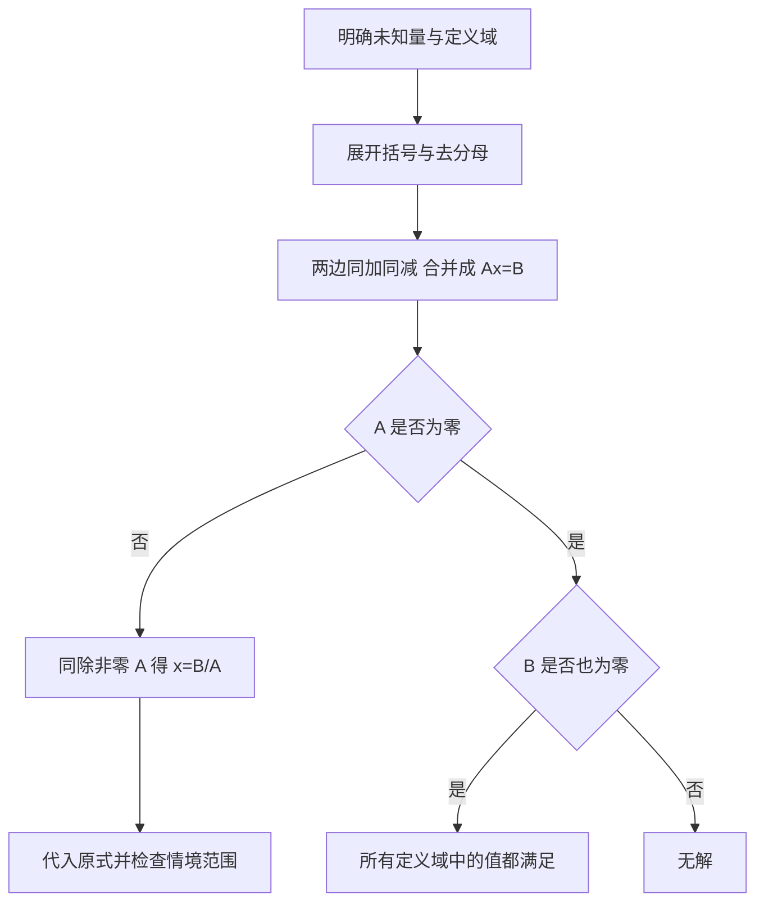

# 一元一次方程：等价变形、解集与应用

[[examples/02-math-linear-equation/README_CN|主题指南（返回）]] · [[examples/02-math-linear-equation/README|English guide]]

## 学习资源 · 分层学习与检索关键词

| 层级 | 精确关键词 | 读到什么程度 |
|---|---|---|
| 核心 | 一元一次方程；等式性质；等价变形；两边同减；系数化为1；代入检验 | 能解释3x+5=20每一行 |
| 扩展 | 去括号；分配律；去分母；最小公倍数；两边都有未知数；实际问题单位 | 独立处理括号分数并检验 |
| 进阶 | 参数方程；系数为零；无解；无穷多解；解集；可逆运算；直线交点 | 分类零系数与定义域 |

推荐阅读顺序：有理数运算 → 等式性质 → 一元一次方程 → 应用问题 → 参数与反例。

> [!note] 这份笔记与网页的关系
> 这是该主题的规范知识笔记。下面完整保留网页所有实质教学段落、折叠例题、练习答案与图示说明，并在其后补充更严谨的推导、更多例题、反例、定义域和模型边界。交互页面适合探索，笔记适合离线理解与复习。关键词用于检索，不表示任何视频已被核验。

核心形式 $ax+b=c$，$a\ne0$ 时

$$x=\frac{c-b}{a},\qquad a\cdot\frac{c-b}{a}+b=c.$$

如果 $a=0$，先比较 $b,c$，不能除以0。

## 网页完整课程材料（包含折叠解答）

### 一元一次方程 —— 等价变形与解法

从零理解等式与解集，逐步解出一次方程；遇到系数为零时能分类，并用代入与直线交点检验。

核心 25 分钟 · 扩展自学 20 分钟 · 难度 2/5 · 先修：用字母表示数、四则运算

### 1 · 前置知识：字母、负数与“等号”

把未知的数叫作 x。3x 是 3×x；x 的系数是 1，−x 的系数是 −1；常数项是不含 x 的数。表达式 3x+5 只表示一个数，方程 3x+5=20 则要求左右相等。解是使原等式成立的 x 的值，解集是所有这些值的集合。

开始前应会：5−8=−3，−2×(−4)=8，(−8)÷(−2)=4；分配律 2(x−3)=2x−6；分母不为 0。除以负数不会把等式的等号翻转，只有不等式的大小方向才需要另一套规则。

**一分钟自检：为什么 −2(x−3) 不是 −2x−6？**

−2 要乘括号里的每一项：−2×x+(−2)×(−3)=−2x+6。若 x=1，原式 −2×(−2)=4，正确展开式 −2+6=4，错误展开式 −2−6=−8。代入同一个数即可发现不等价。

本课默认 x 为实数。一元表示一个未知数，一次表示整理后 x 的最高次数为 1，且其系数不为 0。未知数可以出现多次，也可以出现在等号两边，例如 2x+1=x+4。x²+1=0、1/x=2 都不属于本课的一元一次形式。

### 2 · 完整推导：每次操作都要写两边

一般式是 ax+b=c，先说明 a、b、c 是已知实数且 a≠0。对任意候选 x，下面每一行都成立当且仅当上一行成立；这才保证既不漏解，也不添解。

① ax+b=c。

② 左右同减 b：(ax+b)−b=c−b。

③ 左边 b−b=0：ax=c−b。

④ 左右同除以非零 a：(ax)/a=(c−b)/a。

⑤ a/a=1：x=(c−b)/a。

⑥ 代回原式：a×[(c−b)/a]+b=(c−b)+b=c，左右相等。

同加与同减可以互相撤销，同乘与同除一个非零数也可以互相撤销，因此解集不变。所谓“移项变号”，只是把同加/同减及化简两行省写了；没有越过等号的项不能自行变号。

例题 3x+5=20：两边减 5 得 (3x+5)−5=20−5；化简得 3x=15；两边除以 3 得 (3x)/3=15/3；所以 x=5。检验 3×5+5=15+5=20。x=6 则左边 23，右边 20，因此不是解。

通常先减 5 再除以 3 更简洁，次序不是唯一的。也可以先把整个等式两边除以 3，得到 x+5/3=20/3，再两边减 5/3，得到 x=15/3=5。只除 3x 而不除同侧的 5，就改变了等式。

图中所有方块都代表同一个 x。先从两盘各取走 5，再把各盘平均分成 3 组；这里用正数量示意，负数仍由等式性质处理。

### 正确：两边都减 5

(3x+5)−5=20−5 → 3x=15 → x=5。

### 错误：把 +5 再加到右边

3x=25 → x=25/3；代入原式得到 3×(25/3)+5=30≠20。右边必须做同一次减法。

### 3 · 三个变化：负系数、括号、分母

**例 A · −2x−6=10：负系数照样可以除**

(−2x−6)+6=10+6 → −2x=16。

(−2x)/(−2)=16/(−2) → x=−8。

原式检验：−2×(−8)−6=16−6=10。

−6 被抵消要同加 6，不能再减 6；除以 −2 后是 −8，不能把负号丢掉。

**例 B · 2(x−3)=x+1：先正确展开，再合并**

分配律：2x−6=x+1。

两边同减 x：(2x−6)−x=(x+1)−x → x−6=1。

两边同加 6：x−6+6=1+6 → x=7。

检验左边 2(7−3)=8，右边 7+1=8。

展开必须乘每一项。2(x−3)=2x−3 是错误的，因为漏乘了常数项。

**例 C · (x−1)/3+x/2=2：为什么右边也乘 6？**

分母 3 与 2 的最小公倍数是 6，非零，可以同乘。

6×[(x−1)/3+x/2]=6×2。

6(x−1)/3+6x/2=12 → 2(x−1)+3x=12。

2x−2+3x=12 → 5x−2=12。

两边加 2：5x=14；两边除以 5：x=14/5=2.8。

原式检验：(14/5−1)/3+(14/5)/2=(9/5)/3+7/5=3/5+7/5=2。

只把左边去分母而仍令右边等于 2，会得到另一道方程。乘数作用于等式两边的每一项。

### 4 · 边界：系数变成 0 时，先分类

若原题是 ax+b=dx+c，先两边同减 dx 与 b，得到 (a−d)x=c−b。只有 a−d≠0 才能同除。未知数在整理时消失，题目就不再是非零系数的一元一次方程；这不代表算错。

**把所有参数情形分清**

条件

整理后的等式

解集与例子

a≠0

ax=c−b

唯一解 (c−b)/a；3x+5=20 → 5。

a=0 且 b≠c

0=c−b，不成立

无解；0x+5=20 → 5=20。

a=0 且 b=c

0=0，总成立

每个实数都是解；0x+5=5。

绝对不能写 x=(c−b)/0。也不能把“无穷多解”写成“x=0”：0 只是其中一个解。例如 2x+3=2x+3 在 x=−10、0、7 时都成立。

**反例：同乘 0 为什么不是等价变形？**

x=2 只有一个解。两边同乘 0 得 0=0，却让每个 x 都成立，多出了无穷多个解，所以虽然相等仍被保持，解集却被扩大了。除以含未知数的式子也应先讨论零：x²=x 的解有 0 与 1，直接除以 x 得 x=1，会丢掉 x=0。

下方计算器允许 a=0。图像画的是 y=ax+b 与 y=c：相交一次对应唯一解；平行且分离对应无解；两线重合对应每个实数都是解。它是解集的第二种检验方式。

解方程 时，第一步「两边同减 5」之后，等号左边变成什么？

墨色 = 参数；绿色 = 最终解。除以 a 前务必确认 a ≠ 0。

「移项就是变号」——这句话只描述了表面，没说清来源。本质是两边同加 / 同减：把 从左边去掉时，右边也必须同时减 。只翻符号、不加减数，等式就被你改写了。

- 掌握度 mastery ≥ 0.80

- 提示依赖 hint_dependency ≤ 0.50

- 至少 1 次在无提示条件下独立完成分步求解

- 迁移验证：能解释「移项变号」的本质

### 等价变形：从参数到解，全程可见

先用计算器建立「方程 → 解 → 数轴」的直观，再用排序和分步求解把每一步变形说清楚。

4 个交互环节 · 即时反馈 · 全部结果写入下方 Agent 输出区

拖动滑块，方程、解与数轴实时同步

y=ax+b 与 y=c 的交点横坐标就是解；a=0 时检查是否重合。

### 把四个「变形步骤」拖成正确求解顺序

可以拖拽，也可以先点卡片、再点空位（键盘用户请用后一种方式）。四个位置都放好后点「提交排序」。

### 分步求解

每一步单独判定、单独给反馈。先写出「两边同减 5」后的式子，再写出 x 的值。错误会被区分成「算错」「变形步骤用错」「把移项当符号随便变」。

第一步：两边同减 5 后，等式应写成什么？

第二步：两边同除以 3，写出 x 的值。

阶梯高度 = 支持强度。已用层级越高，hint_dependency 越高；本节点当前 0.00。

### 你做对的部分

提交任意一题后，这里会先指出你判断正确的部分。

### 卡在哪里

如果答错，这里会定位到具体的错误点，并说明缺失的是哪个概念。

### 下一步

这里会给一个你现在就能执行的动作。

transfer 与 hint_dependency 不参与 overall_score 聚合，仅作为 Policy 输入。

你已经看过完整答案。要证明你理解的是原理而不是这一段文字，请回答下面这个问题——这是本次任务结束的唯一条件。

为什么说「移项变号」的本质是「两边同加 / 同减」，而不是「把符号随便反过来」？举一个会出错的例子。

### 分层练习 · 先独立写过程，再展开完整解答

每题都写“做了什么 → 化简成什么 → 代回原式”。下列解答用于自查；读过解答不等于已经独立掌握。原有 Q2 仍检验指定的两步过程。

**基础 1 · 4x+7=23，求 x 并验证**

两边减 7：(4x+7)−7=23−7 → 4x=16。两边除以 4：x=16/4=4。检验 4×4+7=16+7=23。

**基础 2 · −3x+2=14，注意负号**

两边减 2：−3x=12。两边除以 −3：x=−4。检验 −3×(−4)+2=12+2=14。若误得 4，原式为 −10≠14。

**发展 3 · 3(2x−1)=2x+9，处理两个未知数项**

展开：6x−3=2x+9。两边减 2x：4x−3=9。两边加 3：4x=12。两边除以 4：x=3。检验左边 3(6−1)=15，右边 6+9=15。

### 发展 4 · (x+2)/4−x/6=1

先在纸上对等式两边同乘 12，再填写 x；接受整数、小数、分数或 x=…。

**发展 4 的完整解答与原式检验**

12×[(x+2)/4−x/6]=12×1。

3(x+2)−2x=12 → 3x+6−2x=12 → x+6=12。

两边减 6 得 x=6。原式 (6+2)/4−6/6=2−1=1。

错误的 3x+2−2x=12 漏乘括号中的 2；错误的 3(x+2)−2x=1 漏乘右边。

### 边界 5 · 2x+3=2x+8 有怎样的解集？

**边界 5 的完整解答**

两边同减 2x：(2x+3)−2x=(2x+8)−2x → 3=8，矛盾，所以无解。改成 2x+3=2x+3 则化简成 3=3，每个实数都是解；这时不能再除以 0。

**迁移 6 · 打车起步费 5 元，每千米 3 元，总价 20 元**

本题采用不分段、无其他收费的简化计价模型，里程 x 的单位为 km，允许非负小数。列式 5元+(3元/km)×x=20元。两边减 5元，得 (3元/km)×x=15元；再除以 3元/km，x=5km。代回总价 5+3×5=20元。系数与常数的单位必须相容。

若改为买本子：每本 3 元，运费 5 元，则本数 n 必须为非负整数；总价 21 元会得 n=16/3，这不是允许的本数。因此“实数方程有解”与“实际情境可行”要分开检验。

**诊断 7 · “3x+5=20 → x+5=20/3” 错在哪里？**

如果两边同除以 3，左边整个和都要除：(3x+5)/3=3x/3+5/3=x+5/3。正确结果是 x+5/3=20/3。可直接代 x=5 检验：错误等式给 10=20/3，不成立。

退出自测：合上解答，解 5x−2=2x+10；得到 3x−2=10 → 3x=12 → x=4，再确认左右都等于 18。最后用一句话解释为什么减去同一个数不会改变解集。

## 网页提示阶梯与指定分步题的完整材料

原有 Q2 始终是 $3x+5=20$。输入框第一步要求两边同减 5 后的等式，接受 `3x=15`、`3*x=15` 或反向等式 `15=3x`；第二步接受 `x=5`、`x=15/3` 或 `5=x`。这里检查的是题目指定步骤，不能据此宣称其他等价解法都错误。

- 引导问题：要把 $x$ 单独留下，它被系数 3 与相加的常数 5 约束。先确定要撤销哪个运算。
- 策略提示：通常先同减 5，得到 $3x=15$，再同除以 3。若先同除以 3，要把整个左边与整个右边都除，得到 $x+5/3=20/3$。
- 部分示范：$(3x+5)-5=20-5$，化简 $3x=15$；下一步是 $(3x)/3=15/3$。
- 完整答案：$x=5$；代回 $3\times5+5=20$。若已读完整答案，合上材料后独立解释一次“移项变号是两边同加或同减的简写”，再做一题数字不同的题。

排序任务采用“识别与整理 → 两边同减常数 → 两边同除以非零系数 → 化简并验证”的练习路径。它是便于初学者练习的一条路径，不是禁止交换合法步骤的定理。

## 把定义说得更严格：方程、解与等价

设定义域为实数集合 $\mathbb R$，表达式 $L(x)$ 与 $R(x)$ 分别表示左右两边。方程的解集是

$$
S=\{x\in\mathbb R\mid L(x)=R(x)\}.
$$

在同一个定义域中，两个方程等价是指它们的解集相等。不是只检查一个你喜欢的 $x$，而是对所有合法候选值都要成立当且仅当。$3x+5=20$ 与 $3x=15$、$x=5$ 都有同一个解集 $\{5\}$。$x=5$ 与 $x^2=25$ 不等价，因为后一式还允许 $-5$。

> [!important] 等号与解集是两层判断
> 同乘零确实会把一个已成立的等式变成已成立的等式，但它不可逆，因此可能增加解。等价变形不仅要让旧解继续满足，也要防止新解混进来。

等式两边同加一个已知实数 $k$ 后，$L+k=R+k$。再同减 $k$ 可恢复 $L=R$。同乘非零 $k$ 后，$kL=kR$，再除以 $k$ 可恢复。这就是“可逆”的具体意思。除法要先确认除数非零，而不是等算出除以零时才处理。

## 从运算链反向拆解，而不是背“移项”

$ax+b=c$ 把未知量依次“乘以 $a$、加 $b$”后得到 $c$。求解便反向“减 $b$、除以 $a$”。这与解一个输入输出装置很相似：先撤销最后做的操作。比如 $4x-7=9$，最后做的是减 7，所以先同加 7，再同除以 4。

$$
\begin{aligned}
4x-7&=9\\
4x-7+7&=9+7\\
4x&=16\\
\frac{4x}{4}&=\frac{16}{4}\\
x&=4.
\end{aligned}
$$

检验 $4\times4-7=9$。即使 $b$ 为负数，仍可用同减 $b$ 的统一表述：$c-b=9-(-7)=16$。不要把 $9-(-7)$ 错算成 2。

> [!tip] 看不清符号就写完整一行
> $-2x-6=10$ 中同加 6 可以写成 $(-2x-6)+6=10+6$。这样能够看见相消的 $-6+6$，比孤立记忆“负变正”更稳妥。

## 更完整的括号题与小数题

### 例 8：两层括号 $3[2(x-1)+1]=2x+11$

先处理内括号：$2(x-1)=2x-2$，加 1 后为 $2x-1$。再分配外部 3，得到 $6x-3=2x+11$。两边同减 $2x$ 得 $4x-3=11$；两边同加 3 得 $4x=14$；两边同除以 4 得 $x=7/2$。

代回：左边 $3[2(7/2-1)+1]=3[2(5/2)+1]=3(5+1)=18$，右边 $2(7/2)+11=7+11=18$。正确展开不允许漏乘任何括号内项。

### 例 9：小数 $0.3x+0.7=2.2$

两边同乘 10：$3x+7=22$，因为 $10\times0.3x=3x$、$10\times0.7=7$、$10\times2.2=22$。两边同减 7 得 $3x=15$；同除以 3 得 $x=5$。检验 $0.3\times5+0.7=1.5+0.7=2.2$。同乘 10 是减少小数计算的一种选择，直接同减 0.7 再同除以 0.3 也合法。

### 例 10：有负号的分数 $\frac{x-2}{3}-\frac{x+1}{2}=1$

两边同乘 6：$2(x-2)-3(x+1)=6$。展开每个括号，特别保留第二项前的负号：$2x-4-3x-3=6$。合并得到 $-x-7=6$；两边同加 7 得 $-x=13$；同除以 $-1$ 得 $x=-13$。

原式检查：$(-13-2)/3-(-13+1)/2=-15/3-(-12/2)=-5-(-6)=1$。若把 $-3(x+1)$ 写成 $-3x+3$，那是负号没有作用于整个括号。

## 参数方程：必须先讨论，不能“除完再补”

### 例 11：$(k-2)x=6$

- $k\ne2$ 时，系数非零，唯一解 $x=6/(k-2)$。
- $k=2$ 时，原式成为 $0x=6$，也就是 $0=6$，无解。

如果只给出 $6/(k-2)$ 而不写 $k\ne2$，答案不完整。代 $k=5$ 可得 $x=2$，检查 $(5-2)\times2=6$。

### 例 12：$(k-2)x=k-2$

- $k\ne2$ 时，两边同除以 $k-2$，得到 $x=1$。
- $k=2$ 时，两边都为 0，每个实数都是解。

这里同一个参数同时控制系数与常数，若直接约去 $(k-2)$，会丢掉恒等情形。边界分析不是可有可无的附注，而是完整答案的一部分。

> [!warning] 含未知数的分母是另外一类问题
> $\frac{x+1}{x-2}=3$ 的定义域先排除 $x=2$。虽然乘去分母后得到一次式，但原题属于分式方程，需要检查得到的值是否在定义域内。不能仅凭整理后的次数就忽略原题的限制。

此反例的详细解法：$x\ne2$，两边同乘非零的 $x-2$ 得 $x+1=3x-6$；同减 $x$、同加 6 得 $7=2x$，所以 $x=7/2$。它不等于 2；代回 $(7/2+1)/(7/2-2)=(9/2)/(3/2)=3$。

## 直线交点与检验的局限

用 $y=ax+b$ 与 $y=c$ 画图，交点满足同一个 $x$ 下两函数值相等，因此交点横坐标就是方程解。$a\ne0$ 时一条斜线与一条水平线相交一次。$a=0$ 时两线都是水平线：$b\ne c$ 分离，无交点；$b=c$ 重合，每个横坐标都有交点。

图上的像素与标签常经过舍入，画图可以解释结构，但精确分数仍应由代数得到。比如 $3x=1$ 的精确解是 $1/3$，页面标签可能显示 0.33，代回 $3\times0.33=0.99$ 只是舍入误差，不能把 0.33 当作精确解。用精确分数检验 $3\times(1/3)=1$。

一次成功的代入证明“这个数是一个解”，不能独立证明“没有其他解”。唯一性来自非零系数下的可逆推导。对高次方程尤其不要把找到一个解当作找齐所有解。

## 应用题：量与单位必须相容

### 例 13：长方形周长 30cm，宽 6cm

设长为 $x$cm，长方形周长为 $2(x+6)$cm，列式 $2(x+6)=30$。同除以 2 得 $x+6=15$；同减 6 得 $x=9$。检验 $2(9+6)=30$cm，且长 $9$cm 大于 0，满足几何情境。

不能把面积 $6x$ 与周长 30 相等，因为单位 cm² 与 cm 不同。选择表达式之前要解释它代表哪个量。

### 例 14：温度转换

华氏温度 $F$ 与摄氏温度 $C$ 的数值关系是 $F=\frac95C+32$。已知 $F=68$，同减 32 得 $36=\frac95C$；再同乘 $5/9$ 得 $C=20$。代回 $(9/5)\times20+32=68$。这里公式是固定单位下的数值转换，不能把单位直接当纯数字任意相加。

### 例 15：整数情境与实数解

每张票 8 元，固定手续费 3 元，总价 43 元，令票数 $n$ 为非负整数。$8n+3=43$ → $8n=40$ → $n=5$，情境可行。若总价 45 元，则 $n=42/8=5.25$，实数方程有唯一解，但不能买 5.25 张票，情境无可行整数解。

## 错误对照：观察结果，然后定位规则

| 原操作 | 错误结果 | 正确结果 | 定位方法 |
|---|---|---|---|
| $3x+5=20$ 同减 5 | $3x=25$ | $3x=15$ | 右边必须 $20-5$ |
| $3x+5=20$ 同除 3 | $x+5=20/3$ | $x+5/3=20/3$ | 左边每项都除 |
| $-2(x-3)$ 展开 | $-2x-6$ | $-2x+6$ | 负乘负得正 |
| $\frac{x-1}{3}+\frac x2=2$ 同乘 6 | $2(x-1)+3x=2$ | $2(x-1)+3x=12$ | 右边也乘6 |
| $0x=0$ 分类 | 只有 $x=0$ | 每个实数成立 | 代入任意值 |
| $x=2$ 同乘0 | 认为与 $0=0$ 等价 | 解集已扩大 | 无法除0还原 |

> [!example]- 两条解法对照：$6x+12=30$
> 路径一：同减12得 $6x=18$，同除6得 $x=3$。
>
> 路径二：两边整个除6得 $x+2=5$，再同减2得 $x=3$。
>
> 两条路径都可逆且非零除数合法。代回都给 $6\times3+12=30$。指定练习步骤与数学上所有合法步骤要区别理解。

## 自测与完整解答

1. $7x-4=17$：同加4得 $7x=21$，同除7得 $x=3$；检验 $21-4=17$。
2. $5-2x=13$：同减5得 $-2x=8$，同除 $-2$ 得 $x=-4$；检验 $5+8=13$。
3. $4(x+2)=3x-1$：展开 $4x+8=3x-1$，同减 $3x$、同减8得 $x=-9$；左右均为 $-28$。
4. $\frac{x}{5}+\frac{x}{2}=7$：同乘10得 $2x+5x=70$，所以 $x=10$；检验 $2+5=7$。
5. $4x+1=4x-2$：同减 $4x$ 得 $1=-2$，无解。
6. $3(x+1)=3x+3$：展开后左右完全相同，每个实数是解。

> [!question]- 复习时请先遮住答案
> 你能用“同加 / 同减 / 同乘或同除非零数”描述每一行吗？你能说出 x 的定义域和实际单位吗？结果代回的是最初方程吗？未知数消失后，你能区分矛盾与恒等吗？

后续阅读可连接 [[examples/04-physics-free-fall/knowledge|自由落体]]：求 $T^2=2H/g$ 的过程中也使用了同乘与同除，但平方根引入正负分支，物理时间又限制 $T\ge0$，因此不能把“一次方程的唯一解”机械迁移到平方方程。

## 网页资源的完整检索串

- 一元一次方程 等式性质 等价变形 两边同减 系数化为1 代入检验
- 一元一次方程 去括号 分配律 去分母 最小公倍数 实际问题 单位与取值范围
- 参数方程 系数为零 无解 无穷多解 解集 等价变形 可逆运算 直线交点

## 作答与宿主审核边界

所有自由文本解释（包括读过完整答案后的后置验证）只保留原始作答，等待宿主的语义审核。关键词是否出现、文字是否够长都不能证明推理正确；页面不因此提交推理评分或结束验证。数值一致也只能证明输入与参考数值相容，不能证明纸上步骤正确。展开完整答案后的验证区会继续保留，防止重新抄写原题数字跳过验证。

后置验证的精确界面反馈：解释已记录，待宿主语义审核。请对照：移项是等式两边同加/同减的简写，并用原式代入检验你的反例；本页不根据关键词或字数判断解释正确。

指定第一步的诊断：这个框检查题目指定的第一步“两边同减5”后的完整等式，应写3x=15。直接写x的值没有展示这一步；其他完整、可逆的求解路径也可以在数学上成立。

### 图示五步的逐行说明

1. 3x+5=20：识别系数3与左边常数项5。
2. 从左右各减5：(3x+5)−5=20−5，左右取走相同数量。
3. 化简得3x=15；三个相同x的总量是15。
4. 左右各除以非零3：x=5。除法可逆。
5. 代回最初方程，3×5+5=20，检验成立。

参数变化时：a=0且b≠c显示无解；a=0且b=c显示所有实数；a≠0计算精确的(c−b)/a，再只对显示标签舍入。负系数例a=−2、b=−6、c=10得到−8。

## 资料证据与核验范围

2026-10-10 已实际读取 OpenStax 的 [Intermediate Algebra 2e §2.1 Use a General Strategy to Solve Linear Equations](https://openstax.org/books/intermediate-algebra-2e/pages/2-1-use-a-general-strategy-to-solve-linear-equations)，页面返回 HTTP 200。核验位置为 General Strategy、Identity、Contradiction 三段。原文指出：“Check the solution. Substitute the solution into the original equation to make sure the result is a true statement.” 并明确：“The solution of an identity is all real numbers.”、“A contradiction has no solution.”

这支持本课的同加/同减与系数归一流程、代入原式检查、恒等与矛盾分类。分数、计价、参数等例题为本课自编，逐项用代入或分类验证；没有据此声称对齐某特定考试大纲，也没有读取或推荐视频内容。

## 网页投影导读与静态标签
这一附录对照图内标注、按钮、选项、原始任务标签与运行状态。它让离线笔记也能解释交互投影的每个文字节点；完整推导与例题均已在前面的课程正文展开。

- 跳到教学内容
- 数学 · 代数 · 一元一次方程 ax+b=c
- EVIDENCE STAGE · 证据阶段
- practiced · 练习过
- MASTERY · 掌握度
- 0.55
- NEXT REVIEW
- 5 天后 · 09/24
- 本页尚未连接 Runtime；掌握度与证据阶段保持初始占位值，作答评分仅为待核验反馈。
- 学习资源 · 先确定要学什么，再用关键词查资料
- 本页给出可独立阅读的完整推导。离线复习与更多反例见
- 一元一次方程知识笔记
- ，学习路线见
- 核心 · 先学
- 目标：会解释 3x+5=20 的每一步。
- 扩展 · 熟练后
- 目标：处理括号、分数、两边都有未知数。
- 进阶 · 边界与迁移
- 目标：判断何时不能除，并用图像核验。
- 这些是准确的检索词，不是已核验的视频推荐。优先对照教材中“等式的性质”与“一元一次方程”两节。
- 01 · TEACHING · 教学内容
- 等式天平与同步操作
- 相等：同样的总量
- 方块代表未知量；圆点每个代表 1
- 上一步
- 回到原式
- 高亮两边相同操作
- 比较错误移项
- 第 1/5 步：3x+5=20。先识别系数 3 与常数项 5。
- x=5，检验 20=20
- 原式左边 30
- CHECKPOINT · 理解检查
- A. 只剩
- B. 变成
- KEY FORM · 关键式子
- a·x + b = c　（a ≠ 0）
- MISCONCEPTION · 常见误解
- REQUIRED EVIDENCE · 达标要求
- 02 · PRACTICE · 交互练习
- STAGE · EQUIVALENT TRANSFORMATION EXPLORER
- 实线：
- 虚线：y=c
- 重置默认
- Tab 聚焦滑块　·　← → 调整数值
- Q1
- ORDER · 求解顺序（第 1 → 第 4 步）
- SOURCE · 变形步骤（可拖拽）
- 全部取回
- 检查第 1 步
- 把等号两边都减去 5：左边
- 。所以应得到
- 检查第 2 步
- 的两边同除以 3：
- PROGRESSIVE DISCLOSURE · 提示阶梯
- 每一级都必须由你主动点击——它会被记为你的提示依赖
- ① 引导问题
- 只给方向
- ② 策略提示
- 给思路
- 给前半段
- ④ 完整答案
- 需二次确认
- 等待作答
- ASSESSMENT · 多维评分
- POST-VERIFICATION · 后置验证（完整答案后必做）
- 提交自我解释
- EVIDENCE TRAIL · 本次会话事件
- 已产生 0 条事件（只追加，不覆盖）
- 尚无事件
- 运行
- 你求出的 x
- 检验分数题
- 先同减 2x，再分类
- 请选择
- 唯一解 x=5
- 所有实数都成立
- 检查分类
- 03 · AGENT OUTPUT · 数据输出
- 交给宿主 Agent 的交互结果
- 这一区不是调试信息，而是学习者本次会话的完整档案。宿主 Agent 通过它驱动下一轮教学决策。
- BRIDGE · 演示模式
- 未接入宿主 Agent；学习动作会累积为待执行的 MCP 调用。
- 取出调用队列 ▾
- AGENT OUTPUT · 已记录 0 条事件
- 展开 JSON ▾
- LEAP‑V2 分学科前端示例 · 示例 2（数学 / 一元一次方程）　·　node_id
- math.algebra.linear_equation
- ·　unit_tag
- 单文件零依赖 · 零 CDN · 零外部图片 · 全部图形为内联 SVG / DOM 绘制　·　结构规范见
- examples/_shared/leap-web-spec.md
- ，视觉规范见
- LEAP_视觉设计理念_给Gemini.md

Related: [[Knowledge_Index]] · [[docs/teaching-delivery]]

<!-- LEAP_BACKLINKS -->

## Backlinks / 反向关联

[[Knowledge_Index]] · [[curricula/math1-2028-ch01/README]] · [[docs/subject-knowledge-map]] · [[examples/02-math-linear-equation/README]] · [[examples/02-math-linear-equation/README_CN]] · [[examples/04-physics-free-fall/README]] · [[examples/04-physics-free-fall/README_CN]] · [[examples/04-physics-free-fall/knowledge]] · [[examples/08-electronics-ohms-law/knowledge]]
