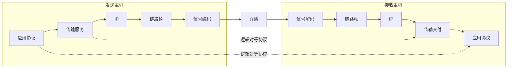
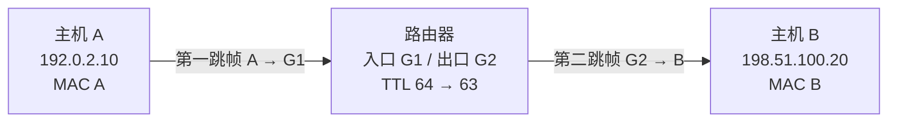

# OSI 七层模型：职责、边界与跨网封装

## 分层学习资源关键词

| 层级 | 可复制的搜索关键词 | 学习目标 |
|---|---|---|
| 核心 / 必看 | OSI 七层模型 每层职责；TCP IP 与 OSI 区别；MAC IP 端口 区别；计算机网络 封装 解封装 | 说出职责、地址与数据单元，避免只背层号 |
| 拓展 / 辅助 | 以太网 帧头 帧尾 FCS；路由器 每一跳 MAC 地址 TTL；HTTP TCP IP 分层 Wireshark | 看见两跳中帧改变、IP 转发与端点交付 |
| 进阶 / 深入 | ISO IEC 7498-1 OSI reference model；RFC 1122 Internet layers；RFC 791 TTL；RFC 9293 TCP；QUIC UDP TLS layering | 理解参考模型与实际协议的差异 |

可在 B 站、大学公开课平台或搜索引擎检索这些词；它们是检索关键词，不是已核验的视频推荐。优先选择会说明“网卡与以太网涉及多个功能层”“路由器重新封装帧”的材料。

导航：[[examples/03-cs-osi-model/README_CN|中文使用说明]] · [[examples/03-cs-osi-model/README|English guide]] · [[examples/README_CN|示例总索引]] · [[examples/06-statistics-probability/knowledge|另一类模型边界：条件概率]]。

> [!abstract] 本稿与交互页的关系
> 本稿是该示例的完整教学知识稿：覆盖网页先修、七层职责、模型边界、100 byte 两跳封装、全部递进练习、提示和完整解答，并补充协议推导与更多反例。交互页是离线操作工具，笔记是可在 Obsidian 中检索、链接和复习的内容底稿。

## 学习目标与推荐路线

完成本课后应能：

1. 区分 bit/byte、MAC/IP/端口，以及协议、服务、接口。
2. 从具体功能解释七层职责，并指出现实协议/设备不保证与七层一一对应。
3. 把八张限定功能卡片归入正确层级。
4. 沿主机 A → 路由器 → 主机 B，说明 TCP 段、IP 数据报、链路帧和物理信号的关系。
5. 独立核对头部/尾部计数、逐跳 MAC、端到端 IP 与 TTL。
6. 用观察证据提出可检验的排错假设，区分“网络可达”与“应用可用”。

推荐 35–50 分钟：先读先修 → 点击七层 SVG → 完整走一次两跳动画 → 匹配 → 职责辨析 → 字节变式 → 排错说明。看过完整解答后，仍需完成新的后置验证。网页的本地评分仅为待核验练习证据；掌握度、证据阶段与节点推进由 Runtime 决定。

## 一、先修概念

### 1. 比特、字节与控制信息

比特（bit）是 0 或 1；8 bit 组成 1 byte。本例的长度单位是 byte，不是 bit。数据在介质上用电压、光强或无线信号等编码表示，因此“介质上跑的是原样数字 0 和 1”是抽象说法，接收端依据约定恢复比特。

**载荷（payload）**是某层承载的上层数据。**头部（header）**通常位于载荷前，包含地址、端口、长度等控制信息；某些协议还有**尾部（trailer）**，例如以太网 FCS。下层看到“上层数据”时，其中可能已经包含更上层的控制信息。

### 2. 协议、服务、接口

| 概念 | 含义 | 示例 |
|---|---|---|
| 协议 | 对等实体遵守的消息格式与处理规则 | 客户端与服务器遵守 HTTP；两个 TCP 端点遵守 TCP |
| 服务 | 某层向上层提供的能力 | TCP 向应用提供有序可靠字节流 |
| 接口 | 同一主机上下层交换数据的方式 | 应用通过 socket 接口使用传输服务 |

同层协议通信是**逻辑关系**。实际字节仍须向下交给相邻层，经介质传输，再由对端向上交付。把逻辑关系画成“两个 L7 直接拉一根物理线”会误读分层图。

### 3. 三种“送到哪里”

| 标识 | 主要职责 | 不能推出的结论 |
|---|---|---|
| MAC | 典型以太网中当前链路的帧转发 | MAC 不会自动告诉你 Internet 上最终服务器在哪；不保证永远端到端不变 |
| IP | 网络层的逻辑源/目的，支持跨网路由 | IP 可达不代表某个应用端口和业务可用；IP 地址也不等于个人身份 |
| 端口 | 传输协议中的通信端点交付 | 端口不是进程的永久身份证；同一进程可用多个端口/连接 |

判断某条通信通常还需要传输协议、源/目的 IP 和源/目的端口，而不只是某一个端口数字。这里选用目的 TCP 端口 80 描述明文 HTTP 示例；并非所有 HTTP 都使用 TCP/80，HTTP/3 使用 QUIC/UDP 等实际协议组合。

### 4. 数据单元

| 数据单元 | 本例结构 |
|---|---|
| 应用数据 | 100 byte HTTP 数据 |
| TCP 段 segment | TCP 头 + 应用载荷 |
| IP 数据报 datagram / 包 packet | IP 头 + TCP 段 |
| 以太网帧 frame | 以太网头 + IP 数据报 + FCS |
| 比特/信号 | 帧对应比特在介质上的编码表示 |

UDP 一般称数据报，不称 TCP 段。“包”在日常表达可能泛指多个层的数据单元，所以严谨解释时先说明层次。

## 二、为何分层

一次通信同时需要：应用语义、数据表示、会话管理、通信端点交付、跨网逻辑寻址、当前链路传输、物理信号。OSI 用七层参考模型拆分职责，使实现可以借助下层服务向上层提供能力，并借助约定的接口协作。

收益包括职责分离、技术替换、模块协作与故障定位；分层本身**不保证更快**，也不要求每层恰好一个独立程序。换链路技术可以尽量保留上层接口，但实际性能、MTU、时延和可靠性等特性可能改变，不能解释成“任何下层变化绝不影响上层”。

> [!question] 网页理解检查
> OSI 分层最直接解决什么问题？
> A. 通过服务和接口拆分职责，便于替换技术与定位故障。
> B. 保证每次通信都有七个包头，而且总比四层模型更快。

> [!success]- 理解检查解答
> A 正确。B 把参考模型、实现模块和性能保证混在一起。下一步通过 TCP 段、IP 数据报、帧的具体组成核对“分层”所表达的职责。

## 三、七层职责、实例与边界

| 层号 | 中文 / 英文 | 主要职责 | 常见实例或功能 | 易误读的边界 |
|---|---|---|---|---|
| L7 | 应用 Application | 面向应用的网络服务与消息语义 | HTTP、DNS、SMTP | 不等于用户界面；DNS 用 TCP/UDP 承载不改变其应用服务职责 |
| L6 | 表示 Presentation | 表示语法、编码转换、压缩、加解密等 | 数据表示与转换功能 | Internet 不保证独立 L6；所有加密并非只能属于 L6 |
| L5 | 会话 Session | 对话组织、会话建立/管理、同步等 | 会话与对话管理功能 | 应用登录状态、TCP 连接、OSI 会话不是同一概念 |
| L4 | 传输 Transport | 通信端点之间的传输能力 | TCP、UDP | TCP 不保证应用事务成功；UDP 不保证更快 |
| L3 | 网络 Network | 逻辑寻址、跨网转发、路由 | IP、路由器 IP 转发 | IP 尽力而为，不保证交付/顺序/无重复 |
| L2 | 数据链路 Data Link | 一条链路上的帧、介质接入与检错等 | 以太网 MAC、二层交换机帧转发 | 链路检错不是端到端可靠；多层设备可有更多职责 |
| L1 | 物理 Physical | 把比特编码为介质信号；编码/时序/收发 | 网卡 PHY、光纤、收发器等 | 不添加统一的“H1 包头”；网卡不只有 L1 功能 |

### 1. 上三层：职责不等于独立包头

现实 Internet 协议栈中，应用程序、库和协议可一起完成 OSI 上三层的相关职责。TLS 通常位于应用与传输之间，并提供加密等能力，但不能机械说“TLS 就是独立 L6，因此每个 HTTPS 包固定有七层头”。隧道、链路加密或应用加密也提醒我们：先描述功能与协议位置，再谈模型归类。

TCP 连接是传输层状态；登录状态可以保存在应用 cookie、token 或服务器数据中，两者生命周期并不相同。因此“一次登录就是 OSI 会话层”“断 TCP 就必然注销应用”都过强。

### 2. TCP 与 UDP

TCP 提供有序可靠字节流，使用序号、确认、重传等机制，并有流量/拥塞控制。字节流意味着 TCP 不保留应用消息边界：应用的两次写入可能被组合，同一次写入也可能分成多个 TCP 段。因此本例“100 byte HTTP 数据一个段”是明确的教学简化，不是 TCP 的普遍承诺。

UDP 保留数据报边界，但不提供 TCP 式连接、重传和排序保证。应用或其他协议可在 UDP 上实现所需机制。低开销可以是选择 UDP 的理由之一，不能推出所有环境中 UDP 必然更快、延迟必然更低。

“TCP 可靠”指传输服务，不是保证所有故障都可消除，也不是应用事务成功保证。连接可能失败；应用仍需解释响应、处理超时、状态与业务语义。

### 3. 链路层与物理层

以太网技术包含帧/MAC 等链路功能，也包含物理规范；普通网卡通常涉及 MAC 与 PHY 两类功能。“以太网属于哪层”或“网卡属于哪层”如果不给具体功能，问题不充分。

本课卡片刻意写为：

- **以太网帧 / MAC 功能 → L2**。
- **二层交换机帧转发 → L2**。
- **网卡 PHY 收发器把比特变成信号 → L1**。

这不是否认设备跨层，而是限定该题判定的功能范围。多层交换机可以有 L3 路由功能；路由器也有链路接口和物理收发功能，不能解释成“路由器只有 L3”。

## 四、OSI 与 Internet 分层

| OSI 七层职责 | 常见 Internet 四层描述 | 常见教学五层描述 |
|---|---|---|
| L7/L6/L5 应用相关职责 | 应用 | 应用 |
| L4 传输 | 传输 | 传输 |
| L3 网络 | Internet / 网络 | 网络 |
| L2 链路 + L1 物理 | 链路 | 链路 + 物理 |

这是教学上的职责对应，而不是规范要求每个协议精确落入唯一 OSI 格子。OSI、Internet 四层与教学五层的用途和抽象不同，使用前先说明模型。

> [!warning] 归层题的正确问法
> 先问“哪个模型”“哪个协议/设备功能”“什么场景”。HTTP 消息语义、IP 路由、MAC 帧转发和 PHY 编码是比整个品牌或设备名更可靠的归层对象。

## 五、完整封装例子：100 byte HTTP 跨两条以太网链路

### 1. 明确假设

本例是教学用受控演示：

- 已经存在 TCP 连接，仅观察一段 100 byte 的明文 HTTP 应用数据。
- IPv4，无 TCP/IP 选项，无 NAT、IP 分片、VLAN、隧道。
- 两条链路均为以太网；不模拟 ARP、握手、ACK、重传、拥塞或信号波形。
- 应用数据恰好放在一个段中只是示例假设。
- 帧长度从以太网头计到 FCS，不计前导码/SFD、帧间间隔。

| 主体 | 本例值 |
|---|---|
| 发送主机 A | IP 192.0.2.10；MAC A；源 TCP 端口 53000 |
| 路由器入口 | MAC G1 |
| 路由器出口 | MAC G2 |
| 接收主机 B | IP 198.51.100.20；MAC B；目的 TCP 端口 80 |
| IPv4 TTL | 发送 64，经过该路由器后 63 |

这里 IP 地址使用文档示例网段；MAC A/G1/G2/B 是便于教学的符号，并非真实 MAC 地址。

### 2. 发送端封装

HTTP 产生应用数据 $D$。TCP、IPv4 与以太网按各自协议添加控制信息：

$$
S_{TCP}=H_{TCP}\Vert D
$$

$$
D_{IP}=H_{IPv4}\Vert H_{TCP}\Vert D
$$

$$
F_1=H_{Eth}(A,G1)\Vert H_{IPv4}(TTL=64)\Vert H_{TCP}\Vert D\Vert FCS_1
$$

符号 $\Vert$ 表示连接各字段；这里并不表示所有协议的真实字节排序只有这一个模式。

1. L7：产生 100 byte HTTP 应用数据。
2. L4：加 20 byte TCP 头，含源/目的端口、序号等，段长 120 byte。
3. L3：加 20 byte IPv4 头，含源/目的 IP、TTL 等，数据报长 140 byte。
4. L2：目的不在本地子网，下一跳是网关；帧源 MAC A、目的 MAC G1。加 14 byte 头与 4 byte FCS，帧长 158 byte。
5. L1：把帧对应的比特编码为信号传送。物理层不是再在帧外套一个“H1 包头”。

### 3. 路由器的关键变化

入口链路处理收到的帧，网络层依据目的 IP 选择路由/出口，并更新 TTL、IPv4 首部校验和。路由器为了转发不需要解包到 TCP 或 HTTP。出口重新构建适用于当前下一跳的帧：

$$
F_2=H_{Eth}(G2,B)\Vert H'_{IPv4}(TTL=63)\Vert H_{TCP}\Vert D\Vert FCS_2
$$

| 字段 | 第一跳 | 第二跳 | 原因 |
|---|---|---|---|
| 源/目的 MAC | A / G1 | G2 / B | 链路封装逐跳变化 |
| 源/目的 IP | 192.0.2.10 / 198.51.100.20 | 相同 | 本例无 NAT/隧道 |
| TTL | 64 | 63 | IP 转发时减少 |
| IPv4 首部校验和 | 原值 | 更新 | IPv4 头内容发生变化 |
| TCP 源/目的端口 | 53000 / 80 | 相同 | 本例无端口转换 |
| FCS | 第一跳帧校验 | 第二跳重算 | 帧内容变化且链路重新封装 |

“IP 地址端到端保留”是本例假设下的结论，不是所有网络的绝对规则。NAT 可以改变地址/端口，隧道可以增加外层 IP 头。IPv6 使用 Hop Limit，且没有 IPv4 那种首部校验和，不应把本例的 IPv4 处理硬套到 IPv6。

### 4. 最终接收端解封装

1. 物理处理恢复信号中的比特与帧。
2. 链路层处理目的帧、检错、去链路控制信息，将 IP 数据报交上层。
3. 网络层确认本机交付并将 TCP 段交给相应协议；本例无分片。
4. TCP 按校验、序号、端点等处理，向目的应用提供有序字节流。
5. HTTP 解释应用消息。收到字节并不等于业务成功；HTTP 状态码、内容和应用逻辑仍要处理。

### 5. 长度推导与计数边界

$$
L_{TCP}=100+20=120\ \text{byte}
$$

$$
L_{IP}=120+20=140\ \text{byte}
$$

$$
L_{frame}=140+14+4=158\ \text{byte}
$$

常见以太网 MTU 1500 约束的是载荷（本例的 IP 数据报），不是把帧头/FCS 加在一起的帧总长。前导码/SFD、帧间间隔还会影响线路占用，但没有计入本题的 158 byte。因此描述带宽效率必须声明计数范围。

> [!example]- 拓展：更短载荷为何不能直接照抄相加
> 常见以太网帧有最小长度要求。若上层载荷不足，链路帧会使用填充以满足最小载荷长度。教学例的 140 byte IP 数据报足够长，所以不需要填充；不能把任意小 $D$ 都用 $D+20+20+14+4$ 当作最终帧长。

> [!example]- 拓展：TCP/IP 选项与 VLAN
> 20 byte TCP 头与 20 byte IPv4 头都是本题无选项的假设；有选项时头部可能变长。VLAN 标签会改变链路头部计数；不同链路技术也未必采用以太网的 14+4。先检查协议参数，再计算。

## 六、网页动画的 13 个步骤

| 步骤 | 当前设备 / 层 | 当前数据单元 | 观察重点 |
|---|---|---|---|
| 1 | A / L7 | HTTP 数据 | 应用语义 |
| 2 | A / L4 | TCP 头 + 数据 | 端口、序号，120 byte |
| 3 | A / L3 | IPv4 头 + TCP 段 | IP、TTL 64，140 byte |
| 4 | A / L2 | 第一跳帧 | A/G1，158 byte |
| 5 | A / L1 | 帧对应信号 | 不新增 H1 头 |
| 6 | 路由器 / L2 | 去入口帧后的 IP 数据报 | 入口链路信息不保留 |
| 7 | 路由器 / L3 | 更新 IP 头的 IP 数据报 | TTL 63、头校验和；TCP 头仍在 |
| 8 | 路由器 / L2 | 第二跳帧 | G2/B，重算 FCS |
| 9 | 路由器 / L1 | 新帧对应信号 | 发送第二条链路 |
| 10 | B / L2 | IP 数据报 | 检错与去链路控制信息 |
| 11 | B / L3 | TCP 段 | 本机交付 |
| 12 | B / L4 | 应用字节 | TCP 处理、上交端点 |
| 13 | B / L7 | HTTP 数据 | 应用解释，非业务成功保证 |

动画提供播放/暂停、单步、上一步、重置。倒退根据固定状态快照重建包结构，因此不会因“补回错误头部”而损坏状态。键盘控制仅在封装控制区使用：←/→ 单步，控制区本身获得焦点时空格播放/暂停；它不会夺走输入框或其他按钮的键盘行为。

## 七、对比与误区

| 误区 | 更准确的说法 |
|---|---|
| 七层一定有七个头 | 具体协议决定头/尾与变换；L1 编码不新增统一头部 |
| UDP 永远比 TCP 快 | 不提供相同保证、开销不同；性能取决于场景与实现 |
| TCP 可靠，所以网页一定成功 | TCP 传输字节；DNS、TLS、HTTP 与业务逻辑还有各自条件 |
| 网卡只在物理层 | 常见网卡涉及 MAC 与 PHY；本题只把 PHY 功能归 L1 |
| 所有交换机只在 L2 | 二层帧转发属 L2，多层交换机还能有 L3 功能 |
| 路由器一定去掉 TCP 头 | 正常 IP 转发保留上层载荷；可能另行检查/改写不能混为基本转发 |
| IP 地址永远不变 | 本例无 NAT/隧道；更复杂路径可有改写或外层封装 |
| 链路 FCS 保证端到端可靠 | FCS 检错不等于修复；完整交付还涉及其他层机制 |
| ping 通就证明网页可用 | ICMP 可达不直接证明 DNS、TCP 端口、TLS、HTTP 或应用事务成功 |
| 分层越多越快 | 分层的直接价值是职责与接口解耦，不是层数带来速度 |

## 八、递进练习、提示与解答

### Q1 入门：八张限定功能卡片归位

把以下卡片归入 OSI 层：HTTP 消息语义、DNS 域名解析、TCP 端点字节流、IP 寻址与转发、路由器 IP 跨网转发、以太网帧/MAC、二层交换机帧转发、网卡 PHY 比特→信号。

> [!tip]- L1 引导
> 先问每张卡片是在解释应用消息、交付端点、选择 IP 路径、转发 MAC 帧，还是编码物理信号。

> [!tip]- L2 策略
> 按“应用服务 → 端点传输 → 跨网 IP → 当前链路 MAC → 物理信号”分组，不给整个设备贴唯一层号。

> [!tip]- L3 部分示范
> HTTP/DNS 是应用服务，TCP 属传输，IP 与路由器 IP 转发属网络。剩下两类根据帧与信号判断。

> [!success]- 完整解答
> HTTP/DNS → L7；TCP → L4；IP/路由器 IP 转发 → L3；以太网帧/MAC、二层交换机帧转发 → L2；网卡 PHY 收发器 → L1。L5/L6 本题没有对应卡片，因为本题并不要求每层恰好一张卡片。

网页支持拖拽或“先选卡片、再选目标”的键盘可达方式；同一层可多张；已放卡片可移动；全部取回可清空归位。未放完会提示未完成，提交完整映射后按正确数量给部分分。原始映射以完整 JSON 保留，而不只记录“7/8”。

### Q2 观察：中间路由器到底处理到了哪里

在动画第 4、7、8、13 步暂停，各回答：

1. 当前数据单元是什么？
2. TCP 头是否仍在？
3. 目的 MAC 与目的 IP 分别是谁？
4. 为什么不会需要一个“H1 包头”？

> [!success]- 完整观察解答
> 第4步是第一跳帧，TCP/IP 头都在，MAC目的G1而IP目的B。第7步是更新后的IP数据报，TCP头仍在，TTL63；路由器按IP转发不需要去掉TCP头。第8步换成G2/B的第二跳帧。第13步应用获得原HTTP字节。L1只是帧比特的物理编码，不是再添加统一协议包头。

### Q3 辨析：三个明确的选择题

1. 路由器按目的 IP 跨网转发的功能属于哪层？选项：L1、L2、L3、L4。
2. TCP 提供可靠字节流、流量控制与端口复用，主要归哪层？选项：L7、L4、L3、L2。
3. 关于封装哪个陈述准确？A 发送封装一次后不再改变；B 采用协议可添加头/尾，具体由协议决定；C 解封装从应用到物理逐层加头；D 物理层添加 IP 头。

> [!success]- 完整解答与错因
> 1 选L3，依据是目的IP与跨网转发；误选L2混淆MAC帧转发与IP路由。2 选L4，本题限定TCP的传输功能；应用也可实现确认等机制，因此不应说应用永远不做可靠性。3 选B。A忽略路由器换链路封装，C把方向与操作说反，D混淆IP头与物理编码。UDP不提供同样保证，但更低延迟不是无条件承诺。

每次重试都会保存新作答，既保留错误又保留后续修正；解释选项不能取代自主推理。

### Q4 应用：200 byte 变式

应用数据改为 200 byte，TCP 头20、IPv4头20、以太网头14、FCS4。无选项、NAT、分片或VLAN，帧计到FCS。填：IPv4数据报长度、帧长度、路由器出口目的MAC，以及端到端IP地址是否改变。

> [!tip]- L1 引导
> 每个长度计到了哪一层？最后一跳的接收方是谁？

> [!tip]- L2 策略
> 先加TCP/IP头，再加链路头尾；MAC是当前下一跳，IP是本例的最终目的。

> [!tip]- L3 部分示范
> TCP段为200+20=220 byte。继续加IPv4头，再算帧。

> [!success]- 完整解答
> IPv4数据报220+20=240 byte；帧240+14+4=258 byte；路由器出口目的MAC是B；无NAT时源/目的IP保留，但TTL减少，IPv4首部校验和更新。四项逐项部分计分。把帧填254通常漏掉FCS；把IP填200通常漏掉上下层头；把出口MAC选G1混淆入口与出口链路。

### Q5 迁移：ping 通却不能访问网页

服务器 IP 能 ping 通，浏览器却打不开该域名网页。提出至少两个不同职责范围的合理假设；每个假设给一个可区分的检查；说明 ping 通不能保证什么。

> [!tip]- L1 引导
> 已有证据究竟证明哪种能力？仍未检查哪些服务？

> [!tip]- L2 策略
> 可按名称解析、TCP端口、HTTP服务分别列候选原因和检查。

> [!tip]- L3 部分示范
> 先比较DNS解析结果与期望IP。但即使改用IP访问也不能忘记Host头、TLS证书或服务虚拟主机的影响。

> [!success]- 完整参考解答
> DNS可能解析错误/超时：查询结果并与已知服务器IP比较，在受控条件下检查域名与IP请求。TCP目的端口可能未监听或被防火墙阻断：检查目的端口连接、服务监听和防火墙规则。HTTP可能返回错误：检查状态码、应用日志和具体请求。ping只提供部分IP/ICMP可达证据，不保证DNS、TCP端口、TLS握手、HTTP服务或业务事务成功。假设只是候选原因，需要用检查结果支持；“IP直连失败”也可能受Host/TLS配置影响。

文字解释需要判断观察、假设和检查是否匹配，不可以因出现“DNS、MAC、IP、TCP”等关键词就认定正确。网页只采集完整原文并提交作答，供宿主语义审阅，不在本地生成语义分数或完成标记。

### 完整答案后的客观变式

某设备只按目的 MAC 转发以太网帧，不进行 IP 路由。选层级（L1/L2/L3/L4），再选依据（按MAC处理帧 / 按IP跨网 / 按端口交付）。

> [!success]- 变式解答
> L2，依据是按MAC处理链路帧。两个选择都正确才结束该验证；只选正确层号而选错依据给部分分。后置验证生成自己的作答记录与评估，再请求Runtime检查活动证据，而不是把“展示过完整答案”当成掌握。

## 九、额外练习与边界反例

### 练习 A：小型头部计算

应用数据320 byte，无选项TCP/IPv4，标准未标记以太网帧。TCP段、IP数据报、帧各多少？

> [!success]- 解答
> 340、360、378 byte。先TCP加20，再IPv4加20，再链路加14+4。不计前导码/SFD与帧间间隔。载荷足够长，不触发最小帧填充。

### 练习 B：一条应用消息为什么可能跨多个段

应用一次写入很长消息，可否要求接收方一次读取恰好得到整条消息？

> [!success]- 解答
> TCP是字节流，不保留应用消息边界；发送写入、TCP分段、接收读取之间没有这种一一对应。应用必须用长度、分隔符或自身协议解析完整消息。

### 练习 C：把 NAT 加回例子

若出口路由器进行源 NAT，“第二跳 TCP/IP字段全部保留”还成立吗？

> [!success]- 解答
> 不成立。源IP和可能的源端口会改变，还需相应更新校验相关字段。应先声明NAT规则与协议后再推导，不能只背“MAC变、IP不变”。

### 练习 D：互换设备名称

把“二层交换机”换成支持IP路由的多层交换机，可否仍给整台设备唯一L2？

> [!success]- 解答
> 不可。按MAC帧转发的功能属L2，按IP进行跨网转发的功能属L3；设备的实现可包含两者，还包含接口/收发功能。

## 十、内容依据与维护检查

- OSI层次与服务/协议概念：ISO/IEC 7498-1 / ITU-T X.200 的参考模型框架，教学用职责简化应注明模型与功能范围。
- [RFC 1122](https://www.rfc-editor.org/rfc/rfc1122)：Internet主机链路、Internet与传输层要求，说明Internet分层与OSI参考模型不能硬等同。
- [RFC 791](https://www.rfc-editor.org/rfc/rfc791)：IPv4首部、TTL、首部校验和与MTU/分片语境。
- [RFC 9293](https://www.rfc-editor.org/rfc/rfc9293)：TCP可靠、有序字节流与TCP段。它替代把RFC793单独当作全部当前TCP规范的做法。

这些文字标准不是视频推荐。网页的例子是假设明确的模型，不承诺覆盖协议栈所有实现；动画不能作为实际网络抓包的替代。

> [!todo] 修改课程时逐项复核
> 是否保留bit/byte与地址先修？是否把设备限定为功能？是否误写UDP永远更快或L1新增包头？路由器是否保留上层载荷并重新封装链路？长度是否包含FCS及填充/选项边界？每题是否有完整解答和新后置验证？自由文字是否仅采集并待语义评估？

回到 [[examples/03-cs-osi-model/README_CN|中文使用说明]] 或 [[examples/README_CN|全部学科示例]]。

Related: [[Knowledge_Index]] · [[docs/teaching-delivery]]

<!-- DELIVERY_DETAIL_START -->

## 教学点深度索引

此索引逐项保留具体先修、机制、推导、例题、误区、边界和迁移依据，供教学包审阅。完整说明和所有题目解答在前述章节；页面只投影其中可控操作。

### 按服务与具体功能理解七层职责

教学点：`cs.osi.function`。

**先修与符号**：协议是对等实体的消息格式和处理规则，服务是某层向上层提供的能力，接口是同一主机上下层交换数据的方式；逻辑对等通信的字节仍要经下层和介质传送。

**机制与条件**：OSI用七层划分职责，使上层能借助下层服务协作；模型描述功能边界，不保证每层都是独立程序、固定包头或性能提升。

**逐步操作与理由**：

1. 先写出卡片具体执行的动作，再判断是在解释应用消息、交付传输端点、按IP选路、按MAC转发帧还是编码介质信号；这样避免用整台设备的名字代替功能。
2. 将HTTP/DNS归L7、TCP归L4、IP转发归L3、以太网帧/MAC归L2、网卡PHY归L1，再检查同一设备是否同时实现其他职责；同层可以有多张卡片。

**完整例子与核对**：网卡PHY把比特编码为电/光/无线信号，属L1；同一网卡的MAC帧处理属L2。二层交换机按目的MAC转发帧属L2，而其管理界面或额外路由功能须分别讨论。

**误区与修正**：错误说法是网卡只属于L1或所有加密都必须是独立L6。修正方法是限定所讨论的功能、协议位置与参考模型，不能给设备所有动作贴一个层号。

**模型与输入边界**：物理层不添加统一H1头；OSI上三层不必各自实现为独立头部。TCP可靠字节流不保证应用事务成功，UDP也没有在所有场景更快的承诺。

**邻近情况对比**：OSI七层与Internet四层是不同抽象：常见Internet应用层承担OSI上三层的相关职责，四层链路描述可覆盖链路与物理；对应表用于理解职责，不是精确一对一协议归类。

**基础、变式、挑战及错因**：基础题：HTTP消息语义归L7，原因是应用服务。变式题：网卡MAC帧处理归L2，不能因设备名含网卡就选L1。挑战题：多层交换机按IP跨网转发归L3，按MAC帧转发仍归L2；整机不能只给一个层号。

**迁移与不变原则**：迁移到HTTP/3时，先认定HTTP仍提供应用消息语义，再说明QUIC使用UDP承载；承载协议变化不把HTTP本身变为传输层，也不能照搬本课TCP/80的包结构。

**图示与操作定位**：可点击七层结构与职责说明，交互页控件 `#osiTeach`。图示展示结构和状态，计算结论还须由上面的守恒、比例或协议推理核对。

### 区分数据单元、控制信息与三类地址

教学点：`cs.osi.units-addresses`。

**先修与符号**：8bit组成1byte，本课长度使用byte。载荷是该层承载的上层内容；头部在载荷前提供控制字段，某些协议还有尾部，例如以太网FCS。

**机制与条件**：TCP段、IP数据报、链路帧是逐层承载关系。MAC用于当前链路帧转发，IP用于网络层逻辑寻址和跨网路由，端口用于传输端点交付，它们回答不同范围的送达问题。

**逐步操作与理由**：

1. 先说明当前使用的协议及计数范围：本例无选项TCP/IPv4，以太网帧从头计到FCS；把应用数据当作TCP载荷，TCP段再成为IP载荷。
2. 依次计算TCP段100+20=120byte、IP数据报120+20=140byte、帧140+14+4=158byte，并分别检查端口、IP和当前下一跳MAC；最后确认没有将bit当byte。

**完整例子与核对**：200byte应用数据形成220byte TCP段、240byte IPv4数据报、258byte以太网帧。发往异网主机时第一跳帧目的MAC是网关G1，目的IP仍是最终主机B；路由器出口帧目的MAC才是B。

**误区与修正**：把IP长度写200漏掉TCP/IP头，把帧写254漏掉4byte FCS；把目的IP改成网关则混淆当前链路下一跳和网络层最终目的。逐层画载荷与头尾能定位漏项。

**模型与输入边界**：以太网最小帧可能需要填充；TCP/IP选项、VLAN和不同链路技术会改变长度。MTU通常约束IP数据报，不等于含帧头/FCS的总长；前导码/SFD和帧间间隔不计入本题。

**邻近情况对比**：端口80是本例明文HTTP的选择，不能据此说所有HTTP都用TCP/80。单个端口数字不等于永久进程身份，完整连接标识还涉及协议与源/目的IP、端口。

**基础、变式、挑战及错因**：基础题：100byte载荷的TCP/IP/帧分别120/140/158byte。变式题：320byte载荷对应340/360/378byte。挑战题：任意很短载荷不能直接套D+58作为帧长，须检查链路填充；数值均要求声明同一计数范围。

**迁移与不变原则**：更换为带选项或VLAN的抓包时，先读取实际协议头长度和标签，再逐层相加；不把本课20、20、14、4四个常量当作所有网络的普遍值。

**图示与操作定位**：逐步包结构与长度追踪，交互页控件 `#encPkt`。图示展示结构和状态，计算结论还须由上面的守恒、比例或协议推理核对。

### 追踪路由器逐跳重新封装及证据边界

教学点：`cs.osi.two-hop`。

**先修与符号**：IP按目的逻辑地址选择跨网路径，链路帧只负责当前一跳；TCP载荷仍包含应用字节。IPv4的TTL和首部校验和属于IP头，不是TCP端口或HTTP语义。

**机制与条件**：普通IP转发去掉入口链路封装、处理网络层字段并重建出口帧；不需要为了转发去掉TCP头或解释HTTP。不同链路的MAC与FCS变化，而无NAT时本例端点IP/端口保留。

**逐步操作与理由**：

1. 观察第一跳帧A/G1，去入口帧后保留IP数据报及其TCP载荷；按目的IP选出口并将TTL64减至63，由于IPv4头变化而更新首部校验和。
2. 建立第二跳帧G2/B并重算FCS，再由接收端依次处理链路、IP、TCP和应用；比较两跳时分别记录MAC、IP、TTL、端口和FCS，不能把所有字段概括为全部不变。

**完整例子与核对**：本例100byte HTTP跨两条以太网链路：第一跳MAC A→G1，第二跳G2→B；源/目的IP192.0.2.10/198.51.100.20不变，TTL64→63，源/目的TCP端口53000/80不变，帧计到FCS仍158byte。

**误区与修正**：错误认为路由器必须先拆到应用层或把TCP头丢掉，会使端点无法正确交付。修正为区分普通转发职责与设备可能另做的检查、过滤或地址转换。

**模型与输入边界**：结论限定为已存在连接、单段、IPv4无选项且无NAT/分片/VLAN/隧道的模型；IPv6使用HopLimit且没有IPv4首部校验和，不可直接照搬。动画不模拟握手、重传、拥塞或真实信号。

**邻近情况对比**：无NAT路径中的端点IP保留，与进行源NAT的路径不同；后者可能改写源IP和源端口并更新校验字段。网络可达与应用可用也不同，ICMP响应不足以证明DNS、TCP端口或HTTP业务成功。

**基础、变式、挑战及错因**：基础题：动画第7步是保留TCP头的IP数据报，TTL63。变式题：出口目的MAC是B而非G1。挑战题：ping通但网页失败时，分别检查DNS解析、TCP服务监听/防火墙及HTTP状态和日志；假设须对应可区分的观察。

**迁移与不变原则**：加入源NAT后重新列逐跳字段，明确源IP及可能源端口的变化；排错时把候选原因与检查结果配对，说明IP直连仍可能受Host头或TLS证书影响，不能用关键词出现来替代推理。

**图示与操作定位**：两跳路由与十三步封装动画，交互页控件 `#encRoute`。图示展示结构和状态，计算结论还须由上面的守恒、比例或协议推理核对。

<!-- DELIVERY_DETAIL_END -->

<!-- HTML_READING_START -->

## 页面短读版、图示标注与操作对照

以下保留页面正文的简短措辞、图示标注及控件文字，便于脱离浏览器检索。模型假设、动态步骤、每题反馈和完整解答见上面的教学章节；这里的待核验/占位状态不表示真实学习者结果。

> [!note]- 导航与学习状态（页面原文）
> 跳到教学内容 · LEAP · 计算机基础 · 网络 · OSI 七层模型 · EVIDENCE STAGE · 证据阶段 · estimated · 仅估计 · MASTERY · 掌握度 · 0.48 · NEXT REVIEW · 待宿主安排 · 本页尚未连接 Runtime；掌握度与证据阶段保持初始占位值，作答评分仅为待核验反馈。

> [!note]- 教学短读版（页面原文）
> 01 · TEACHING · 教学内容 · OSI 七层模型：职责、边界与跨网封装 · 从“为何分层”出发，能描述七层职责，区分 MAC、IP、端口，并沿着“主机 → 路由器 → 主机”解释数据单元如何变化。 · 建议 35–50 分钟 · 先读先修概念，再操作动画，最后完成递进练习 · LEARNING RESOURCES · 搜索关键词 · 核心 / 必看： · “OSI 七层模型 每层职责”“TCP IP 与 OSI 区别”“MAC IP 端口 区别”“计算机网络 封装 解封装”。 · 拓展 / 辅助： · “以太网 帧头 帧尾 FCS”“路由器 每一跳 MAC 地址 TTL”“HTTP TCP IP 分层 Wireshark”。 · 进阶 / 深入： · “ISO IEC 7498-1 OSI reference model”“RFC 1122 Internet layers”“RFC 791 TTL”“RFC 9293 TCP”“QUIC UDP TLS layering”。 · 这些是可复制到 B 站、课程平台或搜索引擎的检索词，不是已核验的视频推荐。优先选择能完整演示两跳封装并说明模型边界的材料。 · 先修：先认清“数据、地址、协议” · 比特 bit · 是 0 或 1；8 bit 构成 1 byte。 · 协议 · 规定消息格式和处理规则， · 服务 · 是某层向上一层提供的能力， · 接口 · 是同一主机上下层交换数据的方式。两个对等层在逻辑上遵守同一协议，实际数据仍要通过下层和介质传送。 · 三种“送到哪里” · MAC： · 典型以太网中，用于当前链路的帧转发。 · IP： · 标识网络层源与目的，支持跨网路由。 · 端口： · 传输层交付到相应的通信端点；端口并非某个进程的永久身份证。 · 四种常见数据单元 · 应用数据： · 如 HTTP 请求。 · TCP 段： · TCP 头 + 载荷。 · IP 数据报： · IP 头 + 载荷。 · 链路帧： · 帧头 + 载荷 + 帧尾；UDP 通常称“数据报”，并不称 TCP 段。 · 1. 分层是职责模型，不是七个独立的程序 · 通信需要应用语义、数据表示、会话管理、端点交付、跨网寻址、链路传送和物理信号。OSI 用七层把这些职责拆开。每层可借助下层服务，为上层提供能力；这样能够按接口替换技术，并按职责排查故障。 · “同层逻辑通信”与“上下层实际传递”同时存在。浏览器与服务器遵守 HTTP，HTTP 数据实际借助 TCP/IP 和链路传到对端。分层不会保证网络更快，也不要求每层都实现成独立模块。 · 点击七层 SVG，或聚焦后按 Enter，查看每层的职责、常见实例和不能据此推出的结论。 · 七层自下而上 · 物理、数据链路、网络、传输、会话、表示、应用。先认识职责，再看协议与设备的具体功能。 · 层 · 解决的问题 / 常见实例 · 边界：不能推出什么 · L7 应用 · 面向应用的网络服务与消息语义；HTTP、DNS、SMTP。 · “应用层”并不是用户界面；DNS 可借助 UDP 或 TCP，不因此改变其应用服务职责。 · L6 表示 · 表示语法、编码转换、压缩、加解密等职责。 · 现实 Internet 不保证存在独立的 L6；TLS 常放在应用与传输之间，不能硬说所有加密都只在 L6。 · L5 会话 · 组织对话、会话建立与管理、同步等职责。 · 应用登录状态、TCP 连接与 OSI 会话不是同一概念，实际会话职责常由应用实现。 · L4 传输 · 通信端点之间的传输；TCP 有序可靠字节流、流量/拥塞控制；UDP 保留报文边界。 · UDP 不提供 TCP 式重传和排序，但不保证更快；TCP 不提供应用事务成功或加密的保证。 · L3 网络 · 跨网逻辑寻址和转发；IP、路由器的 IP 转发功能。 · IP 是尽力而为，不保证交付、顺序或无重复；路由器通常不会为转发而剥除 TCP 头。 · L2 链路 · 一条链路上的帧、介质接入和检错；以太网 MAC、二层交换机。 · 链路检错不等于端到端可靠；以太网技术和网卡也包含物理层功能，多层交换机可有 L3 功能。 · L1 物理 · 将比特映射为电、光、无线信号；编码、时序、收发器、介质。 · 它不会额外添加“IP 头”或统一的“H1 包头”；网卡的 MAC 功能不属于纯物理层。 · 2. OSI 与 TCP/IP：不要强行一一对应 · OSI 是七层参考模型；Internet 通常按应用、传输、Internet/网络、链路四层描述，教学也常把链路拆成链路与物理形成五层。OSI 的上三层职责往往由 Internet 的应用协议、库或程序一起实现。协议归层要先声明采用哪种模型和正在讨论的功能。 · 按功能判断： · “网卡属于哪层”信息不足，因为网卡通常涉及 L1/L2；“网卡收发器把比特变成信号”可归 L1。“交换机属于哪层”要限定二层转发还是三层路由。“以太网属于哪层”也要区分帧/MAC 与物理规范。 · 3. 完整例子：100 字节 HTTP 数据跨两条以太网链路 · 假设已有 TCP 连接，发送一段 100 byte 的 · 明文 HTTP 应用数据 · 。为看清层次，采用 IPv4，无 TCP/IP 选项、无 NAT、无分片，无隧道；忽略建连、重传与确认包。两个地址均为文档示例地址。 · 主机 A · MAC A · 192.0.2.10 · TCP 源端口 53000 · 路由器 · 两个接口 · 入口 MAC G1 · 出口 MAC G2 · 主机 B · MAC B · 198.51.100.20 · TCP 目的端口 80 · 第一跳：A → G1 · 第二跳：G2 → B · 应用： · 生成 100 byte HTTP 数据。TCP 不是“一条应用消息必定对应一个段”；这里只选取一个不分段的简化示例。 · 传输： · 加 20 byte TCP 头，含源端口 53000、目的端口 80、序号等，成为 120 byte TCP 段。 · 网络： · 加 20 byte IPv4 头，源 192.0.2.10、目的 198.51.100.20、TTL 64，成为 140 byte IP 数据报。 · 第一跳链路： · 目的不在本地子网，发给网关。加 14 byte 以太网头与 4 byte FCS，帧的源/目的 MAC 为 A/G1，总长 158 byte。 · 物理： · 把帧对应的比特编码为信号发送；不是在帧外再增加一个“H1 包头”。 · 路由器： · 处理入口链路帧，把 IP 数据报交给网络层；查目的 IP 的路由，TTL 从 64 到 63，更新 IPv4 首部校验和；为出口链路重新封装帧，MAC 改为 G2/B，重算 FCS。此假设下 IP 源/目的和 TCP 端口保持不变。 · 接收端： · 从信号恢复比特/帧；链路层检错和去链路信息，网络层确认本机交付并去 IP 头，TCP 按序号等处理后把有序字节交给目的端点，HTTP 才处理应用消息。 · 字节核对： · 100 + 20 = 120（TCP 段）；120 + 20 = 140（IPv4 数据报）；140 + 14 + 4 = 158（以太网帧）。本例按帧头到 FCS 计数；不计前导码/SFD 与帧间间隔。MTU 1500 通常限制的是以太网载荷，不是这里包含帧头/尾的长度。 · 4. 对比、误区与排错 · 逐跳与端到端： · 路由器会替换当前链路封装；IP 地址在本例中保留，但 NAT、隧道等可改变外层地址，因此“IP 永远不变”过强。 · 检错与可靠： · 帧的 FCS 检错不等于必然修复，IP 尽力而为，TCP 用确认、重传等提高字节流可靠性。最终应用交易是否成功仍由应用处理。 · 可达与可用： · 网线正常不保证 DNS 正常；能 ping 通不保证 TCP 端口开放；TCP 建连成功不保证 HTTP 返回成功；排查证据应对应正在检查的职责。 · 顺序与头部： · 封装一般向下，解封装向上；具体协议加哪些头尾、是否压缩/加密、是否分段由协议决定，不是“七层必有七个头”。 · CHECKPOINT · 理解检查 · OSI 分层最直接解决什么问题？ · A. 通过服务和接口拆分职责，便于替换技术与定位故障 · B. 保证每次通信都有七个包头且总比四层模型更快 · ROAD MAP · 学习路线 · 区分 bit/byte 与 MAC/IP/端口。 · 点七层图，逐层说出职责和边界。 · 走完两跳动画，关注路由器。 · 做匹配、辨析、字节计算与排错说明。 · 看答案后完成新题验证。 · MODEL BOUNDARY · 模型边界 · OSI 是参考模型；协议和设备可能跨层。TLS、QUIC、NAT、隧道、三层交换机都提醒我们：先描述功能，再谈归层。 · WATCH THE ROUTER · 重点观察 · 第一跳 A/G1 → 第二跳 G2/B： · MAC 帧封装改变 · 。无 NAT 时端到端 IP 地址保留，但 TTL 和 IPv4 头校验和改变；路由器转发无需解包到 HTTP。 · SUCCESS CRITERIA · 学习目标 · 准确区分各层职责和具体功能。 · 独立归位 8 张限定功能卡片。 · 算对段/包/帧长度并说明计数边界。 · 能用证据区分“网络可达”与“应用可用”。 · 网页的本地反馈仅为待核验练习证据；掌握度与证据阶段由 Runtime 注入。

> [!note]- 练习、图示与控件（页面原文）
> 02 · PRACTICE · 交互练习 · 从归层到跨网：递进练习 · 入门做功能匹配；进阶走完两跳封装；再做职责辨析、字节计算和排错说明。 · 5 个学习环节　·　即时反馈　·　全部结果写入下方 Agent 输出区 · STAGE · OSI LAYER EXPLORER · 七层结构：点击任一层查看职责 · LAYER DETAIL · 层职责 · 点击左侧任一层（或键盘聚焦后按 Enter），这里显示它的职责范围与典型协议 / 设备。 · 当前选中 · 未选 · 点击图层查看职责　·　键盘 Enter 展开 · Q1 · 入门：把协议与具体功能拖到对应层 · 可以拖拽，也可以先点卡片、再点目标层（键盘用户请用后一种方式）。一个层级可以放多张卡片，已放卡片也能重新移动。按卡片限定的功能判断；网卡、以太网与交换机可能涉及多层。全部放好后点「提交匹配」。 · TARGET · OSI 层级（可放置多张） · SOURCE · 协议与设备（可拖拽） · 提交匹配 · 全部取回 · Q2 · 数据封装与解封装动画 · 本动画与教学例子一致：100 byte HTTP 数据，已有 TCP 连接，经一个路由器跨两跳以太网。单步观察数据单元、MAC、TTL 以及当前处理设备。 · STAGE · ENCAPSULATION / DECAPSULATION · 主机 A → 路由器 → 主机 B：端到端数据与逐跳帧 · 发送主机 A · MAC A · 源端口 53000 · 路由器 · 入口 G1 / 出口 G2 · 接收主机 B · MAC B · 目的端口 80 · CURRENT STEP · 当前步骤 · 点击「单步」或「播放」，观察数据单元如何自上而下加头、再自下而上去头。 · 步骤 0 / 13　·　状态：待开始 · 当前层 · 已封装 · 待处理 · 播放 · 上一步 · 单步 · 重置 · 聚焦控制区：← → 单步 · 空格 播放 / 暂停 · 本动画是受控封装演示，不模拟真实抓包、ARP、握手、拥塞、分片或信号波形。L1 表示信号传送，不添加“H1 头”。发送端处理 L4→L3→L2；中间路由器处理链路与网络职责；最终接收端才向 L4/L7 交付。OSI 上三层不强制对应三个独立包头。 · Q3 · 辨析：层号正确，还要说明边界 · 每题作答后都会给一行解释，并区分你是「记错层级（answer_error）」还是「混淆了层的职责（misconception）」。 · 在 OSI 七层中，路由器按目的 IP 进行跨网转发，这个功能主要属于哪一层？ · A. 物理层（第 1 层） · B. 数据链路层（第 2 层） · C. 网络层（第 3 层） · D. 传输层（第 4 层） · 「可靠传输、流量控制、端口复用」主要是哪一层的职责？ · A. 应用层（第 7 层） · B. 传输层（第 4 层） · C. 网络层（第 3 层） · D. 数据链路层（第 2 层） · 关于「封装」，下面哪一句话是正确的？ · A. 封装只在发送端做一次，之后不再变化 · B. 采用的协议可加头/尾；具体格式与是否添加由协议决定 · C. 解封装是从应用层向物理层逐层加头 · D. 物理层负责加上 IP 头 · Q4 · APPLICATION · 进阶：重新核对字节与逐跳地址 · 变式：应用数据改为 200 byte；TCP 头 20、IPv4 头 20、以太网头 14、FCS 4 byte。仍无选项、NAT、分片或 VLAN，帧长度计至 FCS。 · IPv4 数据报总长度 / byte · 以太网帧总长度 / byte · 路由器出口帧的目的 MAC · 请选择 · 发送主机 A · 入口网关 G1 · 接收主机 B · 无 NAT 时端到端源/目的 IP · 请选择 · 地址保持原值，TTL 减少 · 都替换成路由器地址 · 去除且不再添加 IP 头 · 提交计算与判断 · 逐项部分计分。不要把 1500 byte MTU 直接当作所有帧的总长度，也不要把物理信号当作一个额外协议头。 · Q5 · TRANSFER · 迁移：能 ping 通，为何仍不能访问网页？ · 主机能 ping 通服务器 IP，浏览器却打不开该域名的网页。提出至少两个位于不同职责范围的合理假设，并为每个假设给一个能帮助区分它的检查。说明 ping 通本身还不能保证什么。 · 提交推理，待语义评估 · 页面保存完整原文并提交作答；宿主需判断假设、检查与证据是否匹配。字数、某个关键词或层号出现不能证明推理正确。 · PROGRESSIVE DISCLOSURE · 提示阶梯 · 每一级都必须由你主动点击——它会被记为你的提示依赖 · ① 引导问题 · 只给方向 · ② 策略提示 · 给思路 · ③ 部分示范 · 给前半段 · ④ 完整答案 · 需二次确认 · 阶梯高度 = 支持强度。已用层级越高，hint_dependency 越高；本节点当前 0.00。 · 等待作答 · 你做对的部分 · 提交任意一题后，这里会先指出你判断正确的部分。 · 卡在哪里 · 如果答错，这里会定位到具体的错误点，并说明缺失的是哪个概念。 · 下一步 · 这里会给一个你现在就能执行的动作。 · ASSESSMENT · 多维评分 · transfer 与 hint_dependency 不参与 overall_score 聚合，仅作为 Policy 输入。 · POST-VERIFICATION · 看完答案后的新题 · 后置验证：某设备仅按目的 MAC 转发以太网帧，不进行 IP 路由。选出该功能的层级及直接依据；两项都正确才结束这项验证。 · 该功能属于 · 请选择 · L1 物理 · L2 数据链路 · L3 网络 · L4 传输 · 直接依据 · 请选择 · 按 MAC 处理链路帧 · 按 IP 路由跨网数据报 · 按端口交付通信端点 · 提交变式验证 · EVIDENCE TRAIL · 本次会话事件 · 已产生 0 条事件（只追加，不覆盖） · 尚无事件 · 作答 · 提示 · 运行 · 完成

> [!note]- 反馈与会话记录（页面原文）
> 03 · AGENT OUTPUT · 数据输出 · 交给宿主 Agent 的交互结果 · 这一区不是调试信息，而是学习者本次会话的完整档案。宿主 Agent 通过它驱动下一轮教学决策。 · BRIDGE · 演示模式 · 未接入宿主 Agent；学习动作会累积为待执行的 MCP 调用。 · 取出调用队列 ▾ · AGENT OUTPUT · 已记录 0 条事件 · 展开 JSON ▾ · LEAP 示例 3 · OSI 七层模型 · node_id · cs.network.osi_model · · unit_tag · osi-model · 单文件离线运行 · 教学知识稿见本目录 knowledge.md · 参考模型与受控两跳示例，不是实际抓包模拟器。

<!-- HTML_READING_END -->

<!-- LEAP_BACKLINKS -->

## Backlinks / 反向关联

[[Knowledge_Index]] · [[docs/subject-knowledge-map]] · [[examples/03-cs-osi-model/README]] · [[examples/03-cs-osi-model/README_CN]] · [[examples/06-statistics-probability/knowledge]]
