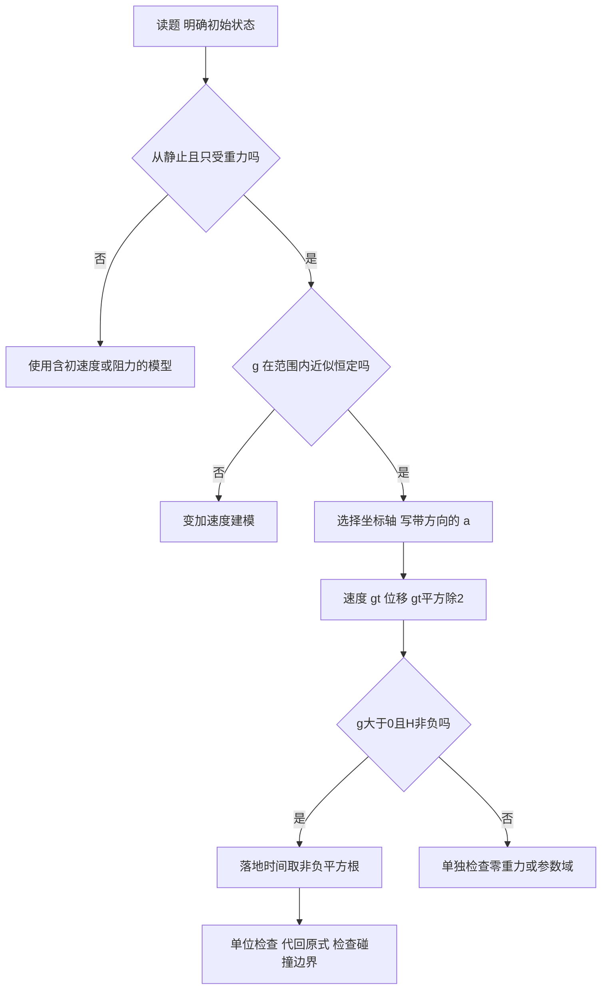

# 理想自由落体：推导、参考轴、单位与边界

[[examples/04-physics-free-fall/README_CN|主题指南（返回）]] · [[examples/04-physics-free-fall/README|English guide]]

## 学习资源 · 分层学习与检索关键词

| 层级 | 精确关键词 | 读到什么程度 |
|---|---|---|
| 核心 | 自由落体；初速度为零；重力加速度；匀加速；速度时间图像面积 | 推导v=gt与s=½gt² |
| 扩展 | 落地时间；速度位移关系；竖直坐标轴；SI单位；最后一秒位移 | 写方向单位并算区间 |
| 进阶 | 真空落体；质量与加速度；空气阻力；终端速度；重力随高度变化；非零初速度 | 检查模型是否适用 |

推荐阅读顺序：速度与加速度 → 坐标轴 → 匀加速图像 → 公式推导 → 数值与单位 → 模型边界。

> [!note] 这份笔记与网页的关系
> 这是该主题的规范知识笔记。下面完整保留网页所有实质教学段落、折叠例题、练习答案与图示说明，并在其后补充更严谨的推导、更多例题、反例、定义域和模型边界。交互页面适合探索，笔记适合离线理解与复习。关键词用于检索，不表示任何视频已被核验。

零初速、恒定 $g>0$、忽略阻力、释放点向下为正：

$$v=gt,\qquad s=\frac12gt^2,\qquad T=\sqrt{\frac{2H}{g}},\qquad V=\sqrt{2gH}.$$

$H$ 是初始距地高度，$s$ 是累计下落位移；落地时 $s(T)=H$。

## 网页完整课程材料（包含折叠解答）

### 自由落体运动 —— h = ½gt² 与位移模拟

从零推导理想自由落体公式，分清方向、位移与高度，算出落地时间与速率，并判断质量无关的结论何时适用。

核心 30 分钟 · 扩展自学 20 分钟 · 难度 2/5 · 先修：四则运算、平方与平方根；本页补齐速度与加速度

### 1 · 先认识四个量，再选模型

速度描述位置变化有多快，单位 m/s；加速度描述速度变化有多快，单位 m/s²。g=9.8m/s² 的意思是在理想下落过程中，每多过 1s，向下的速度增加 9.8m/s。加速度恒定不表示速度恒定。

先修自检：2²=4，√16=4，½×10×2²=20。√(9s²)=3s，长度要用 m、时间要用 s；200cm=2m。式子中 t² 是时间平方，不能先把 t 忘记平方。

本课的理想自由落体满足：物体从静止释放 v₀=0；释放后只受重力；忽略空气阻力与浮力；在这段高度内 g 近似恒定；运动竖直。地球近地面可取 g≈9.8m/s²，有些题明确取 10。只计算释放到首次碰地前的运动。

下落中只受重力的一般运动可能有非零初速度；本课“自由落体”使用中学教材常见的从静止开始这一约定。向下抛出、向上抛出均应使用含 v₀ 的更一般公式，不能直接套本页零初速结果。

设初始距地高度 H，已经下落的距离 s(t)，当前距地高度 z(t)=H−s(t)。H 不随时间变化，s 从 0 增到 H，z 从 H 减到 0。落地时才有 s(T)=H。因此教材中的 h=½gt² 若把 h 用作“已经下落的距离”，不能同时把它当作剩余高度。

### 2 · 方向先约定：g 是正的大小，a 才带方向

默认从释放点向下为正：s₀=0，v₀=0，a=+g，v=+gt，s=+½gt²。改为从地面向上为正：y₀=H，a=−g，v_y=−gt，y=H−½gt²。两种写法描述同一条运动，速率 |v|=gt 都为正。

坐标轴改变的是量的符号与原点，不会把真实运动翻转。下方模拟与这里的小球、读数和 v–t 图共用参数与时刻。

### 3 · 不背结论：逐行推导速度、位移与落地时间

g>0，H≥0，v₀=0；H 是初始高度，s 是累计下落位移，T 是落地时刻。

先采用向下为正，设开始时 t=0。由于 a=g 恒定，速度按时间均匀增加，速度—时间图是一条过原点的直线。

① 对 t>0，加速度定义 a=(v−v₀)/(t−0)=g；两边乘 t 得 v−v₀=gt。

② v₀=0，因此 v(t)=gt，单位 (m/s²)×s=m/s。

③ 速度线性变化，平均速度 v̄=(v₀+v)/2=gt/2。这里能取首末速度平均，是因为加速度恒定。

④ 位移 s=v̄t=(gt/2)t=½gt²。图上它也是 v–t 直线下三角形面积：½×底 t×高 gt。

⑤ 把 v=gt 两边除以 g（g>0）得 t=v/g；代入 s=½gt² 得 s=½g(v/g)²=v²/(2g)。

⑥ 两边乘 2g：v²=2gs。向下正且从静止下落，所以 v≥0，取 v=√(2gs)。

⑦ 落地时 s=H：H=½gT²；同乘2、同除g得 T²=2H/g。

⑧ 代数上 T=±√(2H/g)，但经过的时间 T≥0，因此取 T=√(2H/g)。落地前速率 V=gT=√(2gH)。

每一步都先保证 g>0、H≥0。单位检验：2H/g 的单位 m/(m/s²)=s²，开方后是 s；2gH 的单位 m²/s²，开方后是 m/s。单位不同的量不能直接相加，H/g 自身也还不是时间。

横轴与纵轴都有单位，面积单位 (m/s)×s=m。曲线的斜率单位 (m/s)/s=m/s²。切换参考轴后，带符号的 v_y–t 直线与面积会在横轴下方；这里始终画正的速率，用来比较距离。

### 正确：图下面积

取 g=10、t=2s：v=20m/s，s=½×2×20=20m。

### 错误：把末速度当平均速度

末速度 20m/s 并非整段平均速度；错误地用 20×2=40m，会高估一倍。写 s=gt 则连单位都不对。

核心例题 H=45m、g=9.8m/s²：T=√(2×45/9.8)s=√9.183673…s≈3.03046s；V=√(2×9.8×45)m/s=√882m/s≈29.69848m/s。最后才四舍五入，填写 3.03s、29.70m/s。

完整验证：½×9.8×(√(90/9.8))²=45m；V²=(√882)²=882m²/s²=2×9.8×45。用取整后的 3.03s 验算得到 44.98641m，约 0.03% 的差异来自舍入，不是公式失效。

### 4 · 等时间段：路程为什么越走越多？

取 g=10m/s²，累计位移 s(t)=5t²：0、1、2、3s 时分别是 0、5、20、45m。相邻一秒内的位移要相减：第一秒 5−0=5m，第二秒 20−5=15m，第三秒 45−20=25m，比例 1:3:5。

一般第 n 个完整等时段 Δt 的位移为 ½g[n²−(n−1)²]Δt²=½g(2n−1)Δt²；必须从静止开始并满足恒定加速度。

**迁移：只问“最后一秒”，为什么不能直接用 s(1)？**

若落地时刻 T≥1s，最后一秒指从 T−1 到 T，位移是 s(T)−s(T−1)=½g[T²−(T−1)²]=g(T−½)。H=45m、g=10 时 T=3s，最后一秒为 10×(3−½)=25m；s(1)=5m 是第一秒。若 T<1s，则不存在完整的“最后一秒”，应说明题意或只算整个过程。

### 5 · 同时落地的条件与模型边界

重力 F=mg，牛顿第二定律 F=ma。只受重力时 mg=ma，物体质量 m>0，两边同除以 m 得 a=g。质量较大时重力与惯性一起变大；因此同地点、同释放时刻、同高度、同初速度且真空条件下，质量不会改变落地时间。

箭头是概念示意，没有按力的大小绘制；这不是空气阻力的数值模拟。空气中阻力还取决于形状、迎风面积、速率与流体性质，仅给质量不足以计算谁先落地。

**使用公式前必须检查的条件**

情形

判断与处理

H=0，g>0

T=0、V=0，释放点就在地面，是初始边界。

g=0，H>0，v₀=0

没有加速度，物体保持静止，不会自行落地；不能除以 0。

H<0 或 g<0（把 g 定义为大小）

不属于本页参数域。反向坐标用 a=−g，不能把 g 的大小改成负数。

v₀≠0

改用 v=v₀+at，s=v₀t+½at²，v²=v₀²+2as，并按物理方向与时间选根。

空气阻力显著、很大的高度

可能加速度随速度/高度变化；恒定 g、零阻力公式不再精确。

已经撞地或弹起

碰撞力改变运动；图中落地前速率不是碰撞后的速度。

比较关系要保持另一个量不变：固定 g，H 变为 4H，T 和 V 均变为原来的 2 倍；固定 H，g 变为 4g，T 变为 ½ 倍，V 变为 2 倍。更短的下落时间可以对应更大的落地速率。

在真空中，从同一高度同时释放一个铁球和一个羽毛（初速度都为零），会发生什么？

H 是初始距地高度，s(t) 是已下落的位移；落地时 s(T)=H。公式只用于零初速、恒定g且无阻力的过程。

「重的物体下落更快」——这是亚里士多德的错误直觉。在真实空气里羽毛确实慢，但那是因为空气阻力，不是因为重力只让重的物体加速更快。抽掉空气（真空），二者同步落地。

- 掌握度 mastery ≥ 0.80

- 提示依赖 hint_dependency ≤ 0.50

- 至少 1 次在无提示条件下独立完成计算

- 迁移验证：换一组 h 与 g 算出 t 与 v

### 自由落体模拟：拖动滑块看小球下落与 s–t 曲线

先调参数、看动画与曲线如何联动，再亲手算一次落地时间与速度。

1 个物理模拟 + 1 道计算填空 · 即时反馈 · 全部结果写入下方 Agent 输出区

小球下落动画 与 下落位移—时间曲线（共用同一条时间轴）

0%：t=0s；使用方向键也可控制，无需播放动画。

拖动滑块即可实时改变动画、读数与曲线；曲线与圆点共用同一条时间轴，小球落地时曲线同时到达终点。单步按固定时间片推进。

### 计算落地时间与落地速度

从高度 h = 45 m 自由下落（初速度 0，取 g = 9.8 m/s²）。求落地时间 t 与落地速度 v，保留合适的小数位。系统接受 ±2% 误差，也接受多位小数。

阶梯高度 = 支持强度。已用层级越高，hint_dependency 越高；本节点当前 0.00。

### 你做对的部分

提交任意一题后，这里会先指出你判断正确的部分。

### 卡在哪里

如果答错，这里会定位到具体的错误点，并说明缺失的是哪个概念。

### 下一步

这里会给一个你现在就能执行的动作。

transfer 与 hint_dependency 不参与 overall_score 聚合，仅作为 Policy 输入。

你已经看过完整答案。要证明你理解的是原理而不是这一段数字，请完成下面这道变式题——这是本次任务结束的唯一条件。

变式：高度 h = 80 m，重力加速度 g = 10 m/s²（初速度 0）。求落地时间 t 与落地速度 v（保留两位小数）。并用一句话说明你为什么这样算。

### 分层练习 · 条件、代入、单位、检验都要写

**基础 1 · H=20m，g=10m/s²，从静止落下**

T²=2H/g=40/10=4s²，T=2s。V=gT=10×2=20m/s，方向向下。检验 ½×10×2²=20m，V²=400=2×10×20。

**基础 2 · 月球模型 H=20m，g=1.6m/s²**

T=√(40/1.6)=√25=5s，V=1.6×5=8m/s。检验 ½×1.6×25=20m。与同高度的地球模型相比，月球 g 较小，时间更长，落地速率更小；这需要忽略空气阻力并以所给 g 为准。

**发展 3 · 落地速率 V=30m/s，g=10m/s²，反求 H 与 T**

V²=2gH → H=V²/(2g)=900/20=45m。V=gT → T=V/g=30/10=3s。检验 ½gT²=½×10×9=45m。V/g 单位是 s，V²/g 单位是 m。

### 发展 4 · H=45m，g=10m/s²，最后一秒下落多少米？

**发展 4 的完整解答**

T=√(2×45/10)=3s。最后一秒从 2s 到 3s，位移 s(3)−s(2)=½×10×9−½×10×4=45−20=25m。不是第一秒的 5m，也不是全程的 45m。

### 迁移 5 · 固定 H，只把 g 增大为原来的 4 倍

填写“新值/原值”的倍率，允许小数或分数。

**迁移 5 的完整解答**

T′/T=√[(2H/(4g))/(2H/g)]=√(1/4)=1/2；V′/V=√[(2×4g×H)/(2gH)]=√4=2。注意“时间减少”不表示“落地速率减少”；两者关系不同。

### 边界 6 · g=0、H=10m、从静止释放，会自行落地吗？

**边界 6 的完整解答**

v=v₀+at=0，s=0×t+½×0×t²=0；距地高度仍为 10m，不会自行落地。T=√(2H/g) 的推导用了同除以 g，只在 g>0 的参数域有效。

**诊断 7 · “45/9.8=4.59，所以落地时间4.59秒”**

45m/(9.8m/s²)≈4.59s²，这还不是时间，而且原公式含 ½。应先求 T²=2H/g≈9.1837s²，再取非负平方根 T≈3.03s。单位与代数两项检查都能定位错误。

**方向 8 · 地面为原点、向上正，H=20m、g=10，t=1s**

a=−10m/s²；v_y=−10×1=−10m/s；y=20−½×10×1²=15m。已经下落 s=5m，速率 |v_y|=10m/s。负速度只表示向下，不能解释成“负的快慢”。

退出自测：说明为什么 ½ 出现、为什么时间取正根、为什么铁球更重却不一定更快；任选一种参考轴，再独立计算 H=80m、g=10m/s² 的 T=4s、V=40m/s，并代回 H=½gT² 验证。

## 网页原有作答与提示阶梯的完整材料

Q1 的固定条件为初始距地高度 $H=45\,\mathrm m$、初速度 $v_0=0$、恒定 $g=9.8\,\mathrm{m/s^2}$，忽略空气阻力，求首次落地的时间与碰地前速率。模拟器的初始参数 $H=50\,\mathrm m$ 与作答题 $45\,\mathrm m$ 不同：做题必须读题目，不能抄模拟器当前读数。

- 引导问题：每过一秒速度增加多少？要算时间，相当于解关于 $t$ 的什么方程？
- 策略提示：$H=\frac12gT^2$ 中已知 $H,g$，先同乘 2、同除 $g$，再开方；落地速率用 $V=gT$ 或 $\sqrt{2gH}$。
- 部分示范：$T=\sqrt{2\times45/9.8}=\sqrt{9.183673\ldots}\approx3.03046\,\mathrm s$，由学习者继续求速率。
- 完整答案：$V=9.8\times3.03046\ldots\approx29.69848\,\mathrm{m/s}$；或者直接 $V=\sqrt{882}\,\mathrm{m/s}$。填写 $3.03$ 与 $29.70$ 为合理舍入。时间框允许纯数或末尾 `s/秒`，速率框允许纯数或 `m/s`；错误单位不能被当作正确数值。

展开原题完整答案后，应独立完成原有变式：$H=80\,\mathrm m$、$g=10\,\mathrm{m/s^2}$。$T^2=160/10=16\,\mathrm{s^2}$，故 $T=4\,\mathrm s$；$V=10\times4=40\,\mathrm{m/s}$。验证 $\frac12\times10\times16=80\,\mathrm m$。自我解释应说明来自位移公式与零初速、恒定 g 的条件，而不是只说“换一组数”。

## 用一致符号整理整个模型

| 量 | 本笔记符号 | 单位 | 定义 |
|---|---|---|---|
| 初始距地高度 | $H$ | m | 释放点到地面的竖直距离，常量 |
| 累计向下位移 | $s(t)$ | m | 从释放点到当前点，取向下为正 |
| 距地高度 | $z(t)=H-s(t)$ | m | 当前点到地面的距离 |
| 下落速度 | $v(t)$ | m/s | 向下为正时的带符号速度 |
| 速率 | $u(t)=|v(t)|$ | m/s | 运动快慢，不带方向 |
| 重力加速度大小 | $g$ | m/s² | 采用正数；地球近地面约9.8 |
| 带方向的加速度 | $a$ | m/s² | 根据参考轴可为 $+g$ 或 $-g$ |
| 首次碰地时刻 | $T$ | s | $s(T)=H$ 的非负时间 |
| 碰地前速率 | $V$ | m/s | $u(T^-)$，不描述碰撞后速度 |

教材经常用 $h$ 同时表示下落高度与初始高度，在只求落地总时间时不容易出错。讨论中间时刻时应明确区分 $H,s,z$。例如释放高度 50m，在下落了20m后，$H=50$、$s=20$、$z=30$，不应把三者都填成20。

> [!important] 公式适用域
> 本页不是“任意高度、任意引力”的无限制公式。默认 $H\ge0$、$g>0$、$v_0=0$，只受重力，在运动区间内 $g$ 近似恒定，计算至首次碰地前。条件变化需要换模型。

## 为什么平均速度能取首末值的平均？

“平均速度为首末速度平均”不是任意运动都成立的公式。这里 $v(t)=gt$ 是一条直线，将一段速度图上下翻转后拼在一起，恰好得到底为 $t$、高为 $gt$ 的长方形，原图所占面积为一半。因此

$$
s=\frac{1}{2}\underbrace{t}_{\mathrm s}\underbrace{(gt)}_{\mathrm{m/s}}=\frac12gt^2,
\qquad \bar v=\frac{s}{t}=\frac{gt}{2}=\frac{v_0+v}{2}.
$$

由面积理解时要先识别图的纵轴。速度—时间图的面积是位移；加速度—时间图的面积是速度变化；位移—时间图的斜率是速度，位移图面积则没有本课这种直接含义。图像的轴名与单位是解释物理意义的一部分。

> [!example]- 对照常速运动
> 常速 $v=20\,\mathrm{m/s}$ 持续2s，v–t 图为矩形，位移 $20\times2=40\,\mathrm m$。从0匀加速到20m/s持续2s，图为三角形，位移仅 $\frac12\times2\times20=20\,\mathrm m$。末速度相同、时间相同，不表示运动历史或位移相同。

## 完整符号推导与可逆条件

向下正，从释放点起算：

$$
\begin{aligned}
a &= g, & v_0 &=0, & s_0&=0,\\
\frac{v-v_0}{t} &=g & &\Rightarrow v=gt,\\
\bar v&=\frac{0+gt}{2} & &\Rightarrow s=\bar vt=\frac12gt^2,\\
t&=\frac vg &&(g>0),\\
s&=\frac12g\left(\frac vg\right)^2=\frac{v^2}{2g}
& &\Rightarrow v^2=2gs,\\
s(T)&=H & &\Rightarrow T^2=\frac{2H}{g},\\
T&=\sqrt{\frac{2H}{g}} &&(T\ge0),\\
V&=gT=\sqrt{2gH}.&&
\end{aligned}
$$

如果 $T^2=9$，代数上 $T=3$ 或 $T=-3$；这里从释放开始计时，只接受 $T\ge0$，所以取3s。若换成一个时间原点在释放之后的情境，方程里负时间可能表示释放前的数学延长，不应把它当作“负的经过时间”。题目物理域决定选根。

换参考轴为地面原点、向上正：

$$
y(0)=H,\quad v_y(0)=0,\quad a_y=-g,\quad
v_y(t)=-gt,\quad y(t)=H-\frac12gt^2.
$$

同一时刻有 $s=H-y$、$v=-v_y$。向上轴的速度—时间图在横轴下方，其带符号面积为负位移 $y(t)-H=-\frac12gt^2$；速率—时间图仍在上方，面积为正路程。对于本课单向运动路程等于向下位移大小；有折返时应把每一段路程累加。

## 数值计算：保留中间精度，最后舍入

对 $H=45\,\mathrm m,g=9.8\,\mathrm{m/s^2}$：

$$
\frac{2H}{g}=\frac{90}{9.8}=\frac{450}{49}\,\mathrm{s^2},\quad
T=\frac{15\sqrt2}{7}\,\mathrm s\approx3.030457634\,\mathrm s,
\quad V=21\sqrt2\,\mathrm{m/s}\approx29.69848481\,\mathrm{m/s}.
$$

精确检验 $\frac12\times\frac{49}{5}\times\frac{450}{49}=45\,\mathrm m$，$V^2=(21\sqrt2)^2=882\,\mathrm{m^2/s^2}$。若将时间先粗略取3s，所得速率29.4m/s比真实值低约1%；只是近似粗，不应把它记成精确答案。使用3.03s时位移44.98641m，比45m小0.01359m，相对误差约0.0302%。

页面 Q1 使用±2%容差来容纳舍入，并不能证明推导过程正确。数值正确后仍要解释为什么采用此公式、取哪个方向与哪个根。不要把“系统接受答案”当作物理理解的全部证据。

## 多一步的应用例题

### 例 9：已下落的距离与剩余高度

$H=80\,\mathrm m,g=10\,\mathrm{m/s^2}$，$t=2\,\mathrm s$ 时：$s=\frac12\times10\times4=20\,\mathrm m$；$z=80-20=60\,\mathrm m$；$v=10\times2=20\,\mathrm{m/s}$ 向下。落地时刻 $T=4\,\mathrm s$，尚余 $T-t=2\,\mathrm s$。

不能把剩余高度60m当作重新“从静止”释放：此时已有20m/s初速度。若从当前状态重新计时，剩余过程满足 $60=20\tau+5\tau^2$，解得 $\tau=2$ 或 $-6$，取2s。错误套 $\sqrt{2\times60/10}=\sqrt{12}\approx3.46$ 是把初速度忘掉了。

### 例 10：同高度不同 g

$H=20\,\mathrm m$，地球题取 $g_E=10$，月球题取 $g_M=1.6$，则地球 $T_E=2\,\mathrm s,V_E=20\,\mathrm{m/s}$；月球 $T_M=5\,\mathrm s,V_M=8\,\mathrm{m/s}$。比值 $T_M/T_E=\sqrt{10/1.6}=2.5$，$V_M/V_E=\sqrt{1.6/10}=0.4$。

页面的天体预设仅用于恒定 g 的理想比较，尤其“木星24”不是在描述能让人在固体地面松手做实验的实际条件。

### 例 11：第二秒、第三秒与最后一秒

$g=10$ 时 $s(1)=5,s(2)=20,s(3)=45$（单位m）。第二秒是1到2s，位移15m；第三秒是2到3s，位移25m。若 $H=80$，落地时刻4s，最后一秒为3到4s，位移 $80-45=35$ m。时间段的起止点必须先写，再套位移差。

对一般等时段 $\Delta t$，第 $n$ 个时段位移为

$$
\Delta s_n=s(n\Delta t)-s((n-1)\Delta t)
=\frac12g(2n-1)(\Delta t)^2.
$$

因此从静止匀加速且在这几段中一直有效时，等时位移为1:3:5:7。若物体中途已碰地、起点不从释放计时、或加速度变化，不能直接套这个比例。

### 例 12：某一高度对应哪一时刻？

$H=50$、$g=10$，问距地30m时刻。先换成累计位移 $s=H-z=50-30=20$ m，再算 $t=\sqrt{2s/g}=\sqrt4=2$ s。速率20m/s。若误把30m直接当累计位移，就会得 $\sqrt6$ s，问的其实是距地20m的时刻。

## 质量无关的论证，及它不能证明什么

只受重力时 $F_g=mg$、$F_{\text{合}}=ma$，故 $mg=ma$。对普通物体 $m>0$，约去质量得 $a=g$。这不表示“质量没有惯性”或“重力大小相同”；两者均随质量变化，比例相消而使加速度相同。

有空气阻力且向下为正时，可能有

$$
ma=mg-F_D,\qquad a=g-\frac{F_D}{m}.
$$

$F_D$ 不仅取决于质量，还取决于形状、面积、速率和流体性质。轻薄羽毛常受到相对重量很大的阻力；把纸揉成团会改变形状与面积，因而改变下落过程。这是模型条件变化，而不是推翻真空下的结论。

> [!warning] 示意图与计算模型要区别
> 页面“真实空气”按钮只显示阻力这一额外作用，没有提供阻力系数、面积、密度或实际轨迹。不能从箭头长度读出精确加速度、终端速度或谁何时落地。

若在某一速率达到 $F_D=mg$，合力为0、加速度为0，速度可能保持为终端速度。此时“重力仍存在”与“速度不再增加”可以同时成立。给出具体终端速度需要选择阻力定律与参数，本课没有这些数据。

## 大高度、非零初速与碰撞边界

近地面 g 恒定是近似。若距天体中心距离为 $r$，万有引力模型给 $g(r)=GM/r^2$。从高度 $H$ 到半径 $R$ 的表面时，若 $H\ll R$，变化较小；若高度与半径相当，恒定 g 模型失效，应处理变加速度或能量。用极端“无限高度”验证本课公式会超出模型适用域。

初速度非零且 g 恒定，向下为正应使用

$$v=v_0+gt,\qquad s=v_0t+\frac12gt^2,\qquad v^2=v_0^2+2gs.$$

例如 $H=20\,\mathrm m$，初速度5m/s向下，$g=10$。$20=5T+5T^2$ → $T^2+T-4=0$ → $T=(-1+\sqrt{17})/2\approx1.56$ s（另一根为负，舍去）。$V=5+10T=5\sqrt{17}\approx20.62$ m/s。零初速结果2s不适用于此题。

若初速度向上，应令向下正时 $v_0<0$，会先上升再下落，需要单独区分路程与位移。碰地瞬间，地面对球有很大的接触力，不再“只受重力”；落地前 $V$ 不能延长成碰后恒定速率或穿地轨迹。

> [!example]- 两个容易混淆的零边界
> $H=0,g>0,v_0=0$：开始就接触地面，首次到达地面时间0，落地前的初始速率0。
>
> $H>0,g=0,v_0=0$：物体停在空中，没有任何有限自行落地时刻，不能把除以0记成0。
>
> 两者都是边界，但一个是初始位置条件，一个是没有加速度；原因完全不同。

## 错误对照与额外自测

| 常见说法 | 问题 | 正确核验 |
|---|---|---|
| 加速度恒定，所以速度恒定 | 混淆变化率与原量 | $v=gt$ 随时间增长 |
| $s=gt$ | 左边m，右边m/s | $s=\frac12gt^2$ |
| $T=H/g$ | 结果是s²，且漏2与开方 | $T=\sqrt{2H/g}$ |
| 最后一秒就是 $s(1)$ | 没写区间 | $s(T)-s(T-1)$ |
| 向上正仍写 $v=+gt$ | 符号与参考轴不一致 | $v_y=-gt$ |
| 碰地前速度就是碰地后速度 | 忽略碰撞作用 | 模型在首次碰地前结束 |
| 铁球更重因此加速度更大 | 漏了惯性一起增大 | 真空中 $mg=ma$ |

1. $H=5$ m、$g=10$：$T=1$ s，$V=10$ m/s；检验 $\frac12\times10\times1=5$。
2. $H=125$ m、$g=10$：$T=5$ s，$V=50$ m/s；最后一秒位移 $125-80=45$ m。
3. $g=10$、$t=0.5$ s 且尚未落地：$s=1.25$ m，$v=5$ m/s；$t^2=0.25$，不可把位移写成2.5。
4. 同一 g、高度变9倍：$T$ 与 $V$ 各变3倍；不是9倍。
5. 同一 H、g变9倍：$T$ 变1/3，$V$ 变3；两项关系方向不同。
6. 地面向上正，$H=45,g=10,t=2$：$y=25$ m、$v_y=-20$ m/s，累计下落位移20m。

> [!question]- 复习问题
> 写出本模型的五个前提。解释 $\frac12$ 为什么出现。用单位检查区分速度与位移。改变坐标轴后哪些符号会变、哪些测得的快慢不变？先写区间，再求最后一秒位移。说出为什么数值填对还不足以证明理解完整。

代数变形的基础可回到 [[examples/02-math-linear-equation/knowledge|一元一次方程]]。本课多了平方根选根与物理域：等价代数推导、单位核验和实际模型边界需要一起完成。

## 网页资源的完整检索串

- 自由落体 初速度为零 重力加速度 匀加速直线运动 位移时间公式 速度时间图像面积
- 自由落体 落地时间 速度位移关系 竖直坐标轴 正方向 SI单位 最后一秒位移
- 真空落体 质量与加速度 空气阻力 终端速度 重力随高度变化 初速度非零 竖直抛体

## 作答与宿主审核边界

所有自由文本解释（包括读过完整答案后的后置验证）只保留原始作答，等待宿主的语义审核。关键词是否出现、文字是否够长都不能证明推理正确；页面不因此提交推理评分或结束验证。数值一致也只能证明输入与参考数值相容，不能证明纸上步骤正确。展开完整答案后的验证区会继续保留，防止重新抄写原题数字跳过验证。

后置验证的精确反馈：数值与变式结果一致：T=4s、V=40m/s。原始数字与解释已记录，待宿主语义审核；本页不根据关键词或字数判断推理，也不因此结束验证。数值不一致时先给出T=√(2×80/10)=4s、V=10×4=40m/s作为重新核对路径，同样不为自由文本自动判分。

数值接近时不能断言学习者使用了正确公式。应提示：数值接近正确结果，但单凭数字还不能确定公式或过程正确；核对T²=2H/g以及非负平方根，再检查速率单位。时间框不能填写m/s，速率框不能填写s。

### 六步图示逐行说明

1. 只受重力，v₀=0，向下为正，a=g恒定。
2. t>0时由g=(v−0)/t得到v=gt；随后该式也给出t=0时v=0的连续初始值。
3. 匀加速平均速度为(0+gt)/2，因此s=½gt²，对应三角形面积。
4. g>0时用t=v/g代回，得s=v²/(2g)，即v²=2gs。
5. 落地s=H，T²=2H/g，T≥0，所以T=√(2H/g)。
6. H=45、g=9.8时T≈3.03046s、V≈29.69848m/s，代回得到45m与882m²/s²。

减少动效时播放按钮只推进一帧，不自动持续动画；时间滑块、单步与全部数值图示继续可用。地面向上正得到负速度，图中正速率与已下落距离仍保持物理值。空气模式只示意阻力，明确不能由该图预测精确落地时间。

## 资料证据与核验范围

2026-10-10 已实际读取 OpenStax 的 [University Physics Volume 1 §3.5 Free Fall](https://openstax.org/books/university-physics-volume-1/pages/3-5-free-fall)，页面返回 HTTP 200。核验位置为 Gravity 与选择竖直坐标轴的解释。原文指出：当空气阻力与摩擦可忽略时，同地点各物体具有相同的恒定加速度，与质量无关；原文还明确：“When the object comes in contact with the ground or any other object, it is no longer in free fall and its acceleration of g is no longer valid.”

该书把仅受重力且初速度可能非零的运动也叫 free fall。本课已明确使用中学常见的“从静止释放”约定，非零初速另用一般匀加速公式。这支持质量结论、符号约定和碰撞边界；恒定g、空气阻力示意及天体预设仍是本课声明的模型近似。所有数值练习为自编并代回公式核验；未据此声称考试大纲或视频内容已核验。

## 网页投影导读与静态标签
这一附录对照图内标注、按钮、选项、原始任务标签与运行状态。它让离线笔记也能解释交互投影的每个文字节点；完整推导与例题均已在前面的课程正文展开。

- 跳到教学内容
- 物理 · 力学 · 自由落体 h = ½gt²
- EVIDENCE STAGE · 证据阶段
- estimated · 仅估计
- MASTERY · 掌握度
- 0.70
- NEXT REVIEW
- 1 天后 · 09/20
- 本页尚未连接 Runtime；掌握度与证据阶段保持初始占位值，作答评分仅为待核验反馈。
- 学习资源 · 从定义与方向开始，再查公式与图像
- 离线逐行推导、单位检查和更多边界见
- 自由落体知识笔记
- ；建议顺序见
- 核心 · 先学
- 解释 v=gt 与 s=½gt² 的来源。
- 扩展 · 计算与方向
- 把符号、单位与数值统一起来。
- 进阶 · 模型边界
- 判断理想模型什么时候失效。
- 检索词用于拓展阅读；本页不把未核验的视频链接列为学习资源。地球/月球/木星的 g 只是本模型使用的近似值。
- 01 · TEACHING · 教学内容
- 参考轴与物理位置
- 释放点为原点
- 向下正：s 增大
- 向上正：y 减小
- 物理下落方向始终向下
- s=0 m；距地 H=50 m
- 向下正：a=+9.8m/s²，v=0m/s，s=0m；当前距地50m。
- v–t 图：斜率是 g，面积是位移
- 时间 t (s)
- T=3.19
- V=31.30
- 三角形面积 s=0 m
- 斜率 Δv/Δt = g
- 上一步
- 推导复位
- 强调三角形面积
- 比较常见错误
- 第1/6步：只受重力，v₀=0，向下正，a=g 恒定。
- ½ × t × gt
- t × gt，面积多一倍
- 错误 s=gt²
- 等时间间隔的位移
- 第1秒
- 第2秒
- 第3秒
- 比较同样1s内新增的距离，不是累计位移
- 质量与空气阻力的区别
- 阻力方向向上
- 向下箭头：重力；空气模式只示意非零速度时的阻力
- 理想真空
- 真实空气的边界
- 真空中 a=g；同高同初速同时释放，二者落地时间相同。
- CHECKPOINT · 理解检查
- A. 铁球先落地，因为它受到更大的重力
- B. 同时落地，因为加速度 g 与质量无关
- KEY FORM · 关键式子
- MISCONCEPTION · 常见误解
- REQUIRED EVIDENCE · 达标要求
- 02 · PRACTICE · 交互练习
- STAGE · FREE FALL SIMULATION
- DROP · 下落动画
- s–t CURVE · 下落位移曲线
- 当前向下速率
- 已用时间
- 月球 1.6
- 地球 9.8
- 选定下落时刻（释放至落地前，%）
- 重置
- ← → 单步　·　空格 播放 / 暂停
- 提交作答
- 清空重填
- 提示：t = √(2h/g)，v = g·t = √(2gh)。系统会区分「代公式对但算错」「公式用错（例如拿 h 乘 g）」「把 t 和 v 混用，或认为需要质量 m」。答案保留两位小数即可。
- PROGRESSIVE DISCLOSURE · 提示阶梯
- 每一级都必须由你主动点击——它会被记为你的提示依赖
- ① 引导问题
- 只给方向
- ② 策略提示
- 给思路
- ③ 部分示范
- 给前半段
- ④ 完整答案
- 需二次确认
- 等待作答
- ASSESSMENT · 多维评分
- POST-VERIFICATION · 后置验证（完整答案后必做）
- 提交变式题
- EVIDENCE TRAIL · 本次会话事件
- 已产生 0 条事件（只追加，不覆盖）
- 尚无事件
- 运行
- 最后一秒的位移（m）
- 检查区间位移
- 落地时间倍率
- 落地速率倍率
- 检查迁移关系
- 选择物理结果
- 请选择
- 时间为 0s，立即落地
- 10s 后落地
- 检查边界
- 03 · AGENT OUTPUT · 数据输出
- 交给宿主 Agent 的交互结果
- 这一区不是调试信息，而是学习者本次会话的完整档案。宿主 Agent 通过它驱动下一轮教学决策。
- BRIDGE · 演示模式
- 未接入宿主 Agent；学习动作会累积为待执行的 MCP 调用。
- 取出调用队列 ▾
- AGENT OUTPUT · 已记录 0 条事件
- 展开 JSON ▾
- LEAP‑V2 分学科前端示例 · 示例 4（物理 / 自由落体）　·　node_id
- physics.mechanics.free_fall
- ·　unit_tag
- 单文件零依赖 · 零 CDN · 零外部图片 · 全部图形为内联 SVG / Canvas，公式为原生 MathML　·　结构规范见
- examples/_shared/leap-web-spec.md
- ，视觉规范见
- LEAP_视觉设计理念_给Gemini.md

Related: [[Knowledge_Index]] · [[docs/teaching-delivery]]

<!-- LEAP_BACKLINKS -->

## Backlinks / 反向关联

[[Knowledge_Index]] · [[docs/subject-knowledge-map]] · [[examples/02-math-linear-equation/README]] · [[examples/02-math-linear-equation/README_CN]] · [[examples/02-math-linear-equation/knowledge]] · [[examples/04-physics-free-fall/README]] · [[examples/04-physics-free-fall/README_CN]] · [[examples/08-electronics-ohms-law/knowledge]]
