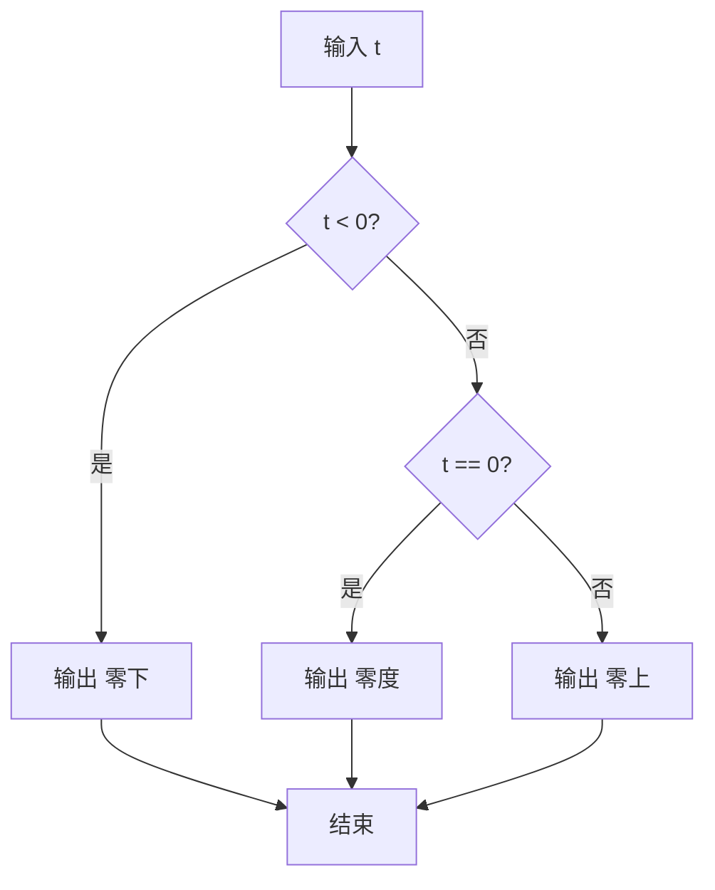
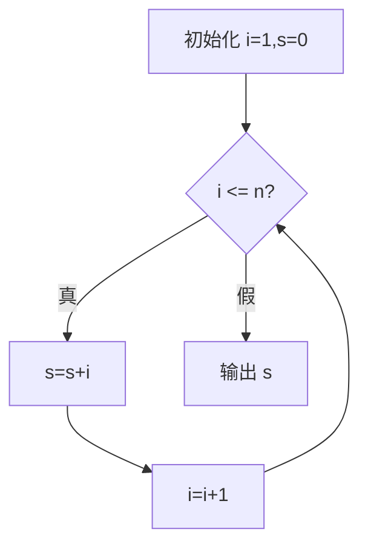
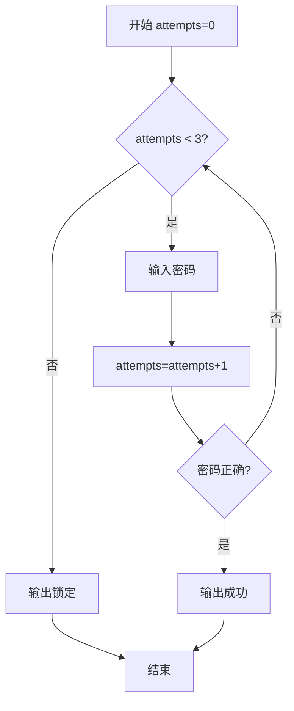

> [!info] 学习资源：精确检索词（三层）
> 核心：`算法流程图 开始结束 处理 判断 输入输出 符号`
> 核心：`流程图 顺序 分支 循环 变量追踪表`
> 扩展：`Python if else while 流程图 取余 奇偶数`
> 扩展：`流程图 累加循环 初始化 更新 边界测试`
> 进阶：`循环不变式 累加 正确性 终止性 递减度量`
> 进阶：`流程图 覆盖测试 等价分区 边界值 off by one`
> 这些是检索词，并非声称已核验的视频或已读取的资料；本课不列未经核验的视频链接。


# 流程图与控制流：从读箭头到验证算法

## 学习资源检索词（三层路线）

| 层级 | 中文检索词 | 英文检索词 | 目标 |
|---|---|---|---|
| 核心先修 | 算法流程图 开始结束 处理 判断 输入输出；变量赋值 比较 真值 | flowchart symbols process decision input output; variable assignment boolean comparison | 读懂每种形状和箭头，写出每一步变量状态 |
| 核心结构 | 流程图 顺序 分支 循环；Python if else while 取余 奇偶数 | structured flowchart sequence selection iteration; Python if else while modulo parity | 画一条完整路径，区分真/假分支，识别回边 |
| 扩展实践 | 流程图 累加循环 初始化 判断 更新 边界值测试 | flowchart accumulator loop initialization condition update boundary tests | 逐轮追踪 i、s、输出，并找出漏更新、错边界 |
| 扩展排错 | while off by one 循环不结束；流程图分支覆盖 | while loop off-by-one infinite loop branch coverage | 用0、1、n、n+1等输入检验路径和次数 |
| 进阶证明 | 循环不变式 累加 正确性 终止性 递减度量 | loop invariant summation correctness termination variant | 证明结果保持不变式，证明最终一定退出 |
| 进阶设计 | 结构化程序图 多路分支 提前结束 重试次数 | structured program flowchart multiway branch retry limit | 把真实任务拆成可覆盖、可结束的路径 |

网页互动说明在 [[examples/05-logic-flowchart/README_CN|流程图示例说明]]；递归对照见 [[examples/01-python-recursion/knowledge|递归知识笔记]]。项目入口：[[README_CN|项目说明]]、[[examples/README_CN|示例目录]]。

> [!abstract] 本笔记的学习顺序
> 先修表达式 → 形状语义 → 顺序状态 → 二路分支 → 计数循环 → 边界与反例 → 循环不变式与终止性 → 分层练习。每个例子都先列状态，再看代码或图。折叠解析包含逐步执行表，适合先遮住答案自测。笔记比网页教学更完整，补充输入/输出符号、多路与提前结束、while/repeat边界、覆盖测试和新任务设计。

## 教学点精讲与交付对应

本节把每个知识点的输入约束、推导、核对与迁移写成完整教学记录；编号供宿主引用，不表示学习者已经掌握。

### 沿箭头读取顺序并记录赋值前后的变量状态

教学点编号：`flow.state.sequence`。

**先修与记号：** 变量记录当前值；x=x+1表示先读取右边的旧x再把计算结果写回左边。x==3产生真假而不改变x。箭头规定先执行哪一步，框在页面左侧或上方并不单独决定顺序。

**原理与条件：** 流程的每个处理节点将当前状态变成下一状态；后续表达式读取到的是此前已经写回的值。因此即使使用同样两行赋值，交换执行顺序也可能改变输出。状态表把这个因果关系明确记录下来。

**带理由的操作顺序：**

1. 先从开始节点沿箭头进入输入或初始化，记录x=2；执行x=x+1时右边读取2，算出3后才写回，所以离开该节点时x=3。
2. 再执行y=x*2，右边读取当前x=3，得到6并写入y；最后沿箭头输出y=6，不能因输入最初是2而仍输出4。
3. 把两节点交换作比较：y先读取旧x=2得到4，随后x变3；y不会自动重算，这说明状态和连线顺序都必须保留。

**完整例题与核对：** 正确顺序：x=2→x=x+1得到3→y=x*2得到6→输出6。交换顺序：x=2→y=x*2得到4→x=x+1得到3→输出4。逐节点状态表与直接代入独立确认两种输出。

**误解与修正：** “同样的框换位置也一定同结果”混淆布局与执行顺序；只移动框而保持箭头确实不改算法，交换连线让赋值先后改变则可能改结果。“x=x+1是数学等式矛盾”误读了赋值，它是状态更新。

**输入与实现边界：** x可取0或负整数时仍按同样赋值规则执行，例如0先加1再乘2输出2；若输入字符串且语言没有自动转数规则，应先验证类型。网页编辑器展示基本节点与连线，不执行任意自建图的全部语义。

**近邻方法对比：** 矩形表达处理，平行四边形表达输入输出，菱形表达产生True/False的条件；它们不能仅因装饰形状相似而互换。布局复位只改变坐标，改箭头或节点动作才改变控制流。

**基础、变式、挑战与解答：** 基础：x=2先加1再乘2，输出6。变式：x=−1同顺序输出0，因为−1+1=0、0*2=0。挑战：原顺序的y=2x+2；若先给y赋值再增加x，输出y=2x，对任意数x两结果相差2，因为后改x不会让y自动重算。把交换后的输出4误当6说明遗漏了先后状态。

**迁移任务与解释：** 把动作改为先打九折再减10元：原价100变90再变80；先减10再打九折为90再变81。仍应记录每节点的新值，不能把存在两种操作当作顺序无关的理由。

**网页图示：** 顺序赋值节点与受控变量状态推演；定位 `#loopSvg`。请用对应的单步或参数控件查看状态，图示用于追踪，不替代上面的逻辑证明。

### 先求余数与条件真假，再沿正确的奇偶分支

教学点编号：`flow.modulo.branch`。

**先修与记号：** Python整数n除以正数2的余数可为0或1；浏览器JS负奇数余数是−1，余数等于0的整除判定仍一致，n%2读作除以2的余数；==0检查余数是否等于0，结果是True或False。偶数指能被2整除的整数，0也满足此定义。

**原理与条件：** 判断节点只求条件真假，真边与假边各连接自己的处理节点。在n%2==0条件下，真边输出偶数，假边输出奇数；输出必须由实际输入的条件求值决定，不能由预测或错误按钮选择改变。

**带理由的操作顺序：**

1. 输入n=7后先算7%2=1，再比较1==0得到False；判断结果为假，所以应沿标有否的箭头进入输出奇数节点。
2. 输入n=8后算8%2=0，再比较0==0得到True；沿标有是的箭头进入输出偶数节点，随后连到结束，不能在判断完成前宣布程序结束。
3. 用边界n=0再走一遍：0%2=0为真，输出偶数；这样同时核对定义、真分支与边界处理，没有把0随意归入奇数。

**完整例题与核对：** n=7：开始→输入7→7%2=1→条件假→否边→输出奇数→结束。n=8：开始→输入8→8%2=0→条件真→是边→输出偶数→结束。直接用7=2×3+1与8=2×4确认余数与结论。

**误解与修正：** “菱形写输出偶数”把处理当条件，无法得到真假；改成n%2==0。“否就是没有结果”也错，否边应执行输出奇数。“按错边可让7变偶数”违背条件求值，演示应留在判断并解释正确方向。

**输入与实现边界：** 0为偶数；若允许负整数，−4除以2余数0是偶数，−3不能整除是奇数。小数、空字符串、7xyz不能作为本题合法整数。课堂规则只识别规定的单条件表达式，不能把含 and False 的复合条件截成前半句判对。

**近邻方法对比：** n%2==0为真时输出偶数；换为n%2!=0后真时输出奇数、假时输出偶数。判断条件取反必须同步交换处理，才保持相同输入的输出；只改条件不换分支会反转结论。

**基础、变式、挑战与解答：** 基础：0走是边输出偶数。变式：7走否边、8走是边，必须写余数1与0。挑战：把条件改为!=0，7现在走是并输出奇数，8走否并输出偶数；仅列是、否字样而无输入与求值不能算完整解释。

**迁移任务与解释：** 温度三分类先判断t<0，真输出零下；假再判断t==0，真输出零度、假输出零上。测试−1、0、1分别覆盖三条叶路径；第一判断的否边不能直接标零上，因为它还包含0。

**网页图示：** 输入驱动且在判断点暂停的分支执行图；定位 `#exeSvg`。请用对应的单步或参数控件查看状态，图示用于追踪，不替代上面的逻辑证明。

### 用计数循环、状态表、不变式与递减度量计算总和

教学点编号：`flow.counted.sum`。

**先修与记号：** 输入n是非负整数；i表示本轮待加的数，s表示已经累加的和。初始化i=1、s=0表示尚未加入任何项。i≤n包含上界，比较不会自动更新i，必须另有i=i+1处理节点。

**原理与条件：** 每次判断前s等于1到i−1的和；真分支先加i再把i增加1，保持这个不变式。条件真时的整数度量n−i+1每轮减少1，最终i=n+1使条件假，故能结束且退出的s恰为1到n的总和。

**带理由的操作顺序：**

1. 初始化i=1、s=0后判断i≤n，不先执行循环体；n=0时1≤0为假，直接输出空和0，说明while可能执行零轮。
2. 条件真时先执行s=s+i，让旧s加入当前i；再执行i=i+1推进到下一项。回边连接判断而非初始化，保留已计算的和。
3. 条件假时沿出口输出s；对n=3，状态依次(i,s)=(1,0)、(2,1)、(3,3)、(4,6)，前三次判断真、最后一次假，总共3次累加和4次判断。

**完整例题与核对：** n=3：1≤3真，s=0+1=1、i=2；2≤3真，s=1+2=3、i=3；3≤3真，s=3+3=6、i=4；4≤3假，输出6。直接1+2+3=6与3×4÷2=6独立核对。n=0循环零轮仍判断一次并输出0。

**误解与修正：** “只要s越来越大就会停”忽略出口只依赖i；漏i更新时i恒为1、条件持续真。“回边回初始化也一样”会反复重置i与s并丢失进度。“判断3次”漏了最后假判断；有限步演示暂停也不是算法已终止。

**输入与实现边界：** n=0输出0且判断1次；n=1输出1且判断2次。负数与小数不在本求和任务输入域。若把≤写成<，n=3漏加3只得3；s初始化1则所有结果多1。遗漏更新模式只观察有限轮，不能把观察上限当出口。

**近邻方法对比：** 正确循环在真边执行累加与更新，假边输出；只保留累加而漏更新不会结束。先加后更新得到1到n的和；先更新后加得到2到n+1，n=3变成2+3+4=9，虽然能停却算错。

**基础、变式、挑战与解答：** 基础：n=0的s=0、i=1、判断1次。变式：n=3结束时s=6、i=4、判断4次。挑战：说明不变式负责正确性、n−i+1负责终止性；用n=1定位先更新再加会输出2，不能只把错误结果9改写成6。

**迁移任务与解释：** 改为阶乘时保留i与循环结构，把s=s+i改为p=p*i，p初值为乘法单位元1。n=0不进循环而输出1，n=3顺序乘1、2、3得到6；若p从0开始，所有结果都为0。

**网页图示：** 可单步前后退并切换遗漏更新的循环状态图；定位 `#loopSvg`。请用对应的单步或参数控件查看状态，图示用于追踪，不替代上面的逻辑证明。

## 网页课堂原文与交互读法

下面按网页的实际章节保留课堂原文、表格、代码与图示标注，便于离线阅读和在页面定位。按钮文字用于识别控件；空白答案区需要你自己作答。

> [!warning] 初始状态只是占位
> 本节保留的证据阶段、掌握度、复习日期与0条事件都是页面初始文字，不能作为任何学习者的真实状态。只有Runtime返回的当前上下文与成功回执可说明会话状态。隐藏的后置题也记录在这里，以便完整离线学习；看到答案本身不证明掌握。

跳到教学内容

LEAP
      逻辑 · 控制流 · 顺序 / 分支 / 循环

EVIDENCE STAGE · 证据阶段

estimated · 仅估计

MASTERY · 掌握度

0.44

NEXT REVIEW

4 天后 · 09/23

本页尚未连接 Runtime；掌握度与证据阶段保持初始占位值，作答评分仅为待核验反馈。

### 学习资源与路线：从读箭头到验证循环

按核心 → 扩展 → 进阶复制检索词到课程平台或搜索引擎。先用变量表读图，再画图；完整讲义、详细解答与更多迁移例题见 流程图知识笔记。

**核心：读一条路径**

算法流程图 开始结束 处理 判断 输入输出 符号
流程图 顺序 分支 循环 变量追踪表

**扩展：从图到代码**

Python if else while 流程图 取余 奇偶数
流程图 累加循环 初始化 更新 边界测试

**进阶：证明流程可靠**

循环不变式 累加 正确性 终止性 递减度量
流程图 覆盖测试 等价分区 边界值 off by one

建议：读懂变量与真假条件 → 跟踪 n=7 / n=8 的两条分支 → 单步累加 1 到 3 → 测试 n=0 与漏更新 → 独立画出温度分类或密码重试。

01 · TEACHING · 教学内容

### 流程图基础：顺序、分支、循环三种控制结构

学完这一节，你能沿箭头逐步读懂含顺序、真假分支和计数循环的流程图，记录变量变化，并用边界输入检查结论。

预计 35–50 分钟　·　可分段学习　·　先修：变量赋值、比较、真假与取余

流程图是用图形表示「算法步骤怎样流动」的图。它不关心语法细节，只关心控制流——也就是程序在每一步「往哪里走」。所有流程图都由三种基本结构组合而成：顺序、分支、循环。读懂这三种结构，就读懂了绝大多数程序的骨架。

### 一、形状语义：每种框代表一类动作

流程图的形状不是装饰，而是语义编码——看到形状就知道这一步在做什么。先记住四种基本形状：

**图示标注（沿箭头读图）：**

- 开始 / 结束
- 圆角矩形
- 处理 / 赋值
- 直角矩形
- 判断
- 菱形
- 流向
- 箭头

每根箭头都有方向；读图时沿箭头执行，不按框的左右位置猜顺序。二路判断应标“是 / 否”：一次只走一条。分支可以汇合、分别结束或回到循环判断；每条可能执行的路径都必须有明确的后续。

记住一句口诀：圆角起止、矩形做事、菱形提问、箭头指路。
形状错了，意思就错了——把「判断」画成矩形，读者会以为它是在「做一件事」而不是「做一个选择」。

### 二、三种基本控制结构

- ①　顺序 —— 步骤一个接一个，没有分叉。最常见，也是其它两种结构的「积木」。
- ②　分支 —— 在「判断」框处根据条件选一条路走（二选一或多选一），可汇合，也可分别结束。
- ③　循环 —— 判断条件成立就重复一段，不成立就跳出。本课的计数循环需要更新计数器，并证明它最终越过边界；仅仅画回边或改变量还不足以保证结束。

### 顺序结构

三个处理框从上到下串接，箭头依次相连。读的顺序就是执行的顺序。

**图示标注（沿箭头读图）：**

- 读入 n
- 计算 n+1
- 输出结果

### 分支结构

「判断」框（菱形）把流程分成两路：条件成立走「是」，不成立走「否」，两路在下方汇合到同一个结束。

**图示标注（沿箭头读图）：**

- 开始
- n>0?
- 否
- 是
- 输出"非正"
- 输出"正"
- 结束

### 循环结构

判断成立就进入「循环体」做事，做完再回到判断框（回边箭头）。一旦条件不成立，就沿另一条路跳出循环。回边箭头是循环最醒目的标志。

**图示标注（沿箭头读图）：**

- 开始
- i<=5? (先令i=1)
- 否·跳出
- 是
- 循环体：i=i+1
- 结束

循环要同时检查初始化、判断、循环体、更新、回边、出口。计数器“变了”还不够：i <= 5 却每次 i = i - 1，会一直远离退出边界。也存在有意持续运行或等待外部事件的循环；本课先研究能证明结束的计数循环。

CHECKPOINT · 理解检查

下面哪种说法是对的？「流程图的菱形判断框里，可以写一条赋值（处理）语句。」

- **按钮：** A. 可以，菱形里也能写赋值语句，只是习惯上少写

- **按钮：** B. 不可以，菱形只放判断条件，处理必须画成矩形

KEY FORM · 形状语义速查

圆角矩形 ＝ 开始 / 结束

直角矩形 ＝ 处理 / 赋值

菱形 ＝ 判断（条件）

箭头 ＝ 流向（单向）

本课采用单入口、清晰出口的结构化流程：用顺序、分支与循环描述算法的控制骨架；输入输出也可使用平行四边形。

MISCONCEPTION · 常见误解

菱形写能判断真假的条件；矩形写处理动作。循环还要看“变量是否朝出口推进”：更新方向错误，或者遗漏更新，都可能使条件一直为真。图画得整齐，不等于算法正确。

REQUIRED EVIDENCE · 达标要求

- 能说出四种形状的语义
- 能区分顺序 / 分支 / 循环
- 掌握度 mastery ≥ 0.75
- 提示依赖 hint_dependency ≤ 0.50
- 迁移验证：把「判断偶数」画成流程图

FOUNDATIONS · 读图之前

### 把流程看成“位置 + 变量 + 输出”的状态变化

算法是为完成某个任务写出的一系列明确动作。流程图把动作与执行顺序画出来：箭头说明下一步去哪里，框里的内容说明当前步做什么。一次执行中，始终记录三件事：当前节点、变量当前值、已产生的输出。框的位置不决定先后，箭头才决定先后。

| 先修表达式 | 读法与行为 | 例子 |
| --- | --- | --- |
| x = x + 1 | 先读取旧 x，算右侧，再覆盖左侧 x | 旧 x=2 → 右侧 3 → 新 x=3 |
| x == 3 | 比较，得到真或假，不改变 x | x=2 时为假，x 仍为 2 |
| x <= 3 | 小于或等于，边界 3 也成立 | 2、3 成立；4 不成立 |
| n % 2 == 0 | 除以 2 的余数为 0，说明是偶数 | 8%2=0；7%2=1；0%2=0 |

> [!example]- 输入、处理、输出：平行四边形为什么有用？
> 输入把外部给定值写进变量；处理计算或更新变量；输出把结果展示给外部。传统流程图常用平行四边形表示输入/输出，本页部分入门图为简洁使用写有“输入/输出”的矩形。正式画图时可以采用平行四边形，但动作语义仍由框中文字明确表达。
>
> **图示标注（沿箭头读图）：**
>
> - 输入 n / 输出 s
> - 处理：s = s + i

### 先用顺序结构确认变量更新

```text
输入 x=2
x = x + 1      # 读取2，存回3
y = x * 2      # 读取新x=3，存y=6
输出 y         # 输出6
```

交换两条处理语句会得到 y=4。原因是第二步读取的 x 不同；流程图中的顺序有实际影响。只画三个框不够，框与框之间的箭头要连续。

### 分支例题：同一判断只选择一条路

**奇偶判断的两条完整路径**

| 动作 | 输入 7 | 输入 8 |
| --- | --- | --- |
| 开始 → 输入 n | n=7，尚无输出 | n=8，尚无输出 |
| 判断 n%2==0 | 7%2=1；1==0 为假 | 8%2=0；0==0 为真 |
| 选择分支 | 只走“否”箭头 | 只走“是”箭头 |
| 执行输出节点 | 输出“奇数”，n 仍为 7 | 输出“偶数”，n 仍为 8 |
| 结束 | 不会再执行另一分支 | 不会再执行另一分支 |

0 也是偶数，因为 0=2×0。负整数也可以判断奇偶：−4 是偶数，−3 是奇数。不同语言对负数余数的符号规则可能不同，但“余数是否等于 0”仍能检验整除。本课输入须为整数，不把 7.5 截成 7 后继续。

> [!example]- “n>0 的否分支”可以写“负数”吗？
> 不能直接这样写，因为 n=0 也满足“不是正数”。若只分两类，应写“正数 / 非正数”；若需要正、零、负三类，就先判断 n>0，再在否分支判断 n==0。用边界值 0 测试，能立即发现漏掉的情况。

LOOP TRACE · 图与变量同步

### 完整循环例题：计算 1+2+…+n

先令 i=1, s=0。i 表示“下一次要加的数”，s 表示“已经累加的结果”。每次判断 i≤n：真则做 s=s+i，再做 i=i+1，沿回边重新判断；假则输出 s 并结束。把输入设为 3，用“下一步”观察每一步。

上界 n（0–5）

更新方式

**可选模式：** 正确：每次 i=i+1；错误实验：遗漏更新 i。

- **按钮：** 上一步

- **按钮：** 下一步

- **按钮：** 重置循环

**图示标注（沿箭头读图）：**

- 是
- 否
- 回边：再判断
- 开始
- i=1；s=0
- i ≤ n ?
- s = s + i
- i = i + 1
- 输出 s
- 结束
- 一次循环：判断 → 累加 → 更新 → 回到判断
- 退出后才输出；n=0 时循环体执行零次。

i=未初始化 · s=未初始化 · 输出=尚无

初始化之前，变量还没有值。

步骤 0

**已执行到的循环观察表**

| 动作 | i | s | 判断/输出 |
| --- | --- | --- | --- |

**n=3 的完整轮次，最后一次判断不可省略**

| 轮次 | 判断前 i、s | i≤3 | 累加后 s | 更新后 i |
| --- | --- | --- | --- | --- |
| 1 | 1、0 | 真 | 0+1=1 | 2 |
| 2 | 2、1 | 真 | 1+2=3 | 3 |
| 3 | 3、3 | 真 | 3+3=6 | 4 |
| 退出检查 | 4、6 | 假 | 保持 6 | 保持 4，输出 6 |

> [!example]- 为什么有 3 次累加，却有 4 次判断？
> 每轮进入前都判断一次，共 3 次；做完第三轮仍必须再判断，才发现 i=4 已超过 3。因此先判断型循环在执行 n 轮的情况下通常检查 n+1 次。最后一次假值决定“退出”，不执行循环体。

> [!example]- 遗漏更新的实验为什么只显示有限步骤？
> 当 n≥1 且 i 始终为 1，i≤n 每次都真；s 虽在变化，却不影响判断，所以它不能帮助退出。本页展示三轮后报告“演示暂停”，这是为了不让浏览器无限执行，不是算法自己结束。n=0 则首次判断为假，即使漏更新也不进入循环。

### 从图到可靠算法：边界、错误与证明

### 初始化、判断、更新，各有一种常见错误

| 错误 | n=3 的后果 | 修正依据 |
| --- | --- | --- |
| 把 s 初始化成 1 | 1 被多加一次，最终 7 | 尚未累加时应是空和 0 |
| 条件写成 i<n | 只加 1 和 2，最终 3 | 任务包含上界 3，应用 ≤ |
| 更新放到累加前 | 先加 2，再加 3、4，最终 9 | i 表示本轮待加数，先加当前 i 再推进 |
| 漏掉 i=i+1 | i=1 一直成立，反复加 1 | 必须改变控制条件相关的变量 |
| 回边接到初始化 | 每轮把 i、s 重新清零 | 回到判断，保留上一轮结果 |

### 用不变式解释“为什么 s 恰好是正确答案”

每次来到判断框时，s 等于从 1 到 i−1 的和。初始化 i=1、s=0，这正是还没加任何数；累加当前 i 后，s 变成从 1 到 i 的和；再把 i 加 1，就重新满足“到 i−1 的和”。退出时 i=n+1，所以 s 正好等于 1 到 n 的和。

正确性还要配合终止性：条件为真时，n−i+1 是非负整数，每轮减 1；它不能永远减下去，所以最终会退出。若只有 s 变、i 不变，这个度量不会下降，不能证明结束。

> [!example]- 先判断 while 与后判断 repeat 的边界差别
> 本页循环先判断，因此 n=0 时执行零次。后判断循环先做一遍再判断，所以至少执行一次；如果任务允许“什么都不做”，要特别小心选错结构。Python 的 while 属于先判断型；可以用 while True 加 break 表达后判断逻辑，但也要明确退出条件。

> [!example]- 分支汇合与提前结束，二者都可以合法吗？
> 可以。一条分支能回到共同后续，也能直接到结束。重点是所有可达路径都有明确去向，而且是否结束与任务要求一致；“每条分支必须重新汇合”不是普遍规则。含循环的回边是有意重复路径，不能把它误当断线。

### 分层练习：分支边界 → 循环计数 → 新任务

先写预测，再检查。检查会记录答题事件并指出哪一个步骤遗漏；原有正式补全题与评分继续保留。

### 1 · 测试边界 0 的奇偶性

走“是”分支，输出偶数

走“否”分支，输出奇数

0 既不是奇数也不是偶数

- **按钮：** 检查分支边界

代入 0%2==0，先得到条件真假。

> [!example]- 逐步解答
> 0%2=0，0==0 为真，沿“是”箭头执行“输出偶数”，再结束。判断不修改 n，也不需要额外排除 0。

### 2 · 预测 n=3 循环的最后状态

最终 s：　退出时 i：　判断次数：

- **按钮：** 检查循环推演

三个数加完后，是否还需要一次判断？

> [!example]- 逐步解答与 n=0 对照
> n=3 时 s=6、i=4、判断4次；每轮 i=1、2、3 都真，i=4 时假。n=0 时 i=1、s=0，第一次判断1≤0为假，输出0；判断1次、循环体0次。

### 3 · 迁移：把“累加”改成“连乘”

保留 i=1 与 i≤n，每轮改为 p=p*i，每轮后 i=i+1。要算 n!，p 应初始化多少？n=0 时应输出多少？

p 的初值：　n=0 输出：

- **按钮：** 检查迁移

乘法的起点是否与加法一样？

> [!example]- 完整迁移解答
> p=1，n=0 时也输出1；若 p=0，所有后续乘积都被变成0。n=3 时 p 从1，经×1仍为1，再×2变2，再×3变6，i=4 时退出。与递归的对比见递归知识笔记。

> [!example]- 4 · 新任务：把温度分为“零下 / 零度 / 零上”
> 输入 t；判断 t<0，真输出“零下”；假再判断 t==0，真输出“零度”，假输出“零上”；每个输出都连到结束。测试−1、0、1分别覆盖三条路径。若只有 t>0 与“负数”两分支，就会把0错归到负数。

> [!example]- 5 · 提高：最多重试密码三次，怎样保证会结束？
> 令 attempts=0。每次尝试前判断 attempts<3；为真则读密码并把 attempts 加1。密码正确就输出成功并结束；错误则回到次数判断；次数判断为假就输出锁定并结束。测试第一次成功、第三次成功、三次全错。进展来自 attempts 每轮增1，不能只修改“密码文本”来证明退出。

02 · PRACTICE · 交互练习

### 动手画、补全、并跑通一张流程图

先自由摆弄节点与连线，再补全「判断偶数」的流程图，最后给定输入跑一遍执行动画并预测输出。

4 个交互环节　·　即时反馈　·　全部结果写入下方 Agent 输出区

STAGE · FLOWCHART EDITOR · 自由编辑

拖拽摆放节点，并用连线把流程接起来

- **按钮：** 连线模式：关

- **按钮：** 清空连线

- **按钮：** 复位布局

Tab 聚焦节点 · 方向键移动 · 回车进入/完成连线 · 空格切换连线模式

开始 / 结束（圆角）
          处理（矩形）
          判断（菱形）
          连线（流向）

鼠标增强：直接拖动节点可移动；从节点底部的小圆点拖到另一个节点即可连线。键盘用户请用「连线模式」：点一下「连线模式」按钮（或聚焦节点后按空格），再依次点两个节点。连线会随节点移动实时重绘。

Q1

### 补全「判断一个数是否为偶数」的流程图

图里缺了判断条件和「否」分支的处理节点。请把判断条件填进菱形框，并把右边三个候选项分别放进「是 / 否」两条分支。系统会区分你是「放错了位置」还是「条件写错了」。

**图示标注（沿箭头读图）：**

- 开始
- 输入 n
- 条件？
- 否
- 是
- 输出"偶数"
- 否分支？
- 结束

判断条件（写在菱形里）：

TARGET · 分支落位

是 →（应放处理节点）

否 →（应放处理节点）

SOURCE · 候选项（可拖拽）

- **按钮：** 输出"偶数"

- **按钮：** 输出"奇数"

- **按钮：** 令 n = n + 1

- **按钮：** 提交补全

- **按钮：** 取回全部

判定范围：判断条件须表达「n 能否被 2 整除」（如 n % 2 == 0 / n 能被 2 整除）；「是」分支输出"偶数"，「否」分支输出"奇数"。「令 n = n + 1」改变了输入，不是输出结论，算放错位置。

PROGRESSIVE DISCLOSURE · 提示阶梯

每一级都必须由你主动点击——它会被记为你的提示依赖

- **按钮：** ① 引导问题只给方向

- **按钮：** ② 策略提示给思路

- **按钮：** ③ 部分示范给前半段

- **按钮：** ④ 完整答案需二次确认

阶梯高度 = 支持强度。已用层级越高，hint_dependency 越高；本节点当前 0.00。

Q2

### 给定输入 n = 7，跑通执行并预测输出

先预测程序会输出什么，再点「执行」看高亮一步步走到哪。到判断框时你可以选「是 / 否」分支，每一步都有中文说明为什么这么走。

输入 n =

你的预测：程序最终输出

STAGE · EXECUTION ANIMATION

「判断偶数」流程的执行轨迹

FLOW · 当前节点

CURRENT STEP · 当前步骤

先预测输出，再点「执行」。到判断框时会出现「是 / 否」按钮，你可以决定走向。

步骤 0 / 6　·　状态：待开始

在此分支选择：

- **按钮：** 是（条件成立）

- **按钮：** 否（条件不成立）

当前节点　
                已走过　
                未到达

- **按钮：** 播放

- **按钮：** 单步

- **按钮：** 重置

← → 单步　·　空格 播放 / 暂停

你的预测

—

程序真实输出

—

本执行器是受控语义模拟：它只支持这张「输入 → 判断奇偶 → 输出」的单一结构。判断条件是真的按 n 的奇偶性求值，分支选择由你点击决定；它做的是真实的控制流追踪，不是播放预设文字。

等待作答

### 你做对的部分

提交补全题或预测后，这里会先指出你判断正确的部分。

### 卡在哪里

如果答错，这里会定位到具体的错误点（结构放错 / 条件写错 / 预测方向反了），并说明缺失的概念。

### 下一步

这里会给一个你现在就能执行的动作。

ASSESSMENT · 多维评分

transfer 与 hint_dependency 不参与 overall_score 聚合，仅作为 Policy 输入。

POST-VERIFICATION · 后置验证（完整答案后必做）

你已经看过完整答案。要证明你理解的是原理而不是这一段文字，请回答：如果把判断条件写成「n % 2 != 0」，那么「是 / 否」两条分支的输出结论应该怎么调换？为什么？

- **按钮：** 提交自我解释

EVIDENCE TRAIL · 本次会话事件

已产生 0 条事件（只追加，不覆盖）

尚无事件
          作答　提示　运行　完成

03 · AGENT OUTPUT · 数据输出

### 交给宿主 Agent 的交互结果

这一区不是调试信息，而是学习者本次会话的完整档案。宿主 Agent 通过它驱动下一轮教学决策。

BRIDGE · 演示模式
          未接入宿主 Agent；学习动作会累积为待执行的 MCP 调用。

- **按钮：** 取出调用队列 ▾

- **按钮：** AGENT OUTPUT · 已记录 0 条事件
          展开 JSON ▾

LEAP‑V2 分学科前端示例 · 示例 5（逻辑 / 流程图基础）　·　node_id logic.control_flow.basics　·　unit_tag flowchart-basics

    单文件零依赖 · 零 CDN · 零外部图片 · 全部图形为内联 SVG / DOM 绘制　·　结构规范见 examples/_shared/leap-web-spec.md，视觉规范见 LEAP_视觉设计理念_给Gemini.md

## 完整推导、反例与自测扩展

以下按知识逻辑详细推导，再给出更多变式、证明、正式输入验证与可折叠解答。

## 1. 先建立“控制流”模型

算法是有限或可描述的动作规则；一次运行会在这些动作之间移动。**控制流**回答“下一步执行哪一个动作”，不回答动作内部的所有实现细节。流程图的核心对象是：

- **节点**：一个动作、输入输出、判断或开始/结束标记；
- **有向边**：执行完一个节点后可到达的下一节点；
- **状态**：运行到某点时的变量值、已产生输出及是否继续；
- **路径**：从开始沿箭头走到结束的一串节点。含循环时，理论上可能有无限长路径；要求有限完成的任务必须有终止论证。

读图时不要先看“哪一框在左边”，而要按以下顺序：

1. 找开始节点，确认入口变量和输入。
2. 顺箭头走到下一个节点。
3. 到处理节点，按赋值的“先读右、后写左”更新状态。
4. 到判断节点，求出条件的 True / False，只沿匹配的标记边走。
5. 记录输出，不要误以为输出会自动改变变量。
6. 到结束节点才报告路径完成；遇到回边重新判断，不能把回边当作到达终点。

### 1.1 形状语义

| 形状 | 常见含义 | 应写的内容 | 不应混淆 |
|---|---|---|---|
| 圆角矩形/椭圆 | 开始或结束 | “开始”“结束” | 不把普通赋值放在这里 |
| 直角矩形 | 处理、计算、赋值 | `s=s+i`、`i=i+1` | 不把条件选择当处理 |
| 菱形 | 判断、分支条件 | `n%2==0`、`i<=n` | 不写“输出偶数”或赋值 |
| 平行四边形 | 输入/输出 | 读入n、输出s | 不把判断藏在输入框 |
| 箭头 | 方向和顺序 | 标记“是/否”或回边 | 不能无方向地连线 |

形状是帮助阅读的约定，不是魔法。某些绘图工具允许自定义形状；只要图例和文字明确，也可以使用其他视觉风格。对教学图而言保持一致，比追求装饰更重要。

### 1.2 顺序不由布局决定

```text
输入 x=2 → x=x+1 → y=x×2 → 输出 y
```

逐步计算：

1. 输入后 x=2、y尚未存在。
2. 处理 `x=x+1`：右侧读旧x=2，算3，再把3写回x。
3. 处理 `y=x*2`：读取新x=3，得到y=6。
4. 输出y=6。

若交换后两条处理：先 `y=x*2`，得到4，再x变3，最终y仍为4。图里箭头顺序改变会改变算法含义；同样的框集合不能代替有向路径。

## 2. 先修：表达式、边界与状态表

| 表达式 | 是否改变变量 | 示例 |
|---|---|---|
| `x=2` | 是，将2存入x | 旧x无关 |
| `x=x+1` | 是，基于旧x更新 | 2→3 |
| `x==2` | 否，只得到布尔值 | x=2时True |
| `x<=2` | 否，只得到布尔值 | x=2仍True |
| `n%2` | 否，求余数 | 7%2=1，8%2=0 |

“判断框写 `n = 2`”是把赋值和比较混淆；“输出偶数”不是条件，而是条件为真时要执行的处理。把这两类文字放错框，读者会得到另一条算法。

### 2.1 真假分支的完整路径

判断 `n%2==0`：

- n=8：8%2=0，0==0为真，走“是”，输出偶数；
- n=7：7%2=1，1==0为假，走“否”，输出奇数；
- n=0：0%2=0，走“是”，0是偶数；
- n=-4：在 Python 中 -4%2=0，仍走“是”；输入域若只允许非负整数，应在开始处写明并验证；
- n=7.5：本课整数流程不接受它，不应偷偷截成7。

一个二路判断一次只走一条边。除非图明确包含后续汇合，否则不能同时执行“是”和“否”。分支标签是给人和测试使用的证据：没有标签的两条边很容易被读反。

### 2.2 0、负数与多路分类

“不是正数”包含0和负数。如果任务要分“零下 / 零度 / 零上”，应画两个判断：



只写“t>0? 是零上，否是零下”会错分0。边界值0是发现此类错误的最小测试。

## 3. 三种基本控制结构

### 3.1 顺序

顺序是单路节点串接：A完成后必到B，B后必到C。它是所有算法的基本积木。没有判断和回边时，一条输入只能产生一条路径。

### 3.2 分支（选择）

分支在判断节点处选择路径。二路通常写“是/否”；多路可以串接判断、使用“情况1/情况2/其他”，或使用明确的多出口节点。每条可达分支都要有明确处理和后续。

分支可以在下方汇合，也可以分别结束。**必须汇合**不是普遍规则；真正要求是可达路径不会掉进没有意义的悬空节点，并且输出满足任务定义。若一条分支结束而另一条继续，图仍可能正确。

### 3.3 循环（迭代）

循环包含：

1. 初始化：第一次判断前给控制变量一个值；
2. 判断：决定进入还是退出；
3. 循环体：一次重复执行的处理；
4. 更新：让控制条件朝出口推进；
5. 回边：从更新回到判断，而不是回到初始化；
6. 出口：条件为假时到后续或结束。

缺初始化可能读到未定义值；漏更新可能死循环；回到初始化会每轮重置进度；把出口箭头接回循环体会继续执行错误次数。

### 3.4 先判断与后判断

Python `while` 是先判断：

```python
i = 1
while i <= n:
    s = s + i
    i = i + 1
```

n=0时第一次判断1≤0为假，循环体执行0次。后判断结构（某些语言的 repeat-until，或手写“先做一次再判断”）至少执行一次；两种结构对n=0的结果可能不同。画图时把判断框放在循环体前还是后，是语义选择而非排版差异。

## 4. 完整分支例题：判断奇偶

任务：输入整数n，输出“偶数”或“奇数”。条件是 `n % 2 == 0`。

### 4.1 n=7逐步执行

| 步 | 当前节点 | 状态 | 说明 |
|---|---|---|---|
| 1 | 开始 | n尚未读入 | 进入算法 |
| 2 | 输入 | n=7，输出空 | 把外部值存入n |
| 3 | 判断 | 7%2=1，1==0为False | 选择“否” |
| 4 | 输出奇数 | n=7，输出“奇数” | 处理不修改n |
| 5 | 结束 | 结果交给外部 | 不再走“是” |

### 4.2 n=8逐步执行

前两步相同。判断时8%2=0，0==0为True，走“是”，输出偶数，然后结束。不要把“是”理解为“n是某个固定值”；它表示当前条件成立。

### 4.3 输入域与测试覆盖

如果需求写“任意整数”，至少测试负偶数、负奇数、0、1、2。若需求写“正整数”，则应在开始处拒绝0和负数；不能只在文档里说不允许而在流程图中照样让它们进入。

测试集可按等价分区组织：偶数正数、奇数正数、0、负偶数、负奇数、非法小数。每一分区至少取一个代表；边界测试特别关注0与1。

## 5. 完整循环例题：累加 1 到 n

任务：对非负整数n，计算 `1+2+...+n`。当n=0，空和定义为0。

### 5.1 变量职责

```python
def sum_to_loop(n):
    i = 1       # 下一次要加入的数
    s = 0       # 已加入的总和
    while i <= n:
        s = s + i
        i = i + 1
    return s
```

- `i` 是控制变量与下一待加数；
- `s` 是累加器；
- `n` 是固定上界；
- 循环条件读取i和n，但不修改它们。

### 5.2 n=3逐行状态

| 步 | 当前节点 | i | s | 条件/动作 |
|---|---|---:|---:|---|
| 1 | 开始 | — | — | 进入 |
| 2 | 初始化 | 1 | 0 | 尚未加数 |
| 3 | 判断 | 1 | 0 | 1≤3为真 |
| 4 | 累加 | 1 | 1 | s=0+1 |
| 5 | 更新 | 2 | 1 | i=1+1 |
| 6 | 判断 | 2 | 1 | 2≤3为真 |
| 7 | 累加 | 2 | 3 | s=1+2 |
| 8 | 更新 | 3 | 3 | i=2+1 |
| 9 | 判断 | 3 | 3 | 3≤3为真 |
| 10 | 累加 | 3 | 6 | s=3+3 |
| 11 | 更新 | 4 | 6 | i=3+1 |
| 12 | 判断 | 4 | 6 | 4≤3为假 |
| 13 | 输出 | 4 | 6 | 输出6 |
| 14 | 结束 | 4 | 6 | 完成 |

有3次累加、4次判断。最后一次假判断不可省略：它决定离开循环。若n=0，初始化后首次判断1≤0为假，0次累加、1次判断，输出0。

### 5.3 网页逐步循环演示

页面“循环推演”中的“下一步”一次只推进一个节点。蓝色高亮表示当前节点；状态框同步显示i、s和输出；表格记录已经发生的判断、累加和更新。切换到“遗漏更新 i”实验时，n≥1会在三轮后暂停并明确说明“暂停不是算法结束”。有限暂停是浏览器演示保护，真实代码会继续运行直到被中断。

### 5.4 常见错误的具体后果

| 错误图/代码 | n=3的状态或结果 | 根因 |
|---|---|---|
| `s=1` | 1+1+2+3=7 | 加法空和应为0 |
| `i<n` | 加1、2，结果3 | 漏掉上界3，边界应使用≤ |
| 先更新再累加 | 加2、3、4，结果9 | i表示本轮待加数，应先用后更新 |
| 漏`i=i+1` | i始终1，s不断增加 | 判断变量没有进展 |
| 回边回初始化 | 每轮i=1、s=0 | 重置了进度，永远重复第一轮 |
| 假分支也执行累加 | 退出后又多执行一轮 | 没有只沿匹配边选择 |

## 6. 循环不变式与终止性

### 6.1 不变式是什么

一个循环不变式是在每次到达判断点时都为真的陈述。对本例，选择：

> 到达 `i <= n` 判断时，`s` 等于从1到`i−1`的和。

逐段证明：

1. **初始化**：i=1、s=0；从1到0没有项，空和0，所以不变式成立。
2. **保持**：若条件为真，不变式给出s=1到i−1的和；执行s=s+i后得到1到i的和；执行i=i+1后，旧的i变成新的i−1，仍符合不变式。
3. **退出**：条件假时i>n。由初始化和每次递增可知退出时i=n+1，故s是1到n的和。

这比“看几次例子”更强：它解释任意合法n为什么正确。

### 6.2 终止性：找一个下降的度量

当n固定、条件为i≤n时，取度量 `n−i+1`。条件为真、准备进入循环体时它是正整数；n=0首次判断即为假、直接输出空和0；每轮更新i=i+1后减少1；它不可能无限次保持正整数，因此最终出现i=n+1、条件为假。

如果漏更新i，度量不下降；如果更新成i=i−1，度量反而增加。仅看到“某个变量在变”不能证明终止，必须说明与出口条件相关的度量朝正确方向移动。

### 6.3 两个证明问题不要合并

- 不变式证明“退出时输出为何正确”；
- 终止证明“为什么一定会到退出判断”。

一个循环可能终止但结果错（初始化为1）；也可能每轮结果看似合理却不终止（漏更新）。可靠算法同时需要两种证明。



## 7. 结构边界、输入验证与更复杂任务

### 7.1 乘法迁移：计算 n!

保留i=1和条件i≤n，每轮改成 `p=p*i`，更新仍是i=i+1；乘法单位元为1：

```python
def factorial_loop(n):
    p = 1
    i = 1
    while i <= n:
        p = p * i
        i = i + 1
    return p
```

n=0时循环体执行0次，p保持1，得到0!=1。若p初始化0，所有结果都会是0。加法与乘法的初始化不能互换。

### 7.2 最多重试三次

任务：密码正确就成功；错误最多尝试3次后锁定。控制变量attempts必须每次尝试后增加1：



测试第一次成功、第三次成功、三次全错。若在判断前忘了递增，错误密码会无限重试；若从1开始又使用attempts<3，只允许两次，要明确计数含义。

### 7.3 温度三分类

先判断t<0，再在否分支判断t==0；测试−1、0、1。不要把“否”直接标成“零上”，因为0仍在否分支。每个输出节点可以汇合到一个结束节点，也可以各自连接结束。

### 7.4 多层循环和分支

学习复杂流程时分别命名每层控制变量，先证明内层每次终止，再证明外层每轮推进。若一个判断同时依赖两个变量，选择能同时限制两者的测试组合，不要只测一条“顺利路径”。

## 8. 测试：路径、边界与反例

### 8.1 基础测试表

对于奇偶图：

| 分区 | 代表输入 | 预期路径 |
|---|---:|---|
| 正偶数 | 8 | 是→输出偶数→结束 |
| 正奇数 | 7 | 否→输出奇数→结束 |
| 边界0 | 0 | 是→输出偶数→结束 |
| 负偶数（若允许） | −4 | 是→输出偶数→结束 |
| 负奇数（若允许） | −3 | 否→输出奇数→结束 |
| 非整数（若拒绝） | 7.5 | 输入验证失败，不进入判断 |

对于累加图：

| 输入 | 预期累加次数 | 预期判断次数 | 结果 |
|---:|---:|---:|---:|
| 0 | 0 | 1 | 0 |
| 1 | 1 | 2 | 1 |
| 3 | 3 | 4 | 6 |
| 5 | 5 | 6 | 15 |

### 8.2 把“反馈类型”与逻辑位置对齐

- **条件错**：菱形写成输出、赋值或错误比较；先修表达式。
- **分支放反**：条件正确，但“是/否”对应处理错；沿一条具体输入路径重走。
- **边界错**：`<` 与 `<=`、0是否属于域；加入边界值。
- **终止错**：漏更新或更新方向错误；记录控制变量与出口距离。
- **预测错**：图正确但读图者对真假方向判断反了；写出余数与布尔值。

把所有错误都说成“答案不对”会失去可行动的下一步。好的反馈指出具体节点、具体状态和下一次测试输入。

## 9. 交互页面使用与可访问性

1. 学习区先阅读形状语义和顺序例题，再到分支和循环知识块。
2. “循环推演”输入0–5，选择正确更新或遗漏更新实验；下一步会高亮节点、更新i/s和历史表。
3. 循环“上一步”可退回状态；改变n或更新方式会重置推演，避免把旧状态误认为新输入的结果。
4. 原有自由编辑器支持鼠标拖动节点、端口连线，也支持Tab、方向键和按钮进入连线模式。
5. Q1补全偶数流程：菱形填 `n % 2 == 0`，是分支放输出偶数，否分支放输出奇数；“令n=n+1”不是本题结论。
6. 提示阶梯逐级解锁，完整答案仍需要二次确认；它记录提示依赖但不自行提升宿主掌握度。
7. 执行动画先在判断框停住，必须依据当前n选择正确分支；选择错误会留在判断框并写明余数与正确方向。
8. 执行完成后再比较预测和真实输出；真实输出由输入计算，不能被错误分支选择篡改。
9. 流程图补全、预测和本笔记自测都通过LEAP事件追加记录；页面保留原有`window.LEAP`、输出容器、评分与MCP队列契约。

键盘用户可用Tab聚焦原生按钮和槽位，Enter/空格触发选择；拖拽题提供点选后点目标的替代路径。流程动画的状态通过文本、计数和ARIA标签同步呈现；`prefers-reduced-motion: reduce`会关闭动画过渡，不会移除状态信息。窗口宽度375px仍应无横向滚动，SVG使用viewBox缩放。

## 10. 分层练习与详细答案

### A层：读一条路径

**A1.** `n=0` 经过 `n%2==0` 应走哪条边？

> [!success]- A1答案
> 0%2=0，0==0为真，走“是”并输出偶数。0是偶数，不是“没有奇偶性”。

**A2.** n=3的累加循环执行几次累加、几次判断？

> [!success]- A2答案
> 累加3次（i=1、2、3），判断4次（最后i=4为假）。把判断次数写成3会漏掉退出检查。

**A3.** 为什么y=x*2必须放在x=x+1之后才能得到6？

> [!success]- A3答案
> 赋值先读取旧值再写回。x先变3，y读取3得到6；若反过来，y先读取2得到4，之后x变3但y不会自动重算。

### B层：查找结构错误

**B1.** 菱形中写“输出偶数”有什么问题？

> [!success]- B1答案
> 菱形应产生True/False，输出是条件成立后执行的处理。改为菱形`n%2==0`，从“是”边连到矩形“输出偶数”。

**B2.** 计数循环每轮i减1，条件仍是i≤3，会发生什么？

> [!success]- B2答案
> i从1开始时条件真，减成0、−1……仍然≤3，永远不会走假出口。更新方向远离边界。应递增i，或重新设计条件与初值。

**B3.** 初始化s=1，n=0时预期输出什么？

> [!success]- B3答案
> 先判断1≤0为假，循环零次，直接输出1；本题空和应为0，因此初始化错误。n=3也会得到7而非6。

**B4.** 回边连回“初始化”而不是“判断”，为什么不对？

> [!success]- B4答案
> 每轮会重置i=1、s=0，之前的进度消失。流程反复执行第一轮，不会达到i=4的出口。回边应保留状态并回到判断节点。

### C层：边界与路径覆盖

**C1.** 只有“正数 / 负数”两类时，输入0应放哪？如何改图？

> [!success]- C1答案
> 0既不是正数也不是负数的严格定义下，不能塞进任一路；应增加t==0的第三类，或把一条边明确命名为“非正数/非负数”并说明范围。最安全是两个判断的三分类图。

**C2.** `i<n`和`i<=n`各自对n=3累加到什么？

> [!success]- C2答案
> i<n只执行i=1、2，得到3；i<=n执行1、2、3，得到6。是否包含上界由任务定义决定，不能凭习惯选择。

**C3.** 要覆盖奇偶分支，为什么只测n=7不够？

> [!success]- C3答案
> n=7只覆盖否边；至少增加一个偶数如8覆盖是边，并加0测试边界。若允许负数，还应分别测试负偶数与负奇数。测试目标是覆盖路径与边界，而不是重复同一类输入。

### D层：证明与设计

**D1.** 写出累加循环的不变式，并说明退出时为何得到正确结果。

> [!success]- D1答案
> 判断点不变式：s等于1到i−1的和。初始化i=1、s=0成立；真分支先把i加进s，再将i递增，仍满足新i对应的1到i−1；退出时i>n且按递增轨迹为n+1，所以s等于1到n的和。

**D2.** 只修改s而不修改i，为什么不能用“s越来越大”证明终止？

> [!success]- D2答案
> 出口条件只看i与n。s变大不会使i≤n变假；i固定时每次判断仍真。终止度量n−i+1不下降，因此算法可能无限执行。证明必须关联控制条件。

**D3.** 设计最多三次密码重试，写出必须测试的三条路径。

> [!success]- D3答案
> 第一次输入正确：开始→读入→成功→结束；第三次输入正确：两次错误各更新attempts，再在第三次成功；三次全错：attempts从0到3，下一次判断attempts<3为假，输出锁定。还要测试空输入/非法密码如何归类，避免验证节点被绕过。

**D4.** 什么时候分支可以不汇合？

> [!success]- D4答案
> 一条分支可以直接结束，另一条继续；例如权限不足直接结束、权限足够进入主流程。只要每条可达路径都有清晰行为、输出与结束条件符合需求，就不必人为画一条汇合线。汇合是复用后续动作的设计选择。

### E层：迁移与反思

**E1.** 把累加循环改成阶乘，初始化与n=0输出是什么？

> [!success]- E1答案
> 将`s=s+i`改为`p=p*i`，p初始化1；n=0首次判断为假，输出1。这来自乘法单位元与0!=1，而不是沿用加法的0。

**E2.** 画一个温度三分类流程并列出边界测试。

> [!success]- E2答案
> 先t<0：真零下，假再判断t==0：真零度，假零上。测试−1、0、1各覆盖一条叶路径；再测试−100和100检查处理不会依赖某个固定数值。

**E3.** 如何说明一个“有意无限”的事件循环不是忘记更新？

> [!success]- E3答案
> 文档应把无限运行作为需求（例如等待网络消息），并说明外部停止事件、取消条件、资源清理和超时策略。它不使用“最终必须由计数器越过边界”的终止证明；对本课计数求和则不能用这种解释掩盖漏更新。

## 11. 把自由解释与自动结构题分开

网页的数字、单选和指定表达式属于结构化题：例如n=3的总和确实是6，0%2==0确实为真，规则可以直接核对。自由解释则需要判断理由、指代与因果关系，不能仅凭出现“奇数、偶数、是、否”就宣布掌握。

后置解释会完整提交给宿主，附带`assessor_scope: host_semantic_review`，文字反馈标明等待语义核验。页面不从关键词堆叠生成解释分数，也不因为提交文字自行请求完成。学习者应写清：具体输入→算出余数→条件真假→应走的箭头→结论；宿主再核验这条推理是否成立。

> [!example]- 什么样的解释包含可核验的因果链？
> “把n%2==0改成n%2!=0后，输入7的余数是1，1不等于0为真，因此现在应沿‘是’输出奇数；输入8的余数0，使条件为假，所以沿‘否’输出偶数。两条输出与原条件的真假方向交换。”这里把条件、输入与结论逐项连起来。仅写“奇数偶数分支是和否，条件判断循环”并没有解释任何路径。

## 12. 从图还原代码：不能遗漏缩进与路径范围

以奇偶分支为例：

```python
if n % 2 == 0:
    print("偶数")
else:
    print("奇数")
```

两个输出分别属于真/假分支。若把第二个print移到else外，它就变成所有路径都执行：偶数会先打印偶数又打印奇数。流程图中的“连到哪条路径”，在代码中通常对应控制结构和缩进，不是把每个框转成一行后随便排列。

循环图也有同样要求：`s=s+i`与`i=i+1`都属于循环体，`输出s`在假出口之后。若输出放在循环体里，会逐轮得到1、3、6，而非仅最终6；这可能用于观察过程，但改变了输出任务。若更新移到循环外，i在循环中不变，就可能不结束。

| 图中的连接关系 | 代码对应 | 放错位置的后果 |
|---|---|---|
| 真边到输出偶数 | if内的print | 若独立执行，将失去条件约束 |
| 否边到输出奇数 | else内的print | 若放循环外/分支外，可能多输出 |
| 回边到判断 | while重复检测 | 若回到初始化，会丢失累加状态 |
| 假出口到输出总和 | while之后 | 若放while内，会输出中间值 |

> [!question]- 同一个图为什么不只能对应一种代码？
> 不同语言与控制结构可以表达同一算法，例如正向条件或取反条件配合互换分支。等价要在相同输入域、相同输出与同样终止行为下验证，不能只比较文字长得像不像。可用n=0、7、8分别走完整路径，再核对代码输出；复杂任务还需更系统的证明或测试。

## 13. 给反馈时怎样定位最后一个正确状态

假设学生预测n=3的累加结果为9。先不要只说“应为6”，而要问每轮加了哪些数。如果记录为2、3、4，就定位到更新放在累加之前；如果记录为1、2、3却相加得9，则是算术错误；如果初值s=3，属于初始化偏差。相同错误数值可能有不同原因，反馈应依据步骤证据。

推荐修正流程：

1. 用一组最小输入复现，如n=1。
2. 写出初始化i=1、s=0。
3. 在每个处理节点标“旧值→新值”。
4. 找与正确路径首次不同的位置。
5. 只改该节点或该边，再验证n=0、1、3。
6. 最后说明为何改动也适用于一般n。

这种方法能防止“看到错结果就把整张图重画”的盲改，也能发现图形结构正确但计算过程误读的情况。

## 14. 复习清单与自我解释

合上页面，用一句话分别回答：

- 圆角、矩形、菱形、箭头、平行四边形各表达什么？
- 为什么框的位置不能代替箭头？
- n=0在奇偶判断和累加循环中分别走哪条路径？
- 计数循环的初始化、判断、体、更新、回边、出口在哪里？
- 为什么n=3有3次累加却4次判断？
- 能给出一个“终止但错误”的循环和一个“看似有进展但不终止”的循环吗？
- 不变式与终止度量分别证明什么？
- 输入域改变（允许负数/小数）时，图与测试需要改哪里？

建议复习间隔为：当天重走n=0和n=3；隔天重新画三分类温度图；一周后不看答案设计最多重试三次。真正掌握的标志是能从状态表重建图，而不是只记住某个框的形状名称。

> [!tip] 一张可复用的流程追踪表
> 每一行写“节点 → 进入时变量 → 条件真假 → 下一节点 → 输出/更新”。循环每次回边都新写一行，直到明确的假出口。若连续两行的控制变量没有按预期推进，暂停并检查更新；若输出与预期不同，回到产生它的最后一个处理节点，而不是盲目重画整张图。

Related: [[Knowledge_Index]] · [[docs/teaching-delivery]]

## 进一步迁移：重新识别度量、路径与输入契约

### 迁移案例 1

累计偶数时应把分支放进循环体：初始化i=1、s=0，每次i≤n为真后判断i%2==0，真时加i，假时不改s，两条路汇合到i=i+1，再回到外层判断。n=5逐次经过1、2、3、4、5，只在2和4加数得到6；不变式改成“s是1到i−1所有偶数的和”，更新必须在两条路都执行，不能只放到偶数分支。

### 迁移案例 2

若把回边放在奇数分支但偶数分支直接输出，n=5会在遇到2时提前结束并输出2，这与任务的总和6不同。结构检查要问每条可达分支最终是否经过控制变量更新与外层判断，而不只是问图里有没有一个i=i+1框。使用n=1、2、5分别覆盖零个偶数、首个偶数和多个偶数，能定位过早出口。

### 迁移案例 3

设计查找列表中第一个负数时，可以使用i<len(xs)与xs[i]<0两层判断：越界出口说明未找到，负数出口直接报告i，其余情况更新i再循环。空列表应在第一个长度判断就退出，不能先读取xs[0]。提前成功出口与耗尽失败出口都可结束，因此分支不必强行汇合到更新框；是否汇合取决于任务要求。

<!-- LEAP_BACKLINKS -->

## Backlinks / 反向关联

[[Knowledge_Index]] · [[docs/subject-knowledge-map]] · [[examples/01-python-recursion/knowledge]] · [[examples/05-logic-flowchart/README_CN]]
