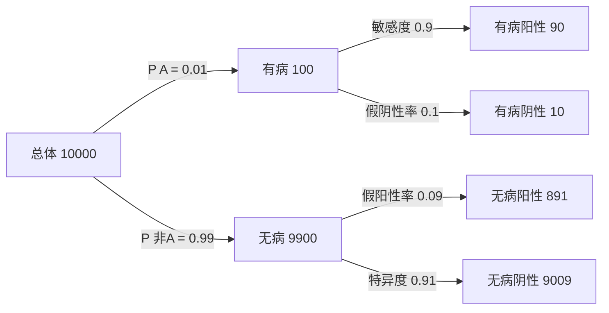

# 条件概率、基率与独立性：看见分母

## 分层学习资源关键词

| 层级 | 可复制的搜索关键词 | 目标 |
|---|---|---|
| 核心 / 必看 | 条件概率 自然频数 四格表；P A given B 分母；贝叶斯公式 基率忽视 筛查阳性 | 能先说出分母范围，再算比例 |
| 拓展 / 辅助 | 概率树 全概率公式 敏感度 特异度；独立事件 与 互斥事件 区别；医学筛查 阳性预测值 | 用树与四格表互相核对，处理误区 |
| 进阶 / 深入 | Bayes odds likelihood ratio；conditional probability zero probability events；selection bias conditional independence | 推导优势与似然比，理解选择与零概率边界 |

可复制到 B 站、大学课程平台或搜索引擎。这些是关键词，不是已核验视频推荐；优先选择会展示四格人数、不同条件分母和空组边界的材料。

导航：[[examples/06-statistics-probability/README_CN|中文使用说明]] · [[examples/06-statistics-probability/README|English guide]] · [[examples/README_CN|示例总索引]] · [[examples/03-cs-osi-model/knowledge|网络分层的模型边界]]。

> [!abstract] 完整教学稿
> 本稿包含交互页的全部教学内容、默认与预设模型、参数解释、离散练习、语义迁移任务、逐级提示与完整解答，还补充贝叶斯推导、额外例子、参数边界和误区反例。交互页是单文件离线操作工具，本稿是规范化可检索笔记。

## 学习目标与使用路线

建议35–50分钟：先修与条件方向 → 默认10,000人四格表 → 切换条件高亮 → 6步推导 → 改变基率 → 独立与零阳性边界 → 离散题 → 文字解释。目标是：

1. 同一总体内正确填全四格表及行/列合计。
2. 区分 $P(A)$、$P(A\cap B)$、$P(A\mid B)$ 与 $P(B\mid A)$。
3. 从自然频数推导全概率与贝叶斯公式。
4. 解释低基率为何可能使假阳性多于真阳性。
5. 用乘积定义判断独立，区分独立与互斥。
6. 对零分母明确说“无定义”，不赋值0或1。
7. 提交完整推理，并说明比较人群时固定检测参数的假设。

网页本地核对仅适用于明确的离散答案，文字推理交给宿主语义评估；所有新评分仍是待核验反馈。探索滑块不被伪装成已作答或已掌握。

## 一、先修：事件、集合与同一总体

### 1. 定义事件

在筛查模型中：

- $A$：有病。
- $B$：检测阳性。
- $\bar A$：无病。
- $\bar B$：检测阴性。
- $A\cap B$：有病且阳性。

四种健康状态/检测结果组合互不重叠并覆盖总体：

$$
\Omega=(A\cap B)\cup(A\cap\bar B)\cup(\bar A\cap B)\cup(\bar A\cap\bar B)
$$

这里 $\Omega$ 表示样本空间。为从人数推概率，模型假设从同一总体随机等可能选择一人；不能把来自不同人群的分子、分母随意组合。例如一所医院已入院病人的基率与某地区普通人群的检测参数需要确认是否可同时使用。

### 2. 分数、百分比与补集

$1\%=0.01$；$90\%=0.9$。概率范围是0到1，百分比范围是0%到100%。

$$
P(\bar A)=1-P(A),\qquad P(\bar B\mid\bar A)=1-P(B\mid\bar A)
$$

第二个等式要求无病条件组具有正概率。补集必须发生在相同条件人群内：特异度和假阳性率互补，敏感度和“阳性者有病率”不是互补。

## 二、先看竖线右边：条件概率

$$
P(A\mid B)=\frac{P(A\cap B)}{P(B)},\qquad P(B)>0
$$

“已知B”表示把观察范围缩到B的人群。分母是所有B，分子是这些B中同时满足A的人。自然频数形式：

$$
P(A\mid B)=\frac{n(A\cap B)}{n(B)},\qquad n(B)>0
$$

因为共同除以总体人数 $N$，人数比和概率比一致：

$$
\frac{n(A\cap B)/N}{n(B)/N}=\frac{n(A\cap B)}{n(B)}
$$

### 不同问题有不同分母

| 表达式 | 问题 | 分子 | 分母 |
|---|---|---|---|
| $P(A)$ | 随机选一人，有病概率？ | 有病者 | 所有人 |
| $P(A\cap B)$ | 随机选一人，有病且阳性概率？ | 有病阳性者 | 所有人 |
| $P(B\mid A)$ | 已知有病，阳性比例？敏感度 | 有病阳性者 | 所有有病者 |
| $P(A\mid B)$ | 已知阳性，有病比例？阳性预测值 | 有病阳性者 | 所有阳性者 |
| $P(B\mid\bar A)$ | 已知无病，阳性比例？假阳性率 | 无病阳性者 | 所有无病者 |
| $P(\bar B\mid\bar A)$ | 已知无病，阴性比例？特异度 | 无病阴性者 | 所有无病者 |

> [!warning] 逆条件错误
> $P(A\mid B)$ 与 $P(B\mid A)$ 有相同交集，但使用不同分母。它们可以偶然相等，不能一般互换。“病人90%阳性”不能直接推出“阳性者90%有病”。

### 两个方向何时可能相等

若 $P(A)>0$、$P(B)>0$ 且交集概率为正：

$$
\frac{P(A\cap B)}{P(B)}=\frac{P(A\cap B)}{P(A)}
\iff P(A)=P(B)
$$

若交集概率为0、两个条件概率均定义，则它们都为0，即使 $P(A)\ne P(B)$。所以不能把“两个方向数值相等”当成一般定义或必然独立。

> [!question] 网页理解检查
> 想算“已知阳性时有病的概率”，分母应选：A所有阳性者；B所有有病者；C所有人。

> [!success]- 解答与错因
> A正确，分母包括真阳性与假阳性。B反转条件方向，C把条件概率换成联合概率。下一步在四格表中圈出B列，再找其内属于A的人。

## 三、四格表与检测术语

| 健康状态 \ 检测结果 | B：阳性 | B̄：阴性 | 行合计 |
|---|---|---|---|
| A：有病 | TP：真阳性 | FN：假阴性 | TP+FN |
| Ā：无病 | FP：假阳性 | TN：真阴性 | FP+TN |
| 列合计 | TP+FP | FN+TN | N |

$$
\text{敏感度}=\frac{TP}{TP+FN}
$$

$$
\text{假阳性率}=\frac{FP}{FP+TN},\qquad
\text{特异度}=\frac{TN}{FP+TN}=1-\text{假阳性率}
$$

$$
\text{阳性预测值}=\frac{TP}{TP+FP},\qquad
P(A\mid\bar B)=\frac{FN}{FN+TN}
$$

每个分母都必须大于0。“真/假”描述检测结果与健康状态是否一致，不是说存在概率为负或某一格可以重复计数。

## 四、完整默认模型：10,000人、1%基率、90%敏感度、9%假阳性率

### 1. 逐步算人数

$$
n(A)=10000\times0.01=100,\qquad n(\bar A)=9900
$$

$$
TP=100\times0.9=90,\qquad FN=100-90=10
$$

$$
FP=9900\times0.09=891,\qquad TN=9900-891=9009
$$

| 状态 | 阳性 | 阴性 | 合计 |
|---|---:|---:|---:|
| 有病 | 90 | 10 | 100 |
| 无病 | 891 | 9009 | 9900 |
| 合计 | 981 | 9019 | 10000 |

四格是给定概率模型对应的频数/期望人数，**不是已经观察到的病例记录**。网页固定 $N=10000$，滑块为整数百分比，使四格计算恰好是整数；真实样本仍有随机波动，检测参数也有估计不确定性。

### 2. 条件范围

$$
P(A\mid B)=\frac{90}{90+891}=\frac{90}{981}=\frac{10}{109}\approx9.17\%
$$

$$
P(B\mid A)=\frac{90}{90+10}=\frac{90}{100}=90\%
$$

两个方向差异很大：同一个分子90，对应分母981与100。大量无病者即使只有9%的假阳性率，仍贡献891个假阳性，多于90个真阳性。

$$
P(B)=981/10000=9.81\%,\qquad P(\bar B\mid\bar A)=9009/9900=91\%
$$

负条件的补充例子：

$$
P(A\mid\bar B)=10/9019\approx0.11\%
$$

这是阴性者中的有病率，不是敏感度的补集；敏感度补集是 $P(\bar B\mid A)=10/100=10\%$。

### 3. 概率树

一条路径对应联合概率。例如 $P(A\cap B)=0.01\times0.9=0.009$，再乘总体10000得到90。先分健康状态再分检测结果的树，与四格表的四格一一对应。

## 五、全概率与贝叶斯公式推导

事件A与Ā互斥并覆盖总体，所以B分解为两条互斥路径：

$$
B=(A\cap B)\cup(\bar A\cap B)
$$

$$
P(B)=P(A\cap B)+P(\bar A\cap B)
$$

在相关条件概率均定义时，使用乘法法则：

$$
P(A\cap B)=P(B\mid A)P(A)
$$

$$
P(\bar A\cap B)=P(B\mid\bar A)P(\bar A)
$$

得到全概率公式：

$$
P(B)=P(B\mid A)P(A)+P(B\mid\bar A)P(\bar A)
$$

把它代入条件概率定义：

$$
P(A\mid B)=
\frac{P(B\mid A)P(A)}{P(B\mid A)P(A)+P(B\mid\bar A)P(\bar A)}
$$

令基率 $p=P(A)$，敏感度 $s=P(B\mid A)$，假阳性率 $f=P(B\mid\bar A)$，两分支均存在时：

$$
P(A\mid B)=\frac{sp}{sp+f(1-p)},\qquad sp+f(1-p)>0
$$

它不是新的魔法规则，而是“正确分子 / 正确分母”的结果。若A分支概率为0，$s$在总体条件概率意义上无定义；网页仍可把它作为生成模型给空分支指定的参数，但必须区分两种含义。

## 六、改变基率与固定参数假设

保持 $s=0.9$、$f=0.09$，基率改为10%：

| 状态 | 阳性 | 阴性 | 合计 |
|---|---:|---:|---:|
| 有病 | 900 | 100 | 1000 |
| 无病 | 810 | 8190 | 9000 |
| 合计 | 1710 | 8290 | 10000 |

$$
P(A\mid B)=900/1710=10/19\approx52.63\%
$$

| 参数 | 1%基率 | 10%基率 |
|---|---:|---:|
| 敏感度 | 90% | 90% |
| 假阳性率 | 9% | 9% |
| 真阳性人数 | 90 | 900 |
| 假阳性人数 | 891 | 810 |
| 阳性预测值 | 9.17% | 52.63% |

比较中只改变基率是受控模型假设，不能默认为现实检测对任何人群有相同参数。阈值、病程、症状、取样、健康状态判定标准与人群组成都可能改变敏感度/假阳性率。

> [!warning] 本例适用范围
> 这是假想检测的教学模型，不是实际个体诊断建议。群体基率不一定等于某个个体已有信息下的风险；测量参数在新总体中需要核验。不要把9.17%直接套在任何现实检测结果上。

### 拓展推导：基率升高为什么推高后验

对 $0<p<1$、$s>0$、$f>0$，设 $q(p)=sp/[sp+f(1-p)]$，则：

$$
q'(p)=\frac{sf}{[sp+f(1-p)]^2}>0
$$

在固定参数且阳性分母为正的条件下，基率越高，阳性预测值越高。边界 $f=0$ 时，有真阳性则后验为1；若 $sp=0$ 且 $f=0$，分母为0，后验无定义。不能只从导数公式把空条件组补成某个值。

### 拓展推导：优势与似然比

在 $0<p<1$、$f>0$ 及后验两部分都正时：

$$
\frac{P(A\mid B)}{P(\bar A\mid B)}
=\frac{s}{f}\frac{p}{1-p}
$$

即后验优势 = 阳性似然比 $s/f$ × 先验优势。默认模型 $s/f=10$，先验优势 $1/99$，后验优势 $10/99$，换回概率 $10/(10+99)=10/109$。似然比大并不抹掉很低的先验概率。

## 七、独立、互斥与因果

### 1. 独立的通用定义

$$
A\perp B\quad\iff\quad P(A\cap B)=P(A)P(B)
$$

若 $P(B)>0$：

$$
A\perp B\quad\iff\quad P(A\mid B)=P(A)
$$

若 $P(A)>0$ 也可用 $P(B\mid A)=P(B)$。要写条件概率形式必须先确认相应分母存在；乘积定义在退化事件下仍可使用。

### 2. 检测结果何时与有病状态独立

在 $0<p<1$ 下，两组阳性率相等 $s=f$，则：

$$
P(B)=sp+f(1-p)=s
$$

$$
P(A\cap B)=sp=P(A)P(B)
$$

所以结果B不提供区分A与Ā的信息。网页“独立”预设为 $p=20\%$、$s=f=30\%$：TP600、FN1400、FP2400、TN5600，B总数3000，后验600/3000=20%=基率。

### 3. 互斥与独立不相同

互斥意味着交集为空，因此 $P(A\cap B)=0$。若 $P(A),P(B)>0$，它们的乘积大于0，因此互斥事件不独立。

例：单次公平骰子的A“掷出1”、B“掷出2”互斥。已知B后A概率从1/6变为0，当然不是“不受影响”。但有零概率退化事件时，互斥与独立可以同时满足，不能漏掉这一边界。

### 4. 独立、关联与因果

统计独立或关联是联合分布性质，不直接证明某一事件对另一事件有无因果作用。条件化可能改变统计关系；重新筛选人群后原先的独立性未必保留。

> [!example]- 条件化造成的关联
> 独立掷两枚公平硬币，A“第一枚正面”、B“第二枚正面”独立。只保留“至少一枚正面”的结果后，样本为HH、HT、TH。条件总体中P(A)=P(B)=2/3，交集P(A∩B)=1/3，而乘积4/9不等于1/3，因此A、B在筛选后的总体中不独立。比较前后必须声明条件与总体。

## 八、零概率条件与参数边界

| 情况 | 正确处理 |
|---|---|
| P(B)=0 / 阳性人数0 | $P(A\mid B)$ 的离散比例无定义；0/0不是0或1 |
| P(A)=0 / 有病人数0 | $P(B\mid A)$ 无定义；若B有正概率，$P(A\mid B)=0$ |
| P(A)=1 / 无病人数0 | 假阳性率与特异度作为该总体条件比例无定义；若B有正概率，$P(A\mid B)=1$ |
| 全员阳性 | $P(A\mid B)=P(A)$；阴性条件组为空，$P(A\mid\bar B)$ 无定义 |
| 假阳性率0且有真阳性 | 所有阳性者均有病，后验1 |
| 敏感度0但有假阳性 | 后验0；阳性组有成员所以是有定义的0 |
| 真阳性与假阳性均0 | 阳性组为空，无定义；不能与上一行混淆 |

网页零阳性预设 $p=10\%$、$s=f=0$：TP0、FN1000、FP0、TN9000，B0，后验显示“无定义”。不是检测“不准所以概率0”，而是根本没有可用的阳性分母。

退化独立：若A必不发生或必发生，乘积定义可成立；空组条件概率仍无定义。网页通过乘积判断独立，不通过强行填空的条件概率。

> [!info] 进阶范围
> 连续分布中可定义条件密度或正规条件分布，处理单点概率0的条件；需要比本课有限频数比例更多的数学结构。不能把连续情形直接用“0/0=某数”解释，也不宜把本课的离散结论推广成“所有零概率条件绝不可能有任何条件分布”。

## 九、交互工具如何对应数学

### 三个滑块

固定10,000人；基率、敏感度、假阳性率均为0–100整数百分比。更新规则：

$$
A=Np,\quad \bar A=N-A,\quad TP=As,\quad FN=A-TP,\quad FP=\bar A f,\quad TN=\bar A-FP
$$

每次更新检查四格、行、列和总体合计。显示百分比保留两位小数；计算使用原整数人数，不用已经四舍五入的显示百分比回算。

### 四种条件视图

| 按钮 | 高亮范围 | 蓝色目标 | 分母 |
|---|---|---|---|
| 只看B阳性者 | TP、FP | TP | TP+FP |
| 只看A有病者 | TP、FN | TP | TP+FN |
| 看全体 | 全四格 | TP+FN | N |
| 只看阴性者 | FN、TN | FN | FN+TN |

条形图代表**已选条件范围内**的比例，而不是固定10,000人中人数比例；换条件会同时改变条形的分母。这一缩放必须明确说明，避免把同样宽的条当成相同人数。

### 六步推导

1. 用基率分有病/无病人数。
2. 算有病分支真阳性与假阴性。
3. 算无病分支假阳性与真阴性。
4. 阳性总数=真阳性+假阳性。
5. 在阳性条件范围内求有病比例；先检查分母。
6. 反向用有病人数作分母，比较敏感度。

上一/下一步、归零不改变模型概率，只改变讲解阶段。预设一键切换默认稀有事件、10%基率、独立、零阳性。滑块探索不等于完成题目，提交才采集学习证据。

## 十、完整练习、提示与解答

### Q1 入门：整数分子与两个方向的分母

题目固定，不随滑块变化：1,000人；20人有病，其中18阳性、2阴性；980人无病，其中98阳性、882阴性。填 $P(A\mid B)$ 的分子/分母与 $P(B\mid A)$ 的分母。

> [!tip]- L1 引导
> 竖线右边的条件是谁？先圈阳性列，再圈有病行，比较样本范围。

> [!tip]- L2 策略
> 把交集人数、阳性合计、病人合计分别写出来。两个方向共享交集，通常不共享分母。

> [!tip]- L3 部分示范
> 交集人数是18。阳性人数来自两个健康组的阳性者，还需要把无病阳性98加入。

> [!success]- 完整解答
> 分子18；$P(A\mid B)$分母18+98=116，概率18/116=9/58≈15.52%；$P(B\mid A)$分母20，概率18/20=90%。三项逐项部分计分。把前者分母写20是逆条件错误；写1000是混淆联合概率；漏掉98是假阳性没有进入条件组。

### Q2 进阶：独立性

已知 $P(A)=0.2$、$P(B)=0.5$、$P(A\cap B)=0.1$。选：独立，因为0.1=0.2×0.5；互斥，因为它们是不同事件；不独立，因为P(A)≠P(B)。

> [!tip]- 引导与策略
> 独立的定义是事件名称不同、概率相等，还是联合概率等于边缘概率乘积？先计算0.2×0.5。

> [!success]- 完整解答
> 独立：0.2×0.5=0.1，满足乘积定义。等价检查$P(A\mid B)=0.1/0.5=0.2=P(A)$。不是互斥，交集概率为0.1而非0；独立不要求两个边缘概率相等。

### Q3 边界：P(B)=0

离散总体中P(B)=0，按本课比例定义P(A|B)是什么？选0、无定义、1。

> [!tip]- 引导与策略
> 写出分子/分母。交集是B的子事件，概率也为0；0/0是否定义？

> [!success]- 完整解答
> 无定义。分母为0，不能把“无人阳性”解释为“阳性者有病率0”，也不能因“没有反例”赋值1。网页零阳性预设会显示空条件人群与“无定义”。

### Q4 语义迁移：解释敏感度与后验

同伴说：“检测敏感度90%，所以阳性后有病概率就是90%。”用默认1%/90%/9%四格人数解释；再说明基率10%时如何变化，以及固定参数假设。

> [!tip]- L1 引导
> 两个条件概率是在同一组人中取比例吗？“病人中的阳性”与“阳性中的病人”各自分母是谁？

> [!tip]- L2 策略
> 用N=10000先分病人与无病者，分别算阳性人数，再把两个健康组的阳性相加作为分母。

> [!tip]- L3 部分示范
> 1%基率给出100病人，其中90阳性；继续算9900无病者中的假阳性，然后比较90/100与90/所有阳性。

> [!success]- 完整参考解答
> 敏感度$P(B\mid A)=90/100=90\%$，分母是病人；阳性预测值$P(A\mid B)=90/(90+891)=10/109\approx9.17\%$，分母包含真阳性与假阳性。基率10%时有1000病人、9000无病者，真阳性900、假阳性810，所以后验900/1710=10/19≈52.63%。同一敏感度不能代表所有人群相同阳性预测值。这项比较假设检测敏感度与假阳性率在人群间固定；现实可能随人群、阈值、取样条件变化，因此参数需重新核验。这里是群体模型，不是个体直接诊断。

语义审阅需同时检查：条件方向、四格人数、正确分母、近似与精确值关系、基率对比和固定参数边界。单纯出现“贝叶斯、90%、基率”等关键词或满足字数要求不能证明推理正确。网页只保存完整原文，不产生本地语义评分或完成标记。

### 完整答案后的新变式

1,000人中100有病，其中80阳性；无病者中90阳性。求P(A|B)的分子/分母人数。

> [!success]- 完整解答
> 分子80，分母80+90=170，概率80/170=8/17≈47.06%。把分母写100仍是逆条件错误。两项都正确才结束这项客观验证，并生成自己的作答与评估，再请求Runtime检查本地证据；语义解释任务仍独立待评估。

## 十一、额外练习与完整解答

### 练习A：邮件垃圾过滤

20%邮件是垃圾；过滤器把95%垃圾标记出来，把10%正常邮件误标。已知被标记，是垃圾概率？

> [!success]- 解答
> 取10000封邮件：垃圾2000，标记1900；正常8000，误标800。被标记2700，后验1900/2700=19/27≈70.37%。95%是敏感度，70.37%是本总体的标记后验。

### 练习B：完全随机检测

有病/无病者阳性率都为40%，基率5%。阳性后有病概率？

> [!success]- 解答
> 两组阳性率相同，A与B独立。取10000人：TP200、FP3800，总阳性4000，后验200/4000=5%=基率。检测阳性在这个模型里不提供区分健康状态的信息。

### 练习C：假阳性为零

基率2%，敏感度50%，假阳性率0。阳性后有病概率？若敏感度也为0又如何？

> [!success]- 解答
> 第一种情况阳性者存在且全部来自病人，因此后验1。敏感度也为0时TP=FP=0，阳性组为空，后验无定义；不是仍然1。

### 练习D：阴性后的风险

基率10%，敏感度80%，假阳性率10%。阴性者有病概率？

> [!success]- 解答
> 10000人中病人1000，FN200；无病9000，TN8100。阴性8300，$P(A\mid\bar B)=200/8300=2/83\approx2.41\%$。不能把20%假阴性率直接当作阴性后的有病率。

### 练习E：为何不能盲目把两次检测相乘

同一人的两次阳性，是否总能把阳性似然比平方？

> [!success]- 解答
> 需要在有病与无病两种健康状态下分别检查两次检测结果的条件独立性，并确认参数适用。重复取同一样本、共用设备误差或同一病程信息可能使结果相关。没有这些假设，不能直接平方；本页只演示单次检测。

### 练习F：互斥正概率事件

P(A)=0.3、P(B)=0.2，A与B互斥，是否独立？

> [!success]- 解答
> 不独立。交集0，边缘乘积0.06，不满足独立定义；$P(A\mid B)=0\ne0.3$。

## 十二、推理审阅与教学维护

> [!todo] 内容复核清单
> 是否先声明事件、总体和随机选择模型？人数是否四格互斥且合计N？假阳性是否进入阳性分母？敏感度/特异度是否保留正确条件？显示近似是否与精确计算一致？独立是否按乘积定义、零分母是否明确无定义？固定参数是否说明？文字解释是否保留原文待语义审阅？是否提供所有任务的完整解答和新后置验证？

数学依据是有限概率空间中的条件概率定义、互斥可加性、乘法法则与独立定义；公式均在本文逐步推导。进一步参考检索“大学概率论 条件概率与全概率公式”“Bayes theorem natural frequencies”“MIT probability conditional independence”等，并区分教材定义与实际诊断参数估计。

回到 [[examples/06-statistics-probability/README_CN|中文使用说明]] 或 [[examples/README_CN|全部学科示例]]。

Related: [[Knowledge_Index]] · [[docs/teaching-delivery]]

<!-- DELIVERY_DETAIL_START -->

## 教学点深度索引

此索引逐项保留具体先修、机制、推导、例题、误区、边界和迁移依据，供教学包审阅。完整说明和所有题目解答在前述章节；页面只投影其中可控操作。

### 从四格自然频数识别条件方向与分母

教学点：`stats.conditional.denominator`。

**先修与符号**：A表示有病、B表示阳性，补集表示无病或阴性，交集表示同时满足。四格互斥且覆盖同一总体；从人数推概率时假设随机等可能选取一人，不能混用不同人群的分子与分母。

**机制与条件**：P(A|B)把范围缩到B，分母是全部B，分子是B内同时满足A的人；P(B|A)共享交集却使用A作分母。共同除以总体N后约去N，所以人数比等于概率比。

**逐步操作与理由**：

1. 先圈出竖线右侧条件组，计算该行或列的全部人数；求阳性者有病率时，真阳性和假阳性都属于阳性分母，不能漏掉假阳性。
2. 在条件组内找有病且阳性的人作分子，再将分子除以正的条件人数；与逆方向比较时保留同一分子并更换分母，最后检查四格合计仍等于总体。

**完整例子与核对**：1000人中有病20且18阳性、无病980且98阳性：P(A|B)=18/(18+98)=9/58≈15.52%，P(B|A)=18/20=90%；其余格2和882使合计1000。

**误区与修正**：把P(A|B)分母写20反转条件，写1000变成联合概率，写18漏掉假阳性；同一交集不能作为两个方向数值必相同的理由。修正时先用语言说出只看哪组人。

**模型与输入边界**：条件人数必须正；阳性组为空时0/0无定义，而非0或1。默认频数是给定模型的频数/期望人数，不能伪装成已观察病例；参数是否适用于同一总体需确认。

**邻近情况对比**：敏感度是有病者中的阳性率，特异度是无病者中的阴性率；阳性预测值是阳性者中的有病率。敏感度补集是有病者中的阴性率，不是阴性者中的有病率。

**基础、变式、挑战及错因**：基础题：18/116的分子18、分母116。变式题：1000人中80有病阳性、90无病阳性，后验80/170=8/17≈47.06%。挑战题：默认FN10、TN9009时阴性者有病率10/9019≈0.11%，不能写敏感度补集10%。

**迁移与不变原则**：邮件过滤中将A换为垃圾邮件、B换为被标记；先统计被标记的垃圾和正常邮件，再以全部标记邮件为分母。同一条件方向原则可迁移，医疗术语不能代替分母检查。

**图示与操作定位**：四格表与可选条件人群高亮，交互页控件 `#frequencyTable`。图示展示结构和状态，计算结论还须由上面的守恒、比例或协议推理核对。

### 从概率树推全概率并解释基率效应

教学点：`stats.bayes.base-rate`。

**先修与符号**：百分比先换为0到1的概率；病人与无病者构成互斥分支。敏感度s和假阳性率f都是各自健康组的阳性率，基率p是总体有病比例，不能把这三个参数互换。

**机制与条件**：阳性来自有病和无病两条互斥路径，路径概率分别sp和f(1−p)，总阳性概率为两者相加；用sp除以该正总数就是贝叶斯后验，不是独立于分母的新规则。

**逐步操作与理由**：

1. 取N=10000，把基率1%换成p=0.01，得到病人100、无病9900；乘各组阳性率0.9和0.09，得到真阳性90和假阳性891，分别检查各行的阴性补数。
2. 把两组阳性相加得981，再算90/981=10/109≈9.17%；改变基率为10%且保持检测参数固定时重新算900和810，后验900/1710=10/19≈52.63%，不能只改分子。

**完整例子与核对**：默认四格TP90、FN10、FP891、TN9009：合计10000；敏感度90/100=90%，后验90/981≈9.17%。低基率下庞大的无病组使9%误报仍产生891假阳性，多于90真阳性。

**误区与修正**：敏感度90%不意味着阳性者90%有病；该错误忽略无病组的假阳性与基率。修正是先画两条分支、相乘再相加，并用完整阳性分母检验结论。

**模型与输入边界**：公式分母sp+f(1−p)必须大于0；p为0或1时空健康分支的条件比例无定义，滑块指定生成参数不等于已测得空组条件概率。比较现实人群时敏感度和假阳性率也可能变化。

**邻近情况对比**：基率1%与10%的比较只改变p并固定s、f；它是受控模型而非对所有现实检测的普遍承诺。高似然比可以提高先验优势，仍不能自动消除极低基率。

**基础、变式、挑战及错因**：基础题：默认真阳性90、假阳性891、后验10/109。变式题：10%基率给后验10/19。挑战题：20%垃圾邮件、95%检出、10%误报时，10000封中标记1900+800=2700，垃圾后验19/27≈70.37%；95%仍是正向检出率。

**迁移与不变原则**：比较新总体的筛查结果时，先核验总体基率和检测参数能否一起使用，再解释哪些参数固定、哪些变化；群体模型的后验不能直接代替某个个体已有额外信息的风险。

**图示与操作定位**：可控概率树与六步贝叶斯频数推导，交互页控件 `#probabilityTree`。图示展示结构和状态，计算结论还须由上面的守恒、比例或协议推理核对。

### 区分独立互斥并正确处理空条件组

教学点：`stats.independence.boundaries`。

**先修与符号**：交集概率表示同时发生，边缘概率表示各自发生。乘积定义P(A∩B)=P(A)P(B)可在退化事件下使用；条件概率形式还需明确相应分母大于0。

**机制与条件**：独立是联合分布中乘积关系，互斥是交集为空。两个正概率互斥事件的交集为0而边缘乘积大于0，所以不独立；独立或关联本身都不直接建立因果结论。

**逐步操作与理由**：

1. 先计算边缘乘积并与交集比较：P(A)=0.2、P(B)=0.5时乘积0.1，若交集也是0.1则独立；若条件分母正，再用条件概率等于边缘作第二次核对。
2. 遇到P(B)=0时停止计算P(A|B)并标明无定义，同时可继续用乘积定义讨论独立；不要将空阳性组的0/0填成0或1，也不要混淆与非空组内分子为0的情况。

**完整例子与核对**：独立预设p20%、s=f30%：TP600、FN1400、FP2400、TN5600，后验600/3000=20%=基率。零阳性预设p10%、s=f0：TP0、FP0，阳性组为空，后验无定义。

**误区与修正**：独立不要求两个边缘概率相等，也不是事件名称不同；互斥正概率事件不能独立。空组后验无定义与敏感度0但有假阳性的后验0是不同状态，应先查分母是否存在。

**模型与输入边界**：当A概率0或1时乘积定义可能成立，而某个健康组的条件比例仍无定义；连续分布的零概率条件需要额外结构，不可将本课有限频数比例当作全部条件分布理论。

**邻近情况对比**：单次公平骰子的掷出1与掷出2互斥但不独立；两枚公平硬币各自正面原本独立，筛选至少一枚正面后却有关联，因此改变总体可改变独立关系。

**基础、变式、挑战及错因**：基础题：0.1=0.2×0.5证明给定事件独立。变式题：P(A)=0.3、P(B)=0.2且互斥，0≠0.06所以不独立。挑战题：假阳性0且有真阳性时后验1；若真阳性也0则空组无定义，不能仍写1。

**迁移与不变原则**：对同一人的两次检测不能无条件把似然比平方；须在有病和无病状态下分别检验两次结果的条件独立性及参数适用性，共用样本或设备误差可能破坏假设。

**图示与操作定位**：独立与零分母预设及状态说明，交互页控件 `#independenceReading`。图示展示结构和状态，计算结论还须由上面的守恒、比例或协议推理核对。

<!-- DELIVERY_DETAIL_END -->

<!-- HTML_READING_START -->

## 页面短读版、图示标注与操作对照

以下保留页面正文的简短措辞、图示标注及控件文字，便于脱离浏览器检索。模型假设、动态步骤、每题反馈和完整解答见上面的教学章节；这里的待核验/占位状态不表示真实学习者结果。

> [!note]- 导航与学习状态（页面原文）
> 跳到教学内容 · LEAP · 统计 · 条件概率 · 基率与分母 · EVIDENCE STAGE · 证据阶段 · estimated · 仅估计 · MASTERY · 掌握度 · 0.48 · NEXT REVIEW · 待宿主安排 · 本页尚未连接 Runtime；掌握度与证据阶段保持初始占位值，作答评分仅为待核验反馈。

> [!note]- 教学短读版（页面原文）
> 01 · TEACHING · 教学内容 · 条件概率：先看分母，再看基率 · 用四格表、频数条和概率树把“已知”变成可见的样本范围，区分 P(A|B) 与 P(B|A)，判断独立性，并解释阳性结果为何受基率影响。 · 建议 35–50 分钟 · 先修：分数、百分比、集合交集与补集的直觉 · LEARNING RESOURCES · 搜索关键词 · 核心 / 必看： · “条件概率 自然频数 四格表”“P A given B 分母”“贝叶斯公式 基率忽视 筛查阳性”。 · 拓展 / 辅助： · “概率树 全概率公式 敏感度 特异度”“独立事件 与 互斥事件 区别”“医学筛查 阳性预测值”。 · 进阶 / 深入： · “Bayes odds likelihood ratio”“conditional probability zero probability events”“selection bias conditional independence”。 · 可复制到 B 站、课程平台或搜索引擎检索。这里提供检索关键词，不声称某条视频已经核验；优先选择能说明四格人数及分母、而不是只背公式的课程。 · 先修：事件、交集与同一总体 · 事件 A 是“有病”，事件 B 是“检测阳性”。A∩B 是“有病且阳性”；Ā 是“无病”，B̄ 是“阴性”。四种组合互不重叠，合起来覆盖总体。下面使用同一总体的 10,000 人，默认模型把随机选人视为等可能；不能把来自不同人群的分子与分母随意拼在一起。 · 条件概率把观察范围缩小到“条件已成立”的人群。P(A|B) 读作“已知 B，A 的概率”；竖线右边是条件，所以分母必须是 B 的全部人数。 · 1. 三个概率，各回答不同问题 · 符号 · 具体问题 · 对应分母 · P(A) · 随机选一人，有病的概率是多少？这是基率/患病率。 · 所有人 · P(B|A) · 只看有病者，检测阳性的比例是多少？这是敏感度。 · 所有有病者 · P(A|B) · 只看阳性者，真正有病的比例是多少？这是阳性预测值。 · 所有阳性者：真阳性 + 假阳性 · P · A · B · P · A · B · P · B · P · B · 0 · 注意方向： · P(A|B) 和 P(B|A) 有相同交集，却使用不同分母。只有满足额外数值关系时才可能相等；“检测对病人的敏感度高”不能直接推出“阳性者有病的概率高”。 · 2. 完整频数推导：1% 基率，90% 敏感度，9% 假阳性率 · 10,000 人中，有病 100、无病 9,900。 · 有病者 90% 阳性：真阳性 90，假阴性 10。 · 无病者 9% 阳性：假阳性 891，真阴性 9,009。 · 阳性者总数 90+891=981；因此 P(A|B)=90/981=10/109≈9.17%。 · 敏感度 P(B|A)=90/100=90%；两者分母是 981 与 100，不能互换。 · 这些人数是 · 给定概率模型对应的频数/期望人数 · ，用于理解比例，不代表已经观察到的真实病例。这里滑块使用整数百分比，固定 10,000 人，使四格计数为整数。真实样本会有随机波动，参数还可能随人群而变。 · 特异度与假阳性率： · 特异度 P(B̄|Ā)=1−P(B|Ā)。本例假阳性率 9%，特异度 91%。它们的条件都是“无病”，不是“所有阳性”，也不是“所有人”。 · 3. 从四格表得到全概率与贝叶斯公式 · B 的人数来自有病与无病两个互斥分支，所以先把两条路径相乘，再相加：P(B)=P(B|A)P(A)+P(B|Ā)P(Ā)。把这一结果用作条件概率的分母，得到贝叶斯公式。 · P · A · B · P · B · A · P · A · P · B · A · P · A · P · B · A · P · A · 保持敏感度 90%、假阳性率 9%，把基率从 1% 改为 10%：真阳性 900，假阳性 810，阳性总数 1,710，P(A|B)=900/1710=10/19≈52.63%。同一检测参数，应用在人群中不同基率，阳性预测值不同。 · 4. 独立、互斥与零分母 · 独立 · 表示知道一个事件不改变另一个事件的概率，通用定义是 P(A∩B)=P(A)P(B)。若 P(B)>0，可等价写为 P(A|B)=P(A)。在两个健康状态分支都有正概率时，敏感度等于假阳性率意味着检测结果不区分有病与无病。 · 互斥 · 表示不能同时发生，即 A∩B 为空。若 P(A)、P(B) 均大于 0，互斥会使 P(A∩B)=0 而 P(A)P(B)>0，因此它们不独立。独立也不等于因果无关，统计关联也不等于因果作用。 · 边界： · P(B)=0 时，本页的离散比例 P(A|B) 无定义，不能填 0、1 或“永远独立所以随便取”。若 P(A)=0，P(B|A) 也无定义；若全员阳性，则 P(A|B)=P(A)。若基率 0% 或 100%，某个健康分支没有人，滑块可设定反事实分支参数，但当前总体不能据此计算该空组的条件概率。通用乘积定义仍能判断退化独立性。 · CHECKPOINT · 理解检查 · 想算“已知阳性时有病的概率”，四格表应该用哪一组人数作分母？ · A. 所有阳性者：有病阳性 + 无病阳性 · B. 所有有病者：有病阳性 + 有病阴性 · C. 所有人 · READ THE CONDITION · 分母规则 · 把“已知 B”翻译为“只在 B 的那一列内抽人”。先说出谁有资格进入分母，再找其中满足 A 的人。 · BASE-RATE NEGLECT · 基率忽视 · 90% 敏感度告诉你真阳性占病人的比例；低基率的人群里无病人数很多，少量的假阳性率也可能带来大量假阳性。 · NOT A DIAGNOSIS · 模型适用范围 · 本例是教学用假想检测，不是实际诊断建议。现实检测参数会受人群、阈值、取样和验证方法影响；个体风险也不必等于总体基率。 · LEARNING GOALS · 学习目标 · 用同一总体填全 2×2 表。 · 区分条件方向与联合概率。 · 从自然频数推导贝叶斯比例。 · 判断独立与零分母边界。 · 用证据解释基率变化。 · 离散答案可作本地核对；文字解释需由宿主语义审阅，分数保持待核验。

> [!note]- 练习、图示与控件（页面原文）
> 02 · PRACTICE · 交互练习 · 用人数看见“已知”的范围 · 参数探索 → 分步分母选择 → 离散计算 → 概念边界 → 语义解释。探索滑块会更新演示，不作为作答证据；提交按钮才记录答案。 · STAGE · CONDITIONAL PROBABILITY CALCULATOR · 固定 10,000 人的筛查模型 · 基率 P(A) · 1% · 总体中有病的人占比 · 敏感度设定 P(B|A) · 90% · 若病人组非空，组内阳性比例 · 假阳性率设定 P(B|Ā) · 9% · 若无病组非空，组内阳性比例 · 稀有事件：1% / 90% / 9% · 基率变为 10% · 独立：两组阳性率都为 30% · 零阳性：检查分母边界 · 9.17% · P(A|B) · 阳性者中的有病率 · 90.00% · P(B|A) · 病人中的阳性率 · 9.81% · P(B) · 全体中的阳性率 · 91.00% · P(B̄|Ā) · 特异度 · 同一总体 10,000 人；点击下方条件按钮高亮分母范围 · 模型频数 · B：阳性 · B̄：阴性 · 行合计 · A：有病 · 90 · 10 · 100 · Ā：无病 · 891 · 9009 · 9900 · 列合计 · 981 · 9019 · 10000 · 只看 B 阳性者 · P(A|B) · 只看 A 病人 · P(B|A) · 看全体 · P(A) · 只看阴性者 · P(A|B̄) · 条件范围内的比例频数条 · 每次选择条件后，用条形宽度表示分母范围内满足目标的人数比例。 · 从总体分到健康状态再分到检测结果的概率树 · 每条路径的频数与四格表一致。首先分有病与无病，再分别分阳性与阴性。 · 总体 N=10,000 · 先分健康状态 · 上一步推导 · 下一步推导 · 推导归零 · 步骤 1 / 6 · 精确计算使用未四舍五入的整数人数；显示的百分比保留两位小数。0 分母明确显示“无定义”，不替换成 0。 · Q1 · FOUNDATION · 入门：为两个方向选择正确分母 · 固定题目，不随上方滑块变化：1,000 人中 20 人有病；其中 18 人阳性、2 人阴性。980 人无病；其中 98 人阳性、882 人阴性。用整数频数填空，不必填写小数百分比。 · P(A|B) 的分子：有病且阳性人数 · P(A|B) 的分母：所有阳性人数 · P(B|A) 的分母：所有有病人数 · 提交三项频数 · Q2 · INDEPENDENCE · 进阶：独立性判断 · 已知 P(A)=0.2，P(B)=0.5，P(A∩B)=0.1。A 与 B 是否独立？ · 独立，因为 0.1=0.2×0.5 · 互斥，因为它们是不同事件 · 不独立，因为 P(A)≠P(B) · Q3 · BOUNDARY · 边界：零概率条件 · 离散总体中 P(B)=0。用本课的比例定义能否计算 P(A|B)？ · 等于 0，因为没有阳性者 · 无定义，因为分母为 0 · 等于 1，因为阳性者无反例 · Q4 · SEMANTIC TRANSFER · 迁移：向同伴解释“90% 敏感度” · 同伴说：“这个检测敏感度 90%，所以阳性后有病概率就是 90%。”用 1% 基率、90% 敏感度、9% 假阳性率的四格人数解释这句话；再说明基率改成 10% 时结论如何变化，以及保持检测参数固定的假设为何需要说明。 · 提交解释，待语义审阅 · 保存原文，供宿主评估条件方向、人数核对、推导逻辑和假设边界。页面不会用关键词或字数生成语义分数。 · PROGRESSIVE DISCLOSURE · 主动提示与完整解答 · L1 引导 → L2 策略 → L3 部分示范 → L4 完整答案 · L1 引导问题 · 圈出条件范围 · L2 策略提示 · 列出分子分母 · L3 部分示范 · 先算一个分支 · L4 完整答案 · 二次确认后展开 · 当前提示层级为 0；主动使用提示会保留记录。 · POST-VERIFICATION · 新的客观变式 · 1,000 人中 100 人有病，病人中 80 人阳性；无病者中 90 人阳性。要计算 P(A|B)，请填分子和分母人数。看过答案不等于完成，必须重新判断这个新题。 · 分子人数 · 分母人数 · 提交变式验证 · LOCAL FEEDBACK · 待核验反馈 · 尚未核对离散作答。语义解释不会在本地生成分数。 · 你做对的部分 · 提交后逐项指出正确频数或判断。 · 卡在哪里 → 下一步 · 先检查条件方向，再检查分母，最后核对算术。 · overall_score 权重：correctness 0.4 / conceptual_understanding 0.3 / reasoning_quality 0.2 / application 0.1。离散题按明确答案核对，解释题交给宿主评估；所有新评估保持 provisional。 · EVIDENCE TRAIL · 本次会话事件 · 已产生 0 条事件 · 尚无事件 · 作答、提示与验证均保留追加记录

> [!note]- 反馈与会话记录（页面原文）
> 03 · AGENT OUTPUT · 数据输出 · 交给宿主 Agent 的交互结果 · 这一区不是调试信息，而是学习者本次会话的完整档案。宿主 Agent 通过它驱动下一轮教学决策。 · BRIDGE · 演示模式 · 未接入宿主 Agent；学习动作会累积为待执行的 MCP 调用。 · 取出调用队列 ▾ · AGENT OUTPUT · 已记录 0 条事件 · 展开 JSON ▾ · LEAP 示例 6 · 条件概率与基率 · node_id · stats.probability.conditional · · unit_tag · conditional-probability · 单文件离线运行 · 所有人数属于明确的教学模型 · 自然频数/概率树/四格表同步更新 · 知识稿见本目录 knowledge.md。

<!-- HTML_READING_END -->

<!-- LEAP_BACKLINKS -->

## Backlinks / 反向关联

[[Knowledge_Index]] · [[docs/subject-knowledge-map]] · [[examples/03-cs-osi-model/knowledge]] · [[examples/06-statistics-probability/README]] · [[examples/06-statistics-probability/README_CN]]
