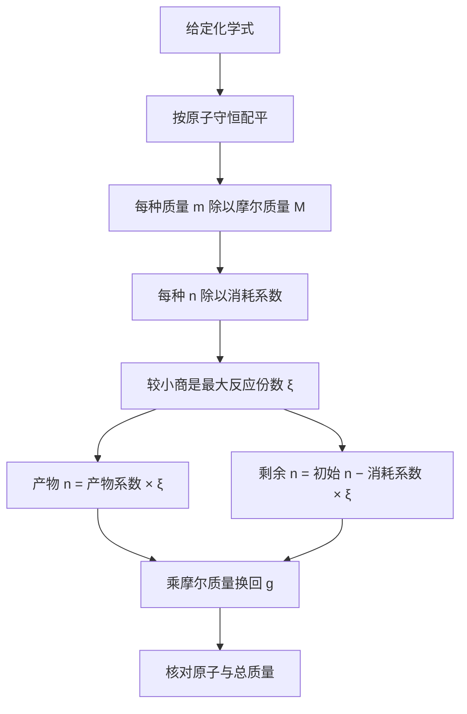

# 配平与限制反应物：从粒子比例到理论产量

## 分层学习资源关键词

| 层级 | 可复制的搜索关键词 | 目标 |
|---|---|---|
| 核心 / 必看 | 化学方程式 配平 系数 下标 区别；物质的量 mol 摩尔质量 n m M；限制反应物 化学计量 | 配平不改物质，先换mol再比较消耗 |
| 拓展 / 辅助 | 粒子模型 配平 原子守恒；理论产量 实际产量 百分产率；反应物过量 n 除以 系数 | 用粒子与质量核对，说明理想与实际 |
| 进阶 / 深入 | OpenStax Chemistry 2e 4.1 balancing equations；OpenStax 4.4 reaction yields；reaction extent limiting reagent；BIPM mole Avogadro constant | 理解反应进度、SI单位与模型边界 |

可复制到B站、大学公开课平台或搜索引擎。这是关键词清单，不是已核验视频推荐；优先选择完整区分下标/系数、g/mol、理论/实际且计算剩余量的材料。

导航：[[examples/07-chemistry-stoichiometry/README_CN|中文说明]] · [[examples/07-chemistry-stoichiometry/README|English guide]] · [[examples/07-chemistry-stoichiometry/sources|实际阅读的内容依据]] · [[examples/README_CN|示例索引]]。

> [!abstract] 完整教学稿
> 本稿包含交互页全部概念、公式、粒子/宏观演示说明、固定练习、分级提示和完整解答，另补充守恒推导、更多反例、反应进度与产率边界。交互页是离线工具，本稿是Obsidian可检索知识底稿。

## 学习目标与路线

建议35–50分钟，先修是元素符号、分子式下标、比值与单位换算。学习路线：化学式与系数 → 原子守恒配平 → 系数的粒子/mol比 → g换mol → n/系数比较 → 产物与剩余 → 理论模型边界。

目标是能独立核对元素守恒，正确区分mol比与质量比，求出限制物、理论产量和剩余物，并说明配平为什么不保证反应开始、完全、迅速或百分之百回收。网页只核对明确客观答案；论证、迁移与自信不从客观正确性自动推算。

## 一、先修：化学式、系数与指定实体

### 1. 下标决定组成，系数决定数量

- H₂：每个氢分子含2个H原子。
- O₂：每个氧分子含2个O原子。
- H₂O：每个水分子含2个H原子、1个O原子。
- 2H₂：两个H₂分子或2mol H₂，不是一个H₄分子。

下标是物质组成的一部分，改下标会改变所指物质/实体。把H₂O改成H₂O₂会变成过氧化氢；把H₂改成H也从双原子分子换成了原子。配平只调整给定化学式前的系数，不能以改变物质身份来“凑数字”。

### 2. 物质的量与摩尔

物质的量符号$n$，SI单位mol。1mol含精确的 $6.02214076\times10^{23}$ 个指定基本实体。阿伏伽德罗常数：

$$
N_A=6.02214076\times10^{23}\ \mathrm{mol^{-1}},\qquad N=nN_A
$$

必须说明计数对象：原子、分子、离子、电子或指定粒子组。例如1mol H₂分子含2mol H原子；二者虽有关系，却不是相同实体的数量。

宏观mol量可以是0.5mol或0.25mol，它们对应很大的整数粒子数量的宏观近似。离散小球示意则不能把一个H₂分子切成“半个H₂分子”继续按同一种物质计数，所以下方两个工具刻意使用不同尺度。

### 3. 摩尔质量与质量换算

摩尔质量$M$是每mol指定物质的质量，常用g/mol。本例固定学校近似：

| 物质 | 本课摩尔质量 |
|---|---:|
| H₂ | 2.00 g/mol |
| O₂ | 32.0 g/mol |
| H₂O | 18.0 g/mol |

这些不是宣称自然界实际摩尔质量恰好等于这三个数字；它们是与H≈1、O≈16一致的课堂近似，所有题目统一使用。实际数值与同位素组成、所用原子量表和测量精度有关。

$$
n=\frac{m}{M},\qquad m=nM
$$

单位核对：

$$
\frac{\mathrm g}{\mathrm{g\,mol^{-1}}}=\mathrm{mol}
$$

只把克数代入“系数比例”而不换mol，会把不同物质每mol质量差异忽略掉。

## 二、配平水的生成方程

先给定正确反应物与产物化学式：

$$
H_2+O_2\longrightarrow H_2O
$$

初始H左2右2，O左2右1，氧不守恒。按以下步骤配平：

1. 水系数改为2：$H_2+O_2\to2H_2O$，氧左2右2，但氢左2右4。
2. 氢系数改为2：$2H_2+O_2\to2H_2O$，氢左4右4，氧左2右2。
3. 系数2:1:2是最简正整数比。4:2:4等倍数也平衡，但应整体约分。

| 元素 | 反应物原子数 | 产物原子数 |
|---|---:|---:|
| H | 2×2=4 | 2×2=4 |
| O | 1×2=2 | 2×1=2 |

### 代数推导

设系数$a,b,c$：

$$
aH_2+bO_2\to cH_2O
$$

H守恒：$2a=2c$，所以$a=c$。

O守恒：$2b=c$。

所以$(a,b,c)=(2b,b,2b)$，最简正整数解取$b=1$，得$(2,1,2)$。配平具有整体倍数自由度，因此“数字与参考解不完全相同”不总表示不守恒，题目若要求最简就需同时核对最简条件。

> [!warning] 配平的边界
> 配平表达各元素守恒与计量关系，不建立反应机理、速率、能量或可发生条件。对离子反应还需要电荷守恒；本页只讲给定的中性分子方程，不提供任意方程配平引擎。

## 三、系数比不是克数比

$$
2H_2+O_2\to2H_2O
$$

这可读成：

- 两个H₂分子 + 一个O₂分子 → 两个H₂O分子。
- 2mol H₂ + 1mol O₂ → 2mol H₂O。

对应质量：

$$
2\times2.00:1\times32.0:2\times18.0=4.00:32.0:36.0=1:8:9
$$

质量守恒：4+32=36。若错误写成“2g氢+1g氧→2g水”，左3g右2g已直接暴露矛盾，而且各物质对应mol数也不满足消耗比例。

> [!question] 网页理解检查
> 方程系数2:1:2直接表示什么？A指定粒子数/mol比例，质量还需乘摩尔质量；B任意情况下都是2g/1g/2g。

> [!success]- 完整解答
> A。mol比乘以各自摩尔质量才变成质量关系；本课质量比4:32:36而不是2:1:2。保持单位一致是推导的一部分。

## 四、限制反应物与反应份数

每一“反应份”消耗2mol H₂与1mol O₂，生成2mol H₂O。定义理想反应份数/反应进度$\xi$，单位mol：

$$
\xi_{max}=\min\left(\frac{n_0(H_2)}{2},\frac{n_0(O_2)}{1}\right)
$$

较小的商对应限制反应物；相等时两者按化学计量恰好耗尽，没有唯一较早耗尽的一方。产物与剩余量：

$$
n(H_2O)=2\xi_{max}
$$

$$
n_{remain}(H_2)=n_0(H_2)-2\xi_{max}
$$

$$
n_{remain}(O_2)=n_0(O_2)-\xi_{max}
$$

因为取最小商，两个剩余量在理想算术上不会小于0。只比较原始克数不够；只比较mol数也不够，因为各物质的消耗系数不同。

### 一般计量形式

对给定单一反应 $aA+bB\to cC$，在所述理想条件下：

$$
\xi_{max}=\min(n_0(A)/a,n_0(B)/b),\qquad n(C)=c\xi_{max}
$$

这不是用于所有现实反应的无条件公式。如果反应可逆、存在平衡或多个反应路径，还需更多约束。对宏观计量，不要把$\xi$向下取整；向下取整仅在本页“小球是有限整数分子、每步完整一份”的示意规则中使用。

## 五、完整例子：6.00g H₂与32.0g O₂

### 1. 先换mol

$$
n_0(H_2)=6.00/2.00=3.00\ \mathrm{mol}
$$

$$
n_0(O_2)=32.0/32.0=1.00\ \mathrm{mol}
$$

### 2. 比较消耗份数

$$
3.00/2=1.50\ \mathrm{mol},\qquad 1.00/1=1.00\ \mathrm{mol}
$$

O₂限制，$\xi=1.00\mathrm{mol}$。原始6g比32g小，但H₂是过量反应物，直接反驳“克数少必先用完”。

### 3. 理论产物

$$
n(H_2O)=2\xi=2.00\ \mathrm{mol}
$$

$$
m(H_2O)=2.00\times18.0=36.0\ \mathrm g
$$

### 4. 剩余量

$$
n_{remain}(H_2)=3.00-2.00=1.00\ \mathrm{mol}
$$

$$
m_{remain}(H_2)=1.00\times2.00=2.00\ \mathrm g
$$

O₂剩余0。质量核对：

$$
6.00+32.0=36.0+2.00=38.0\ \mathrm g
$$

不能只拿36g水与38g初始物比较然后说“不守恒”；需要把剩余反应物一起计入系统。如果实验装置开放并有物质逸出/进入，实验中某个局部容器的称量也不能不加说明直接代替封闭系统总质量。

### 原子mol核对

初始H原子6mol；产物水H原子4mol，加剩余H₂的H原子2mol，共6mol。初始O原子2mol；产物水O原子2mol，共2mol。

## 六、粒子示意与宏观计算器

### 1. 整数分子示意

默认初始6个H₂、2个O₂。每次消耗2H₂+1O₂，产生2H₂O：

| 反应份 | 剩H₂ | 剩O₂ | 生成H₂O | 总H原子 | 总O原子 |
|---:|---:|---:|---:|---:|---:|
| 0 | 6 | 2 | 0 | 12 | 4 |
| 1 | 4 | 1 | 2 | 12 | 4 |
| 2 | 2 | 0 | 4 | 12 | 4 |

分子总数可以改变，元素原子总数保持。SVG蓝色小球是H、暖色小球是O；显示剩余氢、剩余氧与生成水三个区域。小球按计数重排，不模拟实际碰撞、键断裂步骤、速率或机理。

滑块H₂为0–12整数，O₂为0–8整数。最大完整反应份：

$$
k_{max}=\min(\lfloor N_{H_2}/2\rfloor,N_{O_2})
$$

播放/暂停、反应一份、上一步与恢复初始粒子都可用；改变初始滑块会停止播放并清空旧反应进度。若只剩一个H₂，不能组成示意的一整份；这种整数规则不要用于宏观mol计算。

### 2. 宏观计算器

输入0–10,000g有限非负质量。空值、负数和超范围会给出明确错误并保留上一次计算结果，不伪造新结果。默认6/32g；预设：

| 输入H₂/O₂质量 | 换算mol | 最小份数 | 限制情况 | 水 | 剩余 |
|---|---|---|---|---|---|
| 6g / 32g | 3 / 1 | 1mol | O₂限制 | 36g | H₂ 2g |
| 4g / 64g | 2 / 2 | 1mol | H₂限制 | 36g | O₂ 32g |
| 4g / 32g | 2 / 1 | 1mol | 两者恰好 | 36g | 无 |
| 1g / 8g | 0.5 / 0.25 | 0.25mol | 两者恰好 | 9g | 无 |
| 0g / 32g | 0 / 1 | 0mol | 无足够H₂ | 0g | O₂ 32g |

计算器不向下取整mol。数值显示到适当小数位只是显示处理，内部使用输入量；本课不把显示精度当作真实测量不确定度分析。探索工具不被记为作答正确证据，固定题目提交才记录答案。

## 七、理论产量、实际产量与百分产率

理论产量来自适当配平方程、给定纯反应物与限制反应物量；本页假设：固定反应路径、完全转化、无副反应、产物全回收，并采用统一近似摩尔质量。

实际量可以更小：反应不完全、平衡、动力学限制、副反应或收集损失都会影响结果。配平说明守恒，不能推出一定开始、瞬间反应完、无需能量输入或100%收集。

$$
\text{百分产率}=\frac{\text{实际产量}}{\text{理论产量}}\times100\%,\qquad \text{理论产量}>0
$$

比较对象必须一致，是同一产物且使用相同单位。若理论产量0，百分产率分母0，无定义。异常超过100%的表观产率可能来自湿产物、杂质、称量误差、错误理论基准等，应检查过程而不解读为凭空创造物质。

> [!warning] 教学模型边界
> 页面不是实验操作指南；没有模拟温度、点火、压力、热量、碰撞、反应动力学或平衡。它演示给定化学反应的守恒计量关系，不是任意化学反应预测器。

## 八、完整练习、提示与解答

### Q1 入门：最简正整数配平

固定化学式H₂、O₂、H₂O，填最简正整数系数。网页允许1–20的正整数；空值或小数不是本题要求的格式。

> [!tip]- L1 引导
> 氢与氧各自在左右的原子数是多少？哪个还不相同？

> [!tip]- L2 策略
> 先使水的氧原子总数匹配O₂，再补齐H₂系数；不能改下标。

> [!tip]- L3 部分示范
> H₂+O₂→2H₂O已匹配氧，但左H2、右H4；继续调整氢前系数。

> [!success]- 完整解答
> 2:1:2。H左4右4，O左2右2。4:2:4等倍数也守恒，但不满足最简要求，部分计分并提示整体约分；不守恒时反馈各元素左右计数。改变下标会换物质，不能用于本题配平。

### Q2 应用：6g氢与32g氧

按给定摩尔质量、完全转化和全回收，选择限制反应物，填理论水质量与剩余H₂质量。题目固定，不随工具改变。

> [!tip]- L1 引导
> 输入的单位是g还是mol？比较的“份数”怎样由系数得到？

> [!tip]- L2 策略
> 各自除以M，再分别除消耗系数2与1；较小的值给ξ。水乘2与18，剩氢从初始减2ξ。

> [!tip]- L3 部分示范
> H₂为3mol，O₂为1mol；接下来比较3/2与1/1。

> [!success]- 完整解答
> O₂限制，ξ1mol；水2mol×18=36g；剩H₂1mol×2=2g，O₂0。6+32=36+2核对质量。三项逐项计分并保存每次修正。

### Q3 概念辨析

对2H₂+O₂→2H₂O，选：A系数直接表示2g/1g/2g；B mol比2:1:2、质量比4:32:36=1:8:9；C可以改水下标使数字平衡。

> [!success]- 完整解答
> B。A混淆mol与g；C改变物质组成。下一步用4+32=36和各自摩尔质量验证，而不只记住一个比例。

### Q4 语义迁移

同伴说：“克数少的反应物先用完；配平就一定产生理论量。”用6g/32g例子修正，说明单位、系数、剩余量和至少两个理想假设。

> [!tip]- L1 引导
> “少”指质量、mol还是可支持的反应份数？配平方程表明了什么，没有表明什么？

> [!tip]- L2 策略
> 先写g→mol→n/系数比较，再写产物和剩余；最后检查完全转化、纯物质、反应路径和回收条件。

> [!tip]- L3 部分示范
> 较轻的6g氢是3mol，较重的32g氧是1mol；二者每份消耗量也不同，需比较1.5与1。

> [!success]- 完整参考解答
> 本例6g氢虽然质量更少，却过量：3mol/2=1.5mol份，氧1mol/1=1mol份，所以氧限制。理论水36g，剩氢2g。配平只表达原子守恒与计量关系，不证明速率、反应完全、无副反应或100%收集。理论值假设固定反应路径、纯反应物、完全转化、无副反应与全回收；现实需要核验这些条件，实际产物可能更少。

语义评估应检查克/mol转换、n/系数依据、限制与剩余逻辑、理想边界和结论一致性。出现“mol、守恒、限制反应物”等词不能替代正确推理。网页保存原文并标记宿主语义审阅；不会本地生成文字分数或完成标记。

### 完整答案后的新变式

4.00g H₂、64.0g O₂，M不变。选限制物，填理论水量与剩O₂质量。

> [!success]- 完整解答
> 氢2mol，氧2mol；份数氢2/2=1mol、氧2/1=2mol，所以H₂限制。水2mol=36g；氧剩1mol=32g。4+64=36+32=68g。三项都正确后只请求Runtime检查本地活动证据，不宣称Runtime节点已经推进。

## 九、额外例子与反例

### A. 相同mol数也不一定同时耗尽

1mol H₂与1mol O₂。谁限制？

> [!success]- 解答
> H₂限制，份数1/2=0.5与1/1=1。产水1mol=18g，O₂剩0.5mol=16g。mol数相等不能忽略系数。

### B. 相同克数更不能直接判断

20g H₂与20g O₂。

> [!success]- 解答
> H₂10mol，O₂0.625mol；份数5与0.625，O₂限制。水1.25mol=22.5g；H₂剩8.75mol=17.5g，22.5+17.5=40g。起始克数一样也不代表恰好比例。

### C. 80%产率

6g H₂与32g O₂对应理论水36g，实际收集水28.8g。百分产率？

> [!success]- 解答
> 28.8/36×100%=80%。不能仅由此断言反应恰好转化80%，因为收集损失或副反应也可影响实际水量；产率、转化率与回收率要区分。

### D. 过量物不计入水的质量

若将默认例子中H₂加倍到12g、O₂仍32g，理论水是否加倍？

> [!success]- 解答
> 不会，O₂仍1mol份限制，水仍36g；氢初6mol，消耗2mol，剩4mol=8g。12+32=36+8=44g。

### E. 离散粒子的一份边界

初始3个H₂与2个O₂，示意能发生几整份？

> [!success]- 解答
> min(⌊3/2⌋,2)=1整份，产2水，剩1氢、1氧；H原子6和O原子4守恒。不要把剩余单个H₂切成半个分子继续反应。相同数字若单位是mol，则理想宏观ξ=min(3/2,2)=1.5mol，不向下取整。

### F. 最简配平的线性约束

4:2:4与2:1:2是否一个错误一个正确？

> [!success]- 解答
> 二者都满足原子守恒；若题目要求最简正整数比，只接受2:1:2为完整答案。反馈应区分“守恒已经正确”与“尚未约分”，不能把倍数方程误称为原子不守恒。

## 十、维护与验证范围

> [!todo] 教学内容复核
> 是否只改系数而不改下标？是否说明mol的指定实体与近似摩尔质量？是否比较n/系数而非原始g或n？是否计入过量剩余物核对质量？是否区分粒子整数份与宏观小数mol？是否明确理论/实际和零产率分母？是否所有任务都有完整解答和新变式？文字是否保留原文待宿主语义评估？

浏览器场景覆盖全部117组粒子滑块组合及各反应份、宏观零/小数/过量/恰好输入、系数守恒与最简、部分分重试、文字采集、答案确认、后置验证、宿主桥与离线响应式布局。浏览器正确行为不等于真实MCP联调，更不能替代独立学科审校。

原始依据与实际阅读记录见 [[examples/07-chemistry-stoichiometry/sources|sources]]；回到 [[examples/07-chemistry-stoichiometry/README_CN|中文说明]] 或 [[examples/README_CN|示例索引]]。

<!-- DELIVERY_DETAIL_START -->

## 教学点深度索引

此索引逐项保留具体先修、机制、推导、例题、误区、边界和迁移依据，供教学包审阅。完整说明和所有题目解答在前述章节；页面只投影其中可控操作。

### 保留化学式并按原子守恒配最简系数

教学点：`chem.stoichiometry.balance`。

**先修与符号**：H₂每个分子含2个H，O₂每个分子含2个O，H₂O每个分子含2个H和1个O。下标规定组成，系数表示给定实体的份数，2H₂不是单个H₄分子。

**机制与条件**：配平通过调整化学式前的系数使每种元素左右原子数相等；原子数等于系数乘下标。整体倍数仍守恒，题目要求最简正整数时还须整体约分。

**逐步操作与理由**：

1. 对H₂+O₂→H₂O先数H左2右2、O左2右1；将水系数改2使O左右各2，此时H变成左2右4，必须继续检查其他元素。
2. 将氢系数改2得到2H₂+O₂→2H₂O，重新核对H4=4、O2=2；2:1:2已最简，而4:2:4须除以共同因数2，不能为了守恒改化学式下标。

**完整例子与核对**：设aH₂+bO₂→cH₂O，氢守恒2a=2c给a=c，氧守恒2b=c，所以系数为(2b,b,2b)。取最小正整数b=1得到2:1:2；4:2:4同样守恒但不是最简。

**误区与修正**：把H₂O改为H₂O₂会换成过氧化氢，不能作为本题配平；把4:2:4说成原子不守恒也错误。反馈须区分组成错误、元素不守恒和未约分。

**模型与输入边界**：本页只处理给定中性分子方程；离子反应还要电荷守恒。配平不证明反应会开始、迅速或完全进行，也不提供任意方程求解或机理模拟。

**邻近情况对比**：整数分子示意每整份消耗2H₂+1O₂，分子总数可减少而原子总数守恒；宏观mol可以用小数，不能把有限小球的完整份数取整规则移到宏观计量。

**基础、变式、挑战及错因**：基础题：1:1:1氧不守恒，需改2:1:2。变式题：4:2:4守恒但应约分。挑战题：3个H₂与2个O₂的整数示意最多1整份，产2水、剩1氢1氧；H原子6、O原子4仍守恒，不能切半个氢分子凑份。

**迁移与不变原则**：迁移到其他给定反应式时先按各元素列守恒方程，再求最简正整数解并核对；计数约束保留，但物质组成、系数和实际发生条件须重新确认。

**图示与操作定位**：可调整数分子计数与反应前后原子守恒图，交互页控件 `#particleSvg`。图示展示结构和状态，计算结论还须由上面的守恒、比例或协议推理核对。

### 按指定实体把克换成mol再读计量比例

教学点：`chem.stoichiometry.moles`。

**先修与符号**：mol是物质的量单位，1mol精确含6.02214076×10²³个指定实体。摩尔质量M表示每mol的质量，单位g/mol；1mol H₂分子对应2mol H原子，计数对象不能省略。

**机制与条件**：同mol不同物质的粒子数相同而质量通常不同，因此系数比直接表示指定粒子或mol比。质量比需将每个系数分别乘该物质的M，质量输入则先用n=m/M换成mol。

**逐步操作与理由**：

1. 在本课统一使用M(H₂)=2.00、M(O₂)=32.0、M(H₂O)=18.0g/mol；将6g氢除2得3mol，将32g氧除32得1mol，并用g除以g/mol核对结果单位mol。
2. 把方程2:1:2的mol比依次乘摩尔质量，得4:32:36=1:8:9的质量比；再检查4+32=36，不能拿系数数字直接解释为克数。

**完整例子与核对**：1g H₂是0.5mol、8g O₂是0.25mol，按2:1恰好反应，产0.5mol水即9g；初始质量1+8=9。反应进度0.25mol不向下取整，尽管整数小球示意采用完整份。

**误区与修正**：2g氢+1g氧→2g水既错误套用系数为克数，又出现左3g右2g。修正为先换mol或把系数乘各自M；保持实体和单位一致而非只比较裸数字。

**模型与输入边界**：2.00、32.0、18.0是固定学校近似，不宣称实际摩尔质量恰好如此；宏观输入只接受0到10000g有限非负数，空值、负值或越界不给新结果，零质量可以正常参与计量。

**邻近情况对比**：0.5mol是宏观量，有限示意小球不能切成半个相同分子继续计数；相同mol与相同g都不意味着各反应物能支持相同反应份数，还需检查消耗系数。

**基础、变式、挑战及错因**：基础题：6g H₂换成3mol。变式题：2mol H₂、1mol O₂生成2mol水对应4、32、36g。挑战题：20g氢和20g氧对应10mol和0.625mol，克数相等仍不是恰好比例，不能据此判定同时耗尽。

**迁移与不变原则**：迁移到其他物质时先查并声明该物质的摩尔质量和指定实体，再由配平方程换算mol与质量；固定学校近似只用于本课，不能拿水方程的M或质量比套其他反应。

**图示与操作定位**：宏观克到mol再到质量的可调计算器，交互页控件 `.chem-calculator`。图示展示结构和状态，计算结论还须由上面的守恒、比例或协议推理核对。

### 比较n/系数求限制物、剩余与理论产量

教学点：`chem.stoichiometry.limiting-yield`。

**先修与符号**：配平式每反应份消耗2mol H₂和1mol O₂，产2mol水。已把各质量换成mol；反应进度ξ以mol计，表示各反应物按系数共同可支持的反应份数。

**机制与条件**：最大理想进度取min(n(H₂)/2,n(O₂)/1)，否则至少一种反应物会被消耗到负数。产物等于产物系数乘ξ，剩余等于初始减消耗系数乘ξ；质量核对须包括过量剩余物。

**逐步操作与理由**：

1. 默认6g氢和32g氧换成3mol与1mol，比较3/2=1.5mol份和1/1=1mol份；较小的氧一支限制进度ξ=1mol，较轻的氢质量不能用来直接判限制物。
2. 产水2ξ=2mol，乘18得36g；剩氢3−2ξ=1mol即2g，氧剩0；核对6+32=36+2=38g，再说明完全转化、固定反应路径、纯反应物、无副反应和全回收的理想假设。

**完整例子与核对**：4g H₂与64g O₂对应2mol与2mol，份数1和2，H₂限制；产水2mol=36g、剩氧1mol=32g，总质量68g两侧相等。与默认氧限制例子比较，克数少或mol相等都不能替代n/系数。

**误区与修正**：只比较g、只比较n或忽略过量剩余都可能错误；配平也不等于实际必得理论量。6/32g例子若只比较36g水与38g初始而说不守恒，就漏掉了2g剩氢。

**模型与输入边界**：两商相等时按化学计量同时耗尽，无唯一限制方；任一种反应物0时理论水0。百分产率须用同一产物、同一单位且理论量正，理论0时分母无定义；现实副反应、平衡和收集损失须另行评估。

**邻近情况对比**：理论产量是给定路径和限制量推得的理想基准，实际收集量可因不完全反应或回收损失降低；百分产率不是转化率或回收率的直接同义词，宏观ξ也不采用整数粒子向下取整。

**基础、变式、挑战及错因**：基础题：6/32g给O₂限制、水36g、氢剩2g。变式题：4/64g给H₂限制、水36g、氧剩32g。挑战题：默认理论水36g而收集28.8g，产率80%，不能单凭此断言转化率80%；若理论水0则产率无定义。

**迁移与不变原则**：只把默认氢加倍到12g而氧仍32g，氧仍限制、水仍36g、氢剩8g，44=36+8；过量反应物增加不使产物自动同比增加。转移到其他配平反应时重新比较每种n/消耗系数。

**图示与操作定位**：限制物、反应进度、产物与剩余质量同步计算，交互页控件 `.chem-calculator`。图示展示结构和状态，计算结论还须由上面的守恒、比例或协议推理核对。

<!-- DELIVERY_DETAIL_END -->

<!-- HTML_READING_START -->

## 页面短读版、图示标注与操作对照

以下保留页面正文的简短措辞、图示标注及控件文字，便于脱离浏览器检索。模型假设、动态步骤、每题反馈和完整解答见上面的教学章节；这里的待核验/占位状态不表示真实学习者结果。

> [!note]- 导航与学习状态（页面原文）
> 跳到教学内容 · LEAP · 化学 · 配平 · 限制反应物 · EVIDENCE STAGE · 证据阶段 · estimated · 仅估计 · MASTERY · 掌握度 · 未评估 · NEXT REVIEW · 待宿主安排 · 本页尚未连接 Runtime；掌握度与证据阶段保持初始占位值，作答评分仅为待核验反馈。

> [!note]- 教学短读版（页面原文）
> 01 · TEACHING · 教学内容 · 配平与限制反应物：从粒子比例到理论产量 · 守恒核对化学式，先把质量换成 mol，再比较每种反应物可支持多少“反应份数”，推导产物与剩余量。 · 建议 35–50 分钟 · 先修：分子式下标、元素符号、比值和单位换算 · LEARNING RESOURCES · 搜索关键词 · 核心 / 必看： · “化学方程式 配平 系数 下标 区别”“物质的量 mol 摩尔质量 n m M”“限制反应物 化学计量”。 · 拓展 / 辅助： · “粒子模型 配平 原子守恒”“理论产量 实际产量 百分产率”“反应物过量 n 除以 系数”。 · 进阶 / 深入： · “OpenStax Chemistry 2e 4.1 balancing equations”“OpenStax 4.4 reaction yields”“reaction extent limiting reagent”“BIPM mole Avogadro constant”。 · 可复制到 B 站、公开课平台或搜索引擎检索；不是已核验视频推荐。优先选择明确区分系数与下标、mol 与 g，并能推导剩余反应物的材料。 · 先修：化学式、系数与单位 · H₂ 是每个氢分子含 2 个氢原子，O₂ 是每个氧分子含 2 个氧原子；H₂O 每个水分子含 2 个氢原子和 1 个氧原子。 · 下标 · 是物质组成的一部分； · 系数 · 表示有多少个这种粒子或多少 mol。2H₂ 表示两个 H₂ 分子或 2 mol H₂，不是一个含 4 个氢原子的 H₄ 分子。 · 物质的量 n / mol · 1 mol 含精确的 6.02214076×10²³ 个指定实体，必须说明是原子、分子、离子等哪种实体。1 mol H₂ 分子包含 2 mol H 原子，但二者不是同一种计数对象。 · 摩尔质量 M / g·mol⁻¹ · 质量 m 与物质的量 n 满足 n=m/M。不同物质 1 mol 的质量一般不同。本例为学校近似：H₂ 2.00、O₂ 32.0、H₂O 18.0 g/mol；采用这些近似统一计算。 · n · m · M · mol · g · g · mol · 1. 配平只改系数，不改下标 · 正确化学方程式必须让每种元素在两边的原子总数相同。本课观察水的生成，物质的化学式已经给定；配平调整前面的系数。 · 2 · H · 2 · O · 2 · 2 · H · 2 · O · 未配平 H₂+O₂→H₂O：H 左2右2，O 左2右1。 · 为匹配氧，在 H₂O 前写2：H₂+O₂→2H₂O，此时 H 左2右4。 · 为匹配氢，在 H₂ 前写2：2H₂+O₂→2H₂O，H 左4右4、O 左2右2。 · 系数2:1:2是最简正整数比。4:2:4也守恒，但还可整体约分为2:1:2。 · 不能改成别的物质： · 把 H₂O 下标改成 H₂O₂ 会换成过氧化氢；把 H₂ 改成 H 也换了所指实体。配平不靠改变化学式制造“数字相等”。对离子反应还需守恒电荷，本页只覆盖给定中性分子方程。 · 2. 系数比是粒子数/mol 比，不是质量比 · 2H₂+O₂→2H₂O 表示消耗2个 H₂分子与1个 O₂分子生成2个水分子，或消耗2 mol H₂与1 mol O₂生成2 mol H₂O。使用本例摩尔质量，质量为4.00 g : 32.0 g : 36.0 g，即1:8:9， · 不是2:1:2克 · 宏观量可有小数 mol；离散小球不能分成半个分子。下方粒子演示使用整数分子数，宏观计算器使用连续 mol，两者共享比例但不混用计数尺度。 · 3. 限制反应物：比较 n/系数 · 若理想反应按2:1消耗氢/氧，每一“反应份”消耗2 mol H₂、1 mol O₂。给定 n(H₂)、n(O₂)，比较 n(H₂)/2 与 n(O₂)/1；较小值限制最多可发生多少份反应。若相等，两者恰按化学计量消耗，没有唯一更早耗尽的一方。 · ξ · min · n · H · 2 · 2 · n · O · 2 · 生成水 n(H₂O)=2ξ；剩余氢=n(H₂)−2ξ，剩余氧=n(O₂)−ξ；最后用 m=nM 换回 g。不能只比原始质量大小，也不能只比 mol 数大小，必须先除以各自消耗系数。 · 4. 完整例子：6.00 g H₂ 与 32.0 g O₂ · 换 mol：氢6/2=3 mol，氧32/32=1 mol。 · 比较份数：氢3/2=1.5 mol，氧1/1=1 mol；氧限制，ξ=1 mol。 · 水2ξ=2 mol，质量2×18=36 g。 · 消耗氢2 mol，剩1 mol=2 g；氧消耗1 mol，剩0。 · 质量核对：初始6+32=38 g；产物36+剩余氢2=38 g。不能只拿产物水的质量与全部初始质量比较。 · 5. 理论产量与模型边界 · 理论产量按给定配平方程和反应物量，在反应按所写路径完全进行的理想条件下计算。实际产量可能因反应不完全、平衡、动力学限制、副反应或收集损失而小于理论值；知道系数比不能推出反应必定开始、瞬间完成、或无能量变化。 · 百分产率=实际产量/理论产量×100%，要求理论产量>0且计量对象一致。本例先假设100%转化与回收；不会把理论水量当作实验实测。若没有任一必要反应物，理论产物可为0，此时百分产率的比值无定义。 · 本页是给定方程的化学计量教学示意，不模拟碰撞、键断裂过程、速率、温度、点火或实验操作。小球靠“反应份数”重排以保持原子计数，不是实际反应机理动画。 · CHECKPOINT · 理解检查 · 方程系数2:1:2直接表示哪种比例？ · A. 指定粒子数或 mol 的比例；质量还要乘各自摩尔质量 · B. 任意情况下都是2 g H₂、1 g O₂生成2 g H₂O · WORKFLOW · 推导路线 · 化学式给定，守恒配平。 · 质量除以摩尔质量。 · 比较n/消耗系数。 · 按ξ算产物与剩余。 · 用质量与原子总量复核。 · MISCONCEPTION · 容易混淆 · 少克数不一定限制；少mol也不一定限制。系数表示消耗比例，需要比较每种反应物能支持的反应份数。 · IDEAL MODEL · 适用边界 · 固定配平方程、纯反应物、给定摩尔质量、反应完全、无副反应且全回收。实际情形需更多化学与实验信息。 · SUCCESS CRITERIA · 学习目标 · 正确区分下标与系数。 · 核对元素原子守恒。 · 算对限制物、理论量与剩余量。 · 解释mol比与质量比区别。 · 说明理论模型与实际产量边界。

> [!note]- 练习、图示与控件（页面原文）
> 02 · PRACTICE · 交互练习 · 看原子守恒，再算可反应的份数 · 先操作整数粒子示意，再操作宏观计算器。探索工具不产生作答证据，固定练习的提交按钮才保存答案。 · STAGE · PARTICLE STOICHIOMETRY · 整数分子示意：每份 2H₂ + 1O₂ → 2H₂O · 初始 H₂ 分子数 · 6 · 初始 O₂ 分子数 · 2 · 氢氧水分子粒子示意 · 分子总量变化，氢和氧原子总数守恒。不是实际反应机理。 · 剩余 H₂ · 剩余 O₂ · 已生成 H₂O · H 原子 · O 原子 · 小球计数只表示整数分子，不表示 mol 或克数。 · 0 / 2 · 已发生 / 最多反应份数 · 6 · 剩余 H₂ 分子 · 2 · 剩余 O₂ 分子 · 0 · 已生成 H₂O 分子 · 播放 · 反应一份 · 上一步 · 恢复初始粒子 · 最大完整份数=min(⌊H₂分子数/2⌋, O₂分子数)。若只有1个H₂，虽然有氢原子，也无法组成一整份本示意反应；宏观mol计算不使用这个整数向下取整。 · EXPLORE · REACTION CALCULATOR · 宏观反应计算器：g → mol → 份数 → g · 给定M(H₂)=2.00、M(O₂)=32.0、M(H₂O)=18.0 g/mol。只接受0–10,000 g有限非负输入；用给定学校近似计算理论结果。 · 初始H₂质量 / g · 初始O₂质量 / g · 计算理论量 · 氢限制：4 g / 64 g · 恰好：4 g / 32 g · O₂ · 限制反应物 / 化学计量情况 · 1 mol · 理想反应份数ξ · 36 g · 理论水质量 · 2 g H₂ · 剩余反应物 · Q1 · BALANCE · 入门：填最简正整数系数 · 化学式固定为H₂、O₂、H₂O；只修改它们前面的系数。要求最简正整数比。 · H₂ + · O₂ → · H₂O · 核对原子与最简比 · Q2 · LIMITING REACTANT · 应用：6.00 g氢与32.0 g氧 · 题目固定，不随工具变化；按本课摩尔质量和理想假设，选择限制物、填理论水质量与剩余氢质量。 · 限制反应物 · 请选择 · H₂ · O₂ · 两者恰好按化学计量耗尽 · 理论H₂O质量 / g · 剩余H₂质量 / g · 提交三项结果 · Q3 · CONCEPT · 辨析：2:1:2是否等于质量比？ · 对2H₂+O₂→2H₂O，使用给定摩尔质量，下面哪句准确？ · A. 系数直接说明2 g氢、1 g氧生成2 g水 · B. mol比2:1:2；质量比4:32:36，约成1:8:9 · C. 可以改H₂O下标，让左右原子数字相等即可 · Q4 · SEMANTIC REASONING · 迁移：解释为什么要比较n/系数 · 同伴说：“哪种反应物的克数少，哪种就先用完；只要配平，就一定产生理论量。”用本课6 g/32 g例子反驳或修正这两点，说明单位换算、消耗比例、剩余量与至少两个理想模型假设。 · 提交解释，待语义审阅 · 保存完整推理供宿主评估；不能因为出现“mol、守恒、限制反应物”等词就给正确分数。 · PROGRESSIVE DISCLOSURE · 逐级主动提示 · L1 引导 · 先看原子与单位 · L2 策略 · 比较反应份数 · L3 部分示范 · 示范换算 · L4 完整答案 · 需二次确认 · 当前提示层级0。 · POST-VERIFICATION · 新变式 · 新题：4.00 g H₂与64.0 g O₂，摩尔质量不变，按理想反应。选限制物，填理论水质量及剩余氧质量。 · 限制物 · 请选择 · H₂ · O₂ · 两者恰好 · 水 / g · 剩余O₂ / g · 提交新变式 · LOCAL FEEDBACK · 客观核对与待核验状态 · 尚未评估。论证、迁移与自信不从客观正确性推算。 · 你做对的部分、卡在哪里和下一步会在提交后逐项显示。 · EVIDENCE TRAIL · 本次会话事件 · 尚无事件 · 尚无事件

> [!note]- 反馈与会话记录（页面原文）
> 03 · AGENT OUTPUT · 数据输出 · 交给宿主 Agent 的交互结果 · 这一区不是调试信息，而是学习者本次会话的完整档案。宿主 Agent 通过它驱动下一轮教学决策。 · BRIDGE · 演示模式 · 未接入宿主 Agent；学习动作会累积为待执行的 MCP 调用。 · 取出调用队列 ▾ · AGENT OUTPUT · 已记录 0 条事件 · 展开 JSON ▾ · LEAP 示例7 · 化学计量 · node_id · chem.stoichiometry.limiting · · unit_tag · stoichiometry · 离线单文件 · 给定方程的理想计量模型 · 学校近似摩尔质量 · 教学知识稿与来源见本目录。

<!-- HTML_READING_END -->

Related: [[Knowledge_Index]] · [[docs/teaching-delivery]] · [[docs/subject-knowledge-map]] · [[docs/subject-notes/chemistry]]

<!-- LEAP_BACKLINKS -->

## Backlinks / 反向关联

[[Knowledge_Index]] · [[docs/subject-knowledge-map]] · [[docs/subject-notes/chemistry]] · [[examples/07-chemistry-stoichiometry/README]] · [[examples/07-chemistry-stoichiometry/README_CN]] · [[examples/07-chemistry-stoichiometry/sources]]
